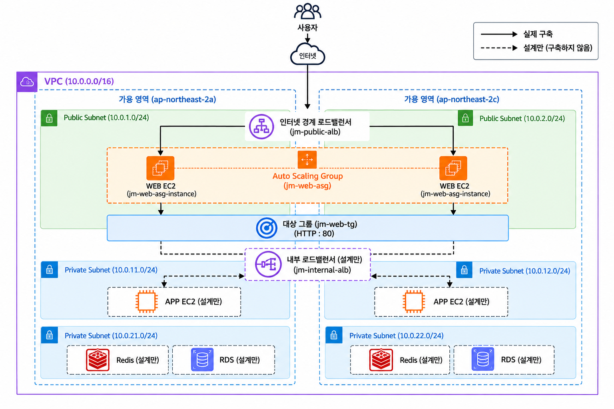
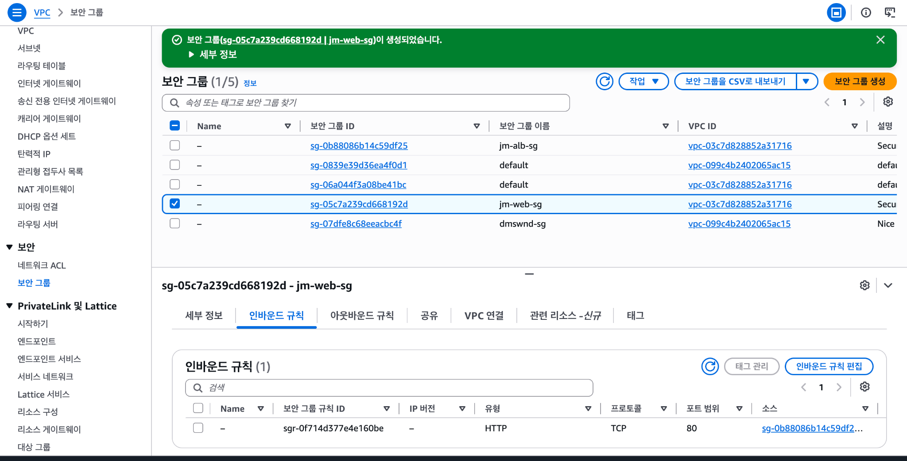
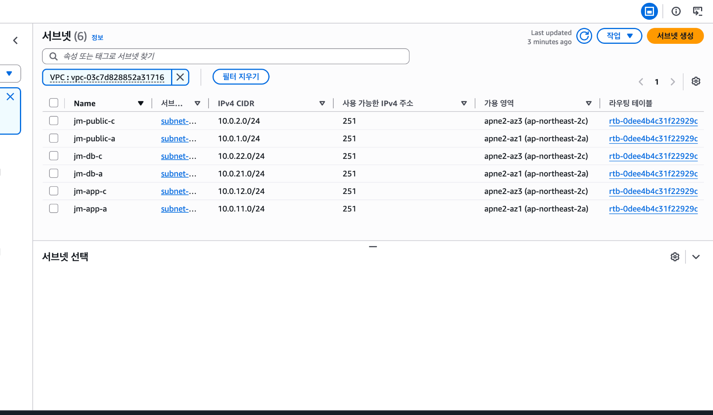
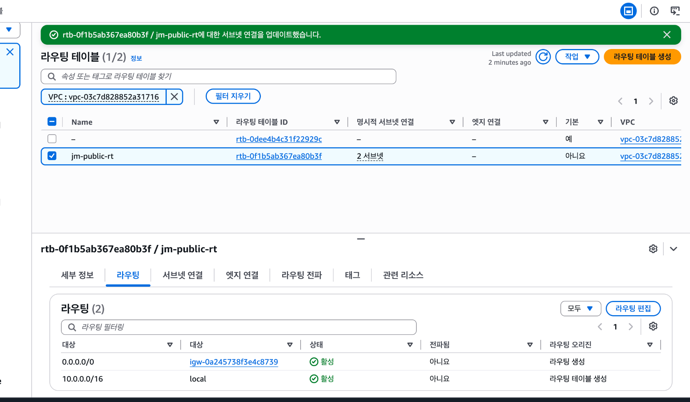
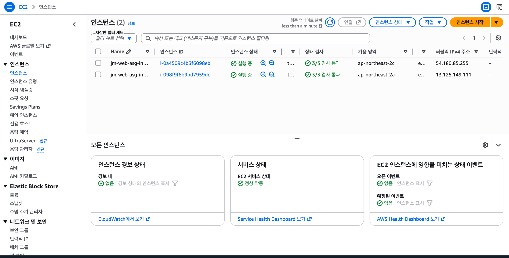
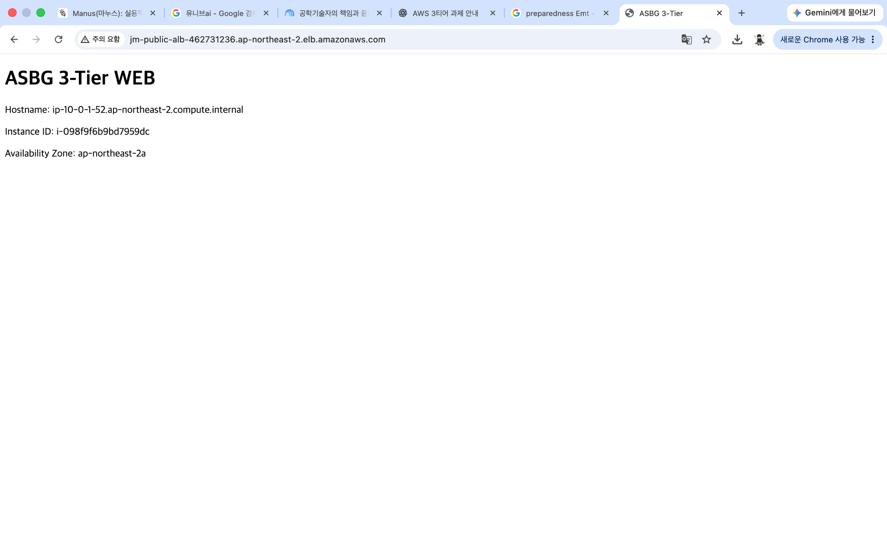
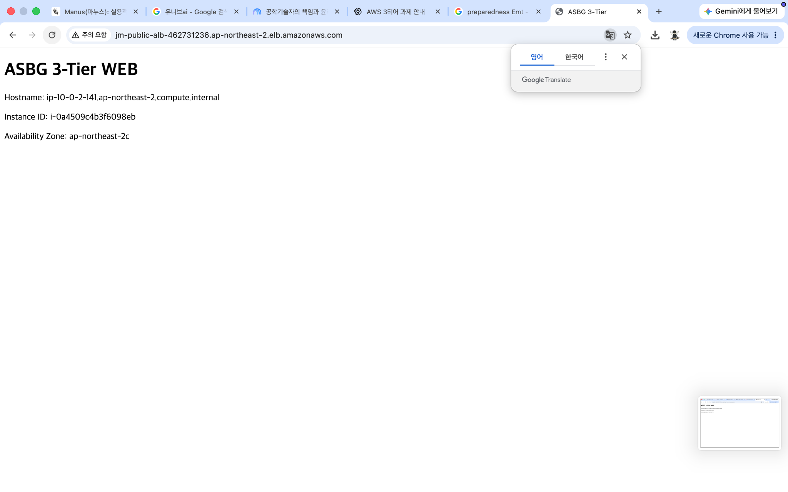
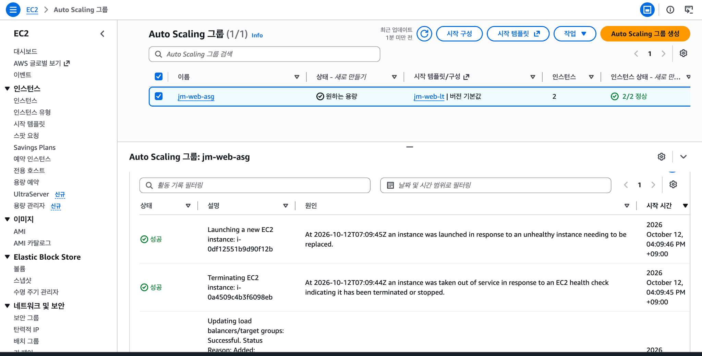
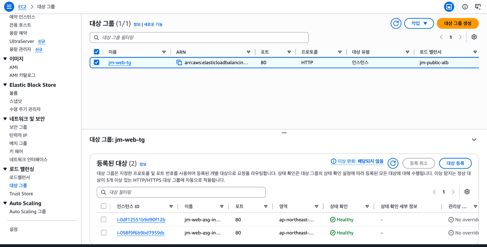
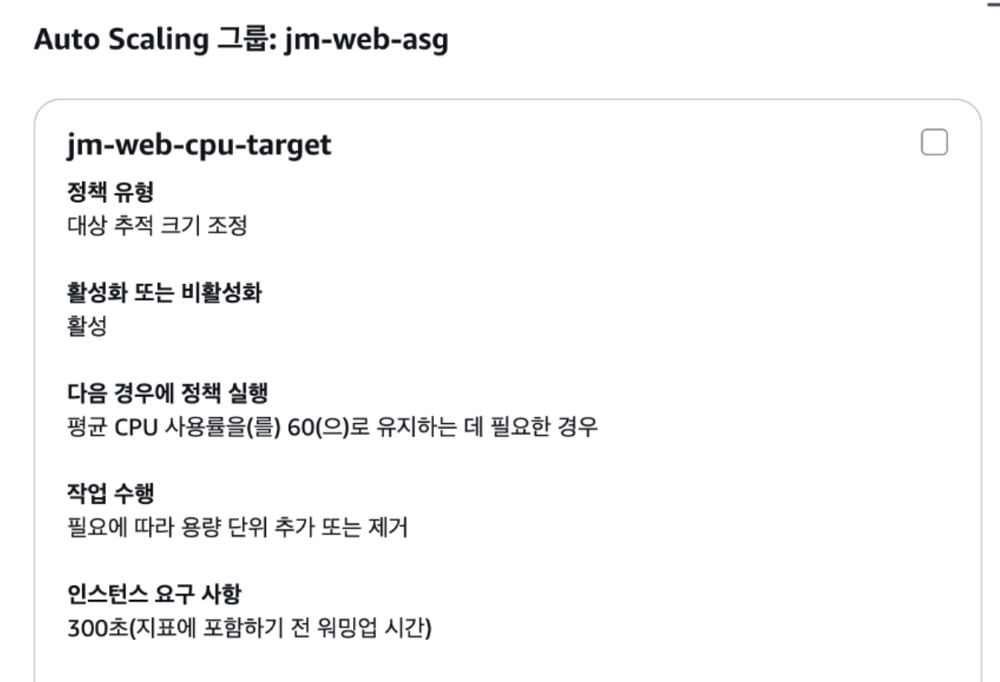

# Session 02 · 수강신청 서비스를 위한 3-Tier 인프라 설계

- 제출자: 강은중
- 리전: 서울 `ap-northeast-2`

## 1. What I Built

수강신청 시작 시간에는 접속이 한꺼번에 몰린다. 이때 서버를 추가하거나 장애 서버를 교체해도 로그인 상태가 유지되어야 하고, 신청 내역도 안전하게 저장되어야 한다. 이 세 가지를 중심으로 WEB·APP·DB 구조를 설계했다.

실습에서는 비용과 범위를 고려해 **WEB 계층의 요청 분산과 인스턴스 자동 복구**를 직접 확인했다. nginx 실습 페이지에 서버 정보를 표시해 어떤 인스턴스가 응답하는지 확인했다. 로그인·강의 조회·수강신청 기능은 구현하지 않았다.

| 구분                      | 범위                                                                                                                          |
| ------------------------- | ----------------------------------------------------------------------------------------------------------------------------- |
| **실제 구현**             | VPC, 2개 AZ의 서브넷 6개, IGW, Public ALB, WEB EC2·Launch Template·ASG, Target Group, CPU Target Tracking 정책                |
| **실제 검증**             | 서로 다른 AZ의 WEB 응답, EC2 강제 종료 후 ASG의 자동 교체, 교체 후 Target 2대 Healthy                                         |
| **설정 완료·동작 미검증** | CPU 부하에 따른 확장·축소, ELB Health Check 실패를 원인으로 한 인스턴스 교체                                                  |
| **설계만**                | Private WEB/APP 구조, NAT Gateway, Internal ALB, APP EC2·ASG, Redis/Valkey 세션 저장소, RDS MySQL Multi-AZ, Scheduled Scaling |

## 2. Design Decisions

### 2.1 아키텍처와 문제별 해결 방법

그림의 **검은 실선 화살표는 실제 구축, 검은 점선 화살표는 설계만 한 연결**을 나타낸다. AZ·ASG의 색상 테두리는 리소스 묶음을 표시한다. 그림의 WEB 배치는 실습 기준인 Public Subnet이며, 운영 환경에서는 WEB도 Private Subnet으로 옮길 계획이다. **Internal ALB·APP·Redis/Valkey·RDS는 설계만 했고, NAT와 Scheduled Scaling은 본문에서 제안한다.**

그림의 대상 그룹 상자는 WEB의 등록 관계와 포트를 표시한다. 실제 요청은 `Public ALB → jm-web-tg에 등록된 WEB EC2`로 전달된다. APP의 데이터 접근 경로는 `APP → Redis/Valkey(세션)`와 `APP → RDS(신청 내역)`다.

| 수강신청에서 생기는 문제                                   | 제안한 처리 방식                                                                                                                                                                        |
| ---------------------------------------------------------- | --------------------------------------------------------------------------------------------------------------------------------------------------------------------------------------- |
| 다른 APP으로 요청이 넘어가거나 서버가 교체되면 로그인 해제 | 브라우저는 세션 ID를 쿠키로 보내고, 모든 APP은 Redis/Valkey에서 같은 세션을 조회한다. 세션 TTL과 쿠키 설정, 서명 키도 APP 간에 맞춘다.                                                  |
| 응답하지 않는 서버로 요청이 계속 전달됨                    | ALB가 `/health`로 대상을 점검하고, 정상 대상이 있는 경우 장애 대상을 요청 분산에서 제외한다. ASG는 EC2·ELB 상태 확인을 바탕으로 인스턴스를 교체한다. WEB과 APP은 각각 두 AZ에 분산한다. |
| 시작 직후 요청 집중, 종료 후 불필요한 서버 유지            | Scheduled Scaling으로 시작 전에 WEB/APP 용량을 확보한다. 사전 확장 시 최소 용량도 올려 조기 축소를 막고, 종료 후 하한을 복원한다. 평상시 변화에는 Target Tracking을 병행한다.           |
| DB 장애로 수강신청 내역에 접근하지 못함                    | RDS MySQL Multi-AZ DB 인스턴스 구성으로 다른 AZ에 Standby를 두고 자동 장애 조치에 대비한다.                                                                                             |

운영 구조의 요청 경로는 `Public ALB → WEB → Internal ALB → APP`이다. WEB은 정적 파일과 요청 전달, APP은 로그인·강의 조회·수강신청 처리를 담당한다. APP에서만 세션 저장소와 DB에 접근하도록 한다.

### 2.2 서비스 선택 이유와 대안

| 선택                                       | 비교한 대안                                | 이번 구성에서 선택한 이유                                                                                                                                                                                |
| ------------------------------------------ | ------------------------------------------ | -------------------------------------------------------------------------------------------------------------------------------------------------------------------------------------------------------- |
| **EC2**                                    | ECS/Fargate, Lambda                        | 이번에는 OS·nginx 설정부터 Launch Template 초기화, 인스턴스 교체까지 직접 확인하고 싶었다. 컨테이너 관리나 함수 단위 설계까지 범위를 넓히지 않고 EC2의 동작에 집중했다.                                  |
| **ALB**                                    | NLB                                        | 수강신청 포털은 HTTP 기반이다. HTTP 요청 분산과 `/health` 점검을 사용하고, 이후 경로별 라우팅도 구성할 수 있어 ALB를 선택했다. TCP/UDP 연결 처리가 중심인 NLB보다 이번 요구에 잘 맞았다.                 |
| **EC2 Auto Scaling**                       | 고정 대수 운영·수동 증설                   | 장애 서버 교체와 필요한 서버 수 유지를 자동화하고 싶었다. 수강신청 때마다 직접 서버를 추가·삭제하는 부담도 줄일 수 있다. 실습에서는 자동 교체를 검증했고 부하에 따른 증감은 정책 설정까지만 했다.        |
| **Redis/Valkey 중앙 세션 저장소 — 설계만** | APP 메모리+Sticky Session, RDS에 세션 저장 | Sticky Session은 해당 서버가 사라졌을 때 세션을 보존해 주지 않는다. 중앙 저장소를 두면 다른 APP도 같은 세션을 조회할 수 있고, 로그인 확인 요청을 수강신청 DB와 분리할 수 있다.                           |
| **RDS MySQL Multi-AZ — 설계만**            | RDS Single-AZ, EC2에 MySQL 직접 운영       | Single-AZ보다 DB 장애에 대비하기 좋고, 직접 MySQL을 운영할 때의 복제·장애 조치 관리 부담을 줄일 수 있다. 여기서는 Primary 1대와 Standby 1대를 제안하며, Standby를 통한 읽기 부하 분산은 포함하지 않는다. |
| **실습의 Public WEB, NAT 제외**            | Private EC2+NAT Gateway, NAT Instance      | NAT Gateway의 시간·데이터 처리 비용과 추가 네트워크 구성을 줄이고 WEB 분산·복구 검증에 집중했다. NAT Instance도 직접 관리할 서버가 늘어나므로 이번 범위에서 제외했다.                                    |

NAT 제외는 실습 범위를 정하면서 선택한 trade-off다. WEB EC2에 공인 IPv4를 할당하고 IGW를 통해 패키지를 내려받되, 인바운드는 ALB 보안 그룹의 HTTP 80만 허용했다. SSH 22는 열지 않았다. 이 구성에도 EC2·ALB·공인 IPv4 비용은 발생한다.

**운영 환경에서는 WEB/APP을 Private Subnet에 두고, 필요한 외부 IPv4 통신을 NAT Gateway로 처리하는 구성이 더 적절하다.** Public ALB만 사용자 요청을 받도록 하고, EC2의 외부 패키지 다운로드는 NAT를 이용한다. ALB에서 EC2로 가는 요청과 VPC 내부 DB 통신은 NAT를 거치지 않는다.

### 2.3 실제 구현한 네트워크와 접근 제어

VPC는 `10.0.0.0/16`으로 만들고 DNS resolution과 DNS hostnames를 모두 활성화했다. 계층별 배치를 구분하려고 서브넷을 나눴으며, WEB은 두 AZ에 배치했다.

| 서브넷        | AZ                | CIDR           | 실제 사용 / 운영 설계                                    |
| ------------- | ----------------- | -------------- | -------------------------------------------------------- |
| `jm-public-a` | `ap-northeast-2a` | `10.0.1.0/24`  | 실제: Public ALB·WEB / 설계: Public ALB·NAT              |
| `jm-public-c` | `ap-northeast-2c` | `10.0.2.0/24`  | 실제: Public ALB·WEB / 설계: Public ALB·NAT              |
| `jm-app-a`    | `ap-northeast-2a` | `10.0.11.0/24` | 실제: 서브넷만 생성 / 설계: Private WEB·APP·Internal ALB |
| `jm-app-c`    | `ap-northeast-2c` | `10.0.12.0/24` | 실제: 서브넷만 생성 / 설계: Private WEB·APP·Internal ALB |
| `jm-db-a`     | `ap-northeast-2a` | `10.0.21.0/24` | 실제: 서브넷만 생성 / 설계: RDS·Redis/Valkey             |
| `jm-db-c`     | `ap-northeast-2c` | `10.0.22.0/24` | 실제: 서브넷만 생성 / 설계: RDS·Redis/Valkey             |

`jm-public-rt`에는 `0.0.0.0/0 → IGW`를 추가하고 `jm-public-a/c`만 연결했다. NAT Gateway와 Private Subnet의 NAT 경로는 만들지 않았다.

| 실제 보안 그룹 | 허용한 인바운드                                  |
| -------------- | ------------------------------------------------ |
| `jm-alb-sg`    | `0.0.0.0/0`에서 HTTP 80                          |
| `jm-web-sg`    | `jm-alb-sg`에서 HTTP 80만 허용. SSH 22 규칙 없음 |

운영 설계에서는 WEB/APP이 같은 Private APP 서브넷을 사용하더라도 보안 그룹을 분리한다. `Public ALB → WEB → Internal ALB → APP`의 바로 앞 계층만 소스로 허용하고, DB의 3306과 세션 저장소의 6379는 APP 보안 그룹에만 연다. 이 내부 계층 규칙은 아직 구현하지 않았다.

서브넷과 Public 라우팅 구성 화면

서브넷 6개의 이름·CIDR·AZ를 확인한 화면이다. 이 캡처에는 **Public 라우팅 테이블 연결 전 상태**가 보인다.

아래는 이후 `jm-public-rt`에 IGW 기본 경로를 추가하고 Public 서브넷 두 개를 연결한 화면이다.

### 2.4 실제 서버와 확장 설정

| 항목                      | 설정과 이유                                                                                         |
| ------------------------- | --------------------------------------------------------------------------------------------------- |
| Launch Template           | `jm-web-lt`. 새 인스턴스에도 같은 초기 설정을 적용하기 위해 사용                                    |
| OS / 인스턴스             | Amazon Linux 2023 `x86_64` / `t3.micro`. nginx 확인용 실습 규모에 맞춰 선택                         |
| User Data                 | nginx 설치, `/health` 생성, Hostname·Instance ID·Availability Zone을 보여 주는 페이지 생성          |
| Public ALB / Target Group | `jm-public-alb` / `jm-web-tg`, HTTP 80, Health Check `/health`                                      |
| Auto Scaling Group        | `jm-web-asg`, `jm-public-a/c`에 분산. `jm-web-tg` 연결 및 ELB Health Check 활성화                   |
| 용량                      | Min **2** / Desired **2** / Max **4**. 기본 2대로 분산하고, 실습 중 증가할 수 있는 대수에 상한 설정 |
| Target Tracking           | `jm-web-cpu-target`, 평균 CPU 목표 **60%**. CPU 포화 전 여유를 두기 위한 실습 기준                  |
| Warm-up                   | **300초**. 새 인스턴스의 초기 구동 지표가 확장 판단에 바로 섞이지 않도록 설정                       |

CPU 60%와 300초는 실습 기준으로 정했으며, 적정성은 부하 시험으로 확인할 계획이다. 특히 nginx의 요청량 증가가 CPU 증가로 그대로 이어진다고 볼 수 없어, 운영에서는 대상당 ALB 요청 수와 응답 시간도 함께 보고 기준을 조정할 계획이다.

두 AZ에 배치된 실제 EC2

## 3. Troubleshooting & Validation

### 3.1 실제로 확인한 내용

| 점검 대상                 | 확인 과정                                                  | 결과와 증거                                                                        |
| ------------------------- | ---------------------------------------------------------- | ---------------------------------------------------------------------------------- |
| ALB 요청 분산             | 같은 ALB 주소로 반복 접속하고 응답의 Instance ID와 AZ 비교 | **충족.** 2a와 2c의 서로 다른 인스턴스 응답 확인. 아래 4.1                         |
| 종료된 EC2 자동 교체      | WEB EC2 한 대를 직접 Terminate한 뒤 ASG Activity 확인      | **충족.** 종료 감지와 대체 인스턴스 생성 성공 기록 확인. 아래 4.2                  |
| 교체 후 정상 대상 수 복원 | Target Group에서 새 Instance ID와 상태 확인                | **충족.** 기존 정상 인스턴스와 새 인스턴스가 모두 Healthy. 아래 4.2                |
| CPU 기반 자동 확장        | 정책 이름·활성 상태·목표값·Warm-up 확인                    | **부분 충족.** 정책 설정 완료. 부하를 발생시키는 확장·축소 실험은 미실시. 아래 4.3 |

이번 교체 기록의 원인은 **EC2 Health Check에서 감지한 종료 상태**였다. ELB Health Check도 활성화했지만, nginx만 중단해 HTTP 상태 확인 실패로 교체되는 경우는 시험하지 않았다. 장애 중 요청을 연속 수집하지 않아 오류율이나 무중단 여부, 전체 복구 시간도 측정하지 않았다.

### 3.2 아직 수행하지 않은 검증 계획

| 항목                | 확인 방법과 통과 기준                                                                                                                                                      |
| ------------------- | -------------------------------------------------------------------------------------------------------------------------------------------------------------------------- |
| 로그인 유지         | APP·세션 저장소 구축 후 동일한 쿠키로 요청을 반복한다. APP 추가·종료 전후 응답 서버가 달라져도 세션 TTL 안에서 같은 사용자로 인증되는지 확인                               |
| HTTP 장애 감지·복구 | 인스턴스는 실행한 채 nginx 또는 APP 프로세스만 중단한다. Target Unhealthy, 정상 대상으로의 응답, ELB 상태 확인에 따른 ASG 교체, 새 대상 Healthy를 순서대로 확인            |
| 동적 확장·축소      | 부하를 단계적으로 높였다가 제거한다. CloudWatch CPU, ASG 용량·Activity, Healthy 수, 응답 시간·5XX를 함께 기록하고, 정책에 따른 2대 초과 확장과 이후 최소 2대까지 축소 확인 |
| Scheduled Scaling   | 예약한 사전 확장 시각에 설정한 용량으로 증설되고, 수강신청 시작 전 대상이 Healthy인지 확인. 종료 후 최소 용량 복원과 동적 축소 확인                                                  |
| 세션 저장소·DB 장애 | Redis/Valkey와 RDS 각각의 장애 조치를 시험한다. 재연결 후 로그인 상태·기존 신청 내역을 확인하고, 오류 구간과 복구 시간을 기록                                              |

## 4. Screenshots

### 4.1 ALB 요청 분산

**완료 조건: 하나의 ALB 주소에서 서로 다른 AZ의 WEB 서버 응답 확인 — 충족**

같은 ALB 주소를 다시 요청했을 때 아래 두 응답을 확인했다. 두 서버가 요청을 처리한다는 근거이며, 분산 비율이나 대량 동시 접속 성능을 측정한 결과는 아니다.

| `ap-northeast-2a` 응답                                                    | `ap-northeast-2c` 응답                                                    |
| ------------------------------------------------------------------------- | ------------------------------------------------------------------------- |
| `i-098f9f6b9bd7959dc`                                                     | `i-0a4509c4b3f6098eb`                                                     |
|  |  |

### 4.2 장애 인스턴스 자동 교체와 복구 완료

**완료 조건: EC2 한 대 종료 후 자동 교체되고 정상 대상이 다시 2대가 됨 — 충족**

`i-0a4509c4b3f6098eb`를 직접 종료했다. ASG Activity에 종료된 인스턴스를 서비스에서 제외하고, 대체 인스턴스 `i-0df12551b9d90f12b`를 생성한 성공 기록이 남았다.

교체 후 `jm-web-tg`에서 새 인스턴스와 기존 `i-098f9f6b9bd7959dc`가 모두 **Healthy**로 표시됐다. 인스턴스 생성 기록에 더해 정상 대상 수가 2대로 돌아온 것까지 확인했다.

### 4.3 Target Tracking 정책

**완료 조건: 부하에 따른 서버 수 자동 조정 — 부분 충족(정책 설정만 완료)**

`jm-web-cpu-target`이 활성 상태이고, 평균 CPU 목표 60%와 Warm-up 300초가 적용된 것을 확인했다. **실제 CPU 부하를 발생시키는 scale-out·scale-in 테스트는 하지 않았다.**

참고 자료

- [Session 02 과제 원문](https://github.com/AWS-Student-Builder-Group-at-UOS/cohort-01-assignments/blob/main/session-02/README.md), [공통 템플릿](https://github.com/AWS-Student-Builder-Group-at-UOS/cohort-01-assignments/blob/main/TEMPLATE.md)
- [i2na IMPLEMENTATION.md](https://github.com/i2na/cohort-01-assignments/blob/session-02/session-02/%EC%9D%B4%EC%98%88%EB%82%98/IMPLEMENTATION.md): 계층별 구성과 검증 기준 참고
- AWS 공식 문서: [ASG 상태 확인](https://docs.aws.amazon.com/autoscaling/ec2/userguide/health-checks-overview.html), [Target Tracking](https://docs.aws.amazon.com/autoscaling/ec2/userguide/as-scaling-target-tracking.html), [Scheduled Scaling](https://docs.aws.amazon.com/autoscaling/ec2/userguide/ec2-auto-scaling-scheduled-scaling.html)
- AWS 공식 문서: [NAT Gateway](https://docs.aws.amazon.com/vpc/latest/userguide/vpc-nat-gateway.html), [RDS Multi-AZ DB 인스턴스](https://docs.aws.amazon.com/AmazonRDS/latest/UserGuide/Concepts.MultiAZSingleStandby.html), [ElastiCache Multi-AZ](https://docs.aws.amazon.com/AmazonElastiCache/latest/dg/AutoFailover.html)

## 5. 한계 및 운영 환경 개선 방향

- **Private 계층 구성:** WEB을 Private Subnet으로 옮기고 APP·Internal ALB를 구축한다. 외부 IPv4 통신이 필요한 WEB/APP은 NAT Gateway를 이용하며, 한 AZ의 NAT에 다른 AZ까지 의존하지 않도록 AZ별 배치를 고려한다. Public ALB만 외부 진입점으로 둔다.
- **세션 유지 검증:** Redis/Valkey와 APP을 연동하고 다른 AZ의 Replica·자동 장애 조치를 구성한다. 비동기 복제 구성에서는 장애 직전 세션 변경이 유실될 수 있으므로 재로그인 가능성도 확인해야 한다.
- **데이터 보호:** RDS Multi-AZ에 백업·복원 검증, 저장·전송 암호화, 자격 증명 관리를 추가한다. 동시 신청의 정원 초과와 중복 신청은 트랜잭션·잠금·고유 제약조건으로 따로 다뤄야 한다.
- **실제 트래픽 검증:** Scheduled Scaling과 Target Tracking을 함께 적용하고 부하 시험으로 용량·목표값·Warm-up을 정한다. 현재 결과는 인스턴스 한 대 종료와 복구까지이며, AZ 전체 장애나 운영 수준 처리량은 검증하지 않았다.
- **운영 보안·관측:** 실습은 HTTP 80만 사용했다. 운영에는 HTTPS와 안전한 세션 쿠키, 관리 접속용 SSM·최소 권한 IAM, 응답 시간·5XX·정상 대상 수 모니터링을 추가한다. 서버 식별 정보를 보여 주는 실습 페이지도 제거한다.
