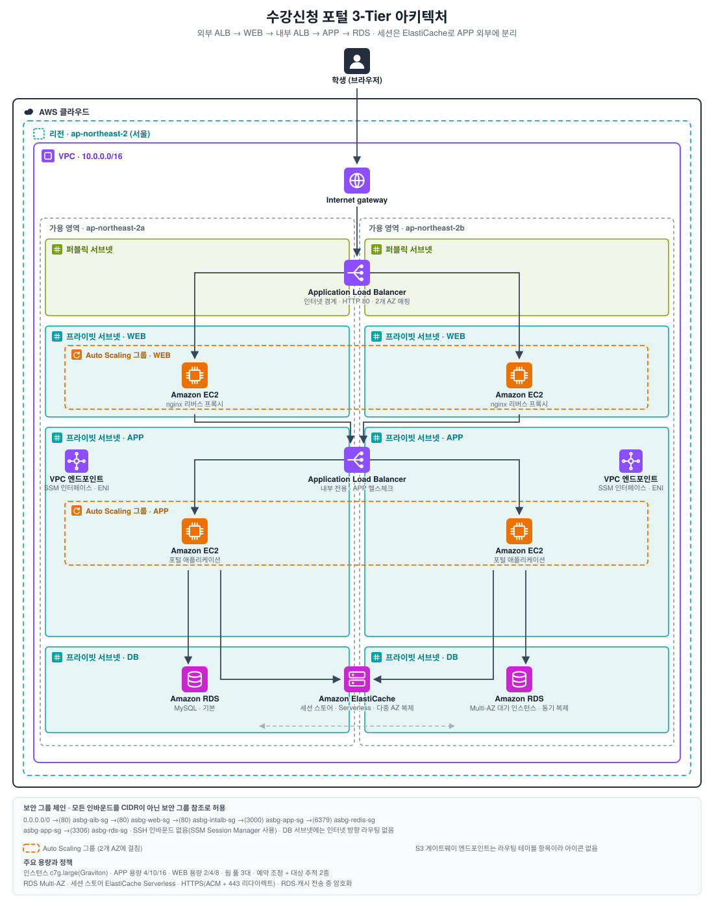

# Session 02 · Assignment

- 제출자: 백재민

## 1. What I Built

수강신청 포털의 **로그인 끊김 · 장애 대응 지연 · 접속량 급증 대응 실패**를 해결하는 WEB·APP·DB 3-Tier 아키텍처를 설계했습니다. 이번 제출 범위는 **아키텍처 설계와 검증 계획**이며, 실행 결과 화면은 포함하지 않습니다.

요청은 `외부 ALB → WEB(nginx) → 내부 ALB → APP → RDS`로 흐르고, 세션은 APP 외부의 ElastiCache에 둡니다. WEB·APP은 각각 Auto Scaling 그룹으로 2개 AZ에 분산하며, 상태 확인 유형을 `ELB`로 두어 애플리케이션 장애까지 교체 대상으로 삼습니다. 확장은 예약 조정으로 바닥을 올리고 대상 추적으로 변동을 따라갑니다. 아웃바운드는 필요한 대상이 S3와 SSM뿐이라 NAT Gateway 없이 VPC 엔드포인트로 구성했습니다.

설계의 근거는 2번에, 각 요구사항을 어떤 방법과 기준으로 확인할지는 3번에 정리했습니다.

## 2. Design Decisions



### 전제

운영 수치를 확보할 수 없어 아래를 가정했습니다. 값보다 산정 논리를 봐 주시면 됩니다.

| 가정 | 값 | 근거 |
|---|---|---|
| 1회차 신청 인원 | 3,000명 | 재학생 1만 명을 학년별 신청 창으로 분산 |
| 시작 직후 접속 비율 | 90% | 정원 경쟁으로 시작 시각에 집중 |
| 1인당 초기 요청 | 7회 | 로그인 1 · 목록 1 · 검색 2 · 신청 3 |
| 피크 집중 구간 | **10~20초** | 수강신청의 본질. 1분에 고르게 퍼지지 않음 |
| APP 1대 처리량 | 300 req/s | 2 vCPU, 조회 위주의 보수적 추정 |

### 문제 정의와 원인

| 과제의 증상 | 원인 | 해결 수단 |
|---|---|---|
| 강의 조회·이동 시 간헐적 로그아웃 | 세션 위치가 인스턴스에 종속. ALB가 분배하므로 로그인하지 않은 인스턴스로 가면 세션을 못 찾음 | 세션 외부화 |
| 재시작·교체 시 로그아웃 | 세션 수명이 인스턴스에 종속 | 세션 외부화 |
| 죽은 서버로 요청이 계속 전달 | 로드밸런서가 애플리케이션 상태를 보지 않음 | ALB 헬스체크 → 대상 제외 |
| 장애 서버가 교체되지 않음 | ASG 상태 판단이 EC2 수준이라 앱 장애를 인지 못 함 | 상태 확인 유형 `ELB` → 인스턴스 교체 |
| 시작 직후 지연·오류 | 피크 시각을 알면서도 사전 대비 없음 | 예약 조정 + 웜 풀 |
| 수동 증설로 대응 지연 | 조정이 사람 작업 시간만큼 지연 | 대상 추적 |
| 종료 후 서버 잔존 | 축소 절차 없음 | 예약 조정 + 대상 추적 |

로그인 끊김은 증상과 원인이 각각 둘입니다. 위치 종속만 끊는 고정 세션으로는 절반만 해결됩니다. 장애 대응도 제외는 ALB, 복구는 ASG가 담당해 설정 위치가 다릅니다.

### 서비스 구성

| 계층 | 서비스 | 선택 이유 |
|---|---|---|
| 접점 | 외부 ALB | 외부 노출 지점을 하나로 한정. 인스턴스는 전부 프라이빗 서브넷 |
| WEB | EC2 + nginx (ASG) | WEB·APP 분리를 실제 계층으로 구현. 정적 자원·TLS 종료·캐싱 확장 지점 |
| 내부 분배 | 내부 ALB | WEB이 APP 주소를 몰라도 되어 APP을 자유롭게 증감 |
| APP | EC2 + Node.js (ASG) | 장애 교체와 확장의 단위 |
| 세션 | ElastiCache | 로그인 끊김의 직접적 해답 |
| DB | RDS MySQL 8.0 | 퍼블릭 액세스 차단, 전용 서브넷, 저장 시 암호화 |
| 아웃바운드 | **VPC 엔드포인트** (S3 게이트웨이 + SSM 인터페이스 3종) | 아래 |

네트워크는 `10.0.0.0/16`에 퍼블릭 / WEB / APP / DB 서브넷을 2개 AZ에 배치했습니다. WEB과 APP을 서브넷까지 나눈 것은 계층별로 라우팅과 NACL을 따로 줄 수 있는 여지를 남기기 위해서이며, DB 서브넷에는 인터넷 방향 경로를 두지 않습니다.

접근 제어는 CIDR이 아니라 보안 그룹 참조로 체인을 구성했습니다.

```
0.0.0.0/0 →(80) alb-sg →(80) web-sg →(80) intalb-sg →(3000) app-sg →(6379) redis-sg
                                                              └──────→(3306) rds-sg
```

인스턴스가 교체·증설돼도 규칙 수정이 필요 없고, 같은 서브넷의 다른 리소스가 자동 허용되지도 않습니다. SSH(22)는 열지 않고 운영 접속은 SSM Session Manager로 처리해 베스천과 키 페어를 제거했습니다.

#### 아웃바운드를 NAT 없이 설계한 이유

NAT Gateway는 프라이빗 서브넷 구성에서 관행적으로 포함되지만, 과제의 세 문제 어디에서도 요구하지 않습니다. 실제로 나가야 할 트래픽을 먼저 정리했습니다.

| 필요한 아웃바운드 | 수단 | 비용 |
|---|---|---|
| OS 패키지(`dnf`) — AL2023 리포지터리는 리전 내 S3 | S3 **게이트웨이** 엔드포인트 | **$0** |
| 앱 코드·설정 — 아티팩트 S3 버킷 | 같은 게이트웨이 엔드포인트 | **$0** |
| SSM 운영 접속 (`ssm`·`ssmmessages`·`ec2messages`) | 인터페이스 엔드포인트 | $0.01/시간/AZ × 3 |
| 그 외 인터넷 | 없음 | — |

| 구성 | 월 고정비 | AZ 장애 영향 |
|---|---|---|
| NAT Gateway AZ별 2개 | 약 $66 + $0.045/GB | 없음 |
| NAT Gateway 단일 배치 | 약 $33 + $0.045/GB | **해당 AZ 장애 시 전체 아웃바운드 중단** |
| **S3 게이트웨이 + SSM 인터페이스 3종** (채택) | **약 $44** | 없음 (AZ마다 ENI) |

고가용성을 지키는 구성끼리 비교하면 엔드포인트가 NAT 2개보다 월 약 $22 저렴하고 단일 장애점도 없습니다. GB당 요금은 인터페이스 엔드포인트가 낮지만 월 626GB 미만에서는 시간당 고정비 때문에 NAT가 유리하며 SSM 트래픽은 그 구간입니다. 따라서 선택 근거는 요금이 아니라 NAT 제거입니다. S3 게이트웨이는 트래픽과 무관하게 무료입니다.

> AL2023에서 S3 엔드포인트와 프라이빗 DNS를 함께 쓸 때 `dnf`가 퍼블릭 S3 주소를 조회해 타임아웃이 나는 사례가 보고돼 있습니다. 엔드포인트 정책에 리전 리포지터리 버킷 ARN을 명시하고 라우팅 테이블 연결을 확인해야 합니다.

### 주요 설정 ① 로그인 유지

세션을 APP 외부 ElastiCache에 저장하면 위치 종속과 수명 종속이 함께 해소됩니다.

| 설정 | 값 | 이유 |
|---|---|---|
| 세션 저장 위치 | ElastiCache | 인스턴스 로컬에 두면 그 인스턴스와 함께 사라짐 |
| **세션 서명 키** | SSM SecureString 1개를 모든 APP이 기동 시 조회 | 세션 쿠키는 서버가 서명합니다. 키가 인스턴스마다 다르면 Redis에 세션이 있어도 다른 APP이 쿠키를 거부합니다. 세션 외부화의 전제 조건 |
| 가용성 | ElastiCache Serverless의 다중 AZ 복제 (기본 제공) | 세션을 밖으로 빼면 세션 스토어가 새 단일 장애점이 됨. Serverless는 복제와 장애 조치가 포함돼 별도 복제본 구성이 불필요 |
| 세션 TTL | 1800초, 요청마다 갱신 | 신청 중 자동 로그아웃 방지 + 방치 세션 정리 |
| 쿠키 | `HttpOnly` · `SameSite=Lax` · `Secure` | 스크립트 접근과 교차 사이트 전송을 막고, 외부 구간이 HTTPS(ACM + 443)이므로 평문 전송도 차단 |
| ALB 고정 세션 | 사용하지 않음 | 아래 |

고정 세션을 쓰지 않은 이유. 체크박스 하나로 첫 번째 증상은 해결합니다. 그러나 ① 묶인 인스턴스가 종료되면 세션도 사라져 두 번째 증상이 남고 ② 사용자가 인스턴스에 고정돼 피크에 늘린 새 인스턴스로 기존 사용자 요청이 가지 않아 확장이 필요한 시점에 분산 효과가 떨어지며 ③ 축소 때도 묶인 사용자가 로그아웃됩니다. 세션을 외부로 분리하면 세 문제가 모두 해소되고 오토 스케일링이 세션을 고려하지 않아도 됩니다. JWT 무상태 인증도 후보였으나 강제 로그아웃·토큰 무효화에 결국 서버 측 저장소가 필요해, 인증 방식 대신 저장 위치만 옮겼습니다.

### 주요 설정 ② 장애 감지와 자동 복구

| 설정 | 값 | 기본값 | 이유 |
|---|---|---|---|
| 헬스체크 경로 | `/health` | `/` | 의존 서비스와 무관하게 앱 생존만 반환. `/`면 DB 지연 시 멀쩡한 인스턴스까지 연쇄 교체 |
| 간격 | **10초** | 30초 | 기본값이면 판정까지 최대 60초. 피크에서 1분은 너무 김 |
| 비정상 임계값 | 2회 | 2회 유지 | 1회면 일시적 지연을 장애로 오판. 10초 × 2 = 약 20초 내 제외 |
| 정상 임계값 | **2회** | 5회 | 교체·확장된 인스턴스의 서비스 복귀를 30초 단축 |
| 등록 취소 지연 | **30초** | 300초 | 기본값은 교체·축소를 매번 5분 지연. 요청 처리가 짧아 30초로 충분 |
| **ASG 상태 확인 유형** | **`ELB`** | **`EC2`** | 아래 |
| 상태 확인 유예 | 300초 | 300초 유지 | 기동·설치 중 비정상 판정 방지 |

상태 확인 유형이 이 문제의 분기점입니다. 기본값 `EC2`는 가상 머신 상태만 확인하므로, 애플리케이션이 중단돼도 OS가 정상이면 ASG는 교체하지 않습니다. `ELB`로 바꿔야 ALB의 비정상 판정이 교체로 이어집니다. ALB가 약 20초 안에 분배에서 제외하고, ASG가 해당 인스턴스를 교체합니다.

### 주요 설정 ③ 폭주 대비와 확장

```
1회차 3,000명 × 접속 90% = 2,700명 × 요청 7회 = 18,900 요청
18,900 ÷ 집중 구간 10~20초 = 945 ~ 1,890 req/s   → 보수적으로 1,500 req/s
1,500 ÷ APP 1대 300 req/s = 5대   → 오차·재시도 여유 2배 = 사전 확장 10대, 최대 16대
```

전제의 요점은 피크가 1분에 고르게 퍼지지 않는다는 것입니다. 분 단위 평균은 315 req/s여서 1~2대로 충분해 보이지만, 실제 부하는 그 5배가 짧게 집중됩니다.

| 정책 | 설정 | 역할 |
|---|---|---|
| 용량 (APP) | 최소 4 / 사전 확장 10 / 최대 16 | 최소 4는 2개 AZ에 2대씩 두어 AZ 하나를 잃어도 2대가 남는 값 |
| 용량 (WEB) | 최소 2 / 사전 확장 4 / 최대 8 | WEB은 프록시라 APP보다 요청당 비용이 낮음. AZ당 1대를 바닥으로 두고 APP의 절반 규모로 운영 |
| 예약 조정 | 시작 30분 전 최소·희망 용량을 함께 상향, 종료 1시간 후 최소만 복귀 | 시작 직후 방어 + 비용 회수 |
| 웜 풀 | 중지 상태, 상한 = 피크의 20%(약 3대) | 기동 지연 단축 |
| 대상 추적 · 요청 수 (주) | `ALBRequestCountPerTarget` 타겟당 **10,000 req/분**, 워밍업 120초 | 1대 처리량 300 req/s(=18,000 req/분)의 약 55% 지점에서 증설을 시작해 여유를 둠 |
| 대상 추적 · CPU (보조) | 평균 60%, 워밍업 120초 | 요청 수 지표의 공백 보완 |

- 예약 조정: 대상 추적은 지표 → 경보 → 기동 → 헬스체크에 수 분이 걸리는데 위험 구간은 시작 직후 수십 초입니다. 반응형만으로는 그 구간을 확장 전 용량으로 버팁니다. 이때 희망 용량만 올리면 부하가 오기 전이라 대상 추적이 곧바로 축소하므로, 최소 용량으로 바닥을 고정해야 사전 확보가 유지됩니다. 종료 후에도 최소만 되돌려 잔여 요청 처리 중인 인스턴스를 끊지 않습니다.
- 웜 풀: 일반 기동은 부팅·설치·헬스체크로 수 분이 걸리지만 웜 풀은 미리 초기화해 중지해 둔 인스턴스를 **약 30초**에 투입합니다. 중지 상태라 EC2 시간 요금 없이 EBS 비용만 들고, 상한을 최대 용량의 20%로 묶어 유휴 비용을 제한했습니다.
- 웜 풀과 예약 조정의 관계: 웜 풀 인스턴스는 **확장이 일어날 때 꺼내 쓰이므로, 예약 조정으로 용량을 올리는 시점에도 함께 소모됩니다.** 따라서 예약 조정 직후에는 웜 풀이 비어 있습니다. 예약을 신청 시작 **30분 전**에 두는 이유가 여기에도 있습니다. 그 사이 웜 풀이 다시 채워져, 정작 부하가 몰리는 시작 시각에는 사전 확보된 10대와 재충전된 웜 풀이 함께 준비됩니다.
- 예측형 스케일링 미채택: 최대 **14일** 이력으로 일·주 단위 반복을 예측하는 정책입니다. 수강신청은 학기당 수 회뿐인 비정기 이벤트라 학습할 주기가 없습니다. 시각을 아는 상황에서는 예약 조정이 더 정확하고 비용도 없습니다.
- 요청 수가 주, CPU가 보조인 이유: 요청 수가 먼저 치솟고 CPU가 뒤따르므로 CPU 기준이면 이미 느려진 뒤 확장됩니다. 다만 요청 수 지표는 "요청당 비용이 일정하다"를 가정하므로, 조회와 신청 처리의 무게 차이를 CPU가 메웁니다. 대상 추적이 여럿이면 ASG는 더 큰 용량을 따르고 축소는 모두 동의할 때만 하므로 충돌하지 않습니다.

### 주요 설정 ④ 기본값을 유지한 항목

| 설정 | 유지한 값 | 이유 |
|---|---|---|
| ALB 라우팅 알고리즘 | 라운드 로빈 | 사양이 동일하고 세션을 외부화해 편중이 없음. 최소 요청 수는 처리 시간 편차가 클 때 유리한데 해당 없음 |
| 교차 영역 로드 밸런싱 | 활성 | 끄면 AZ별 인스턴스 수가 달라졌을 때 한쪽에 부하가 치우침 |
| 유휴 제한 시간 | 60초 | 모든 요청이 수백 ms 내 완료 |
| ASG 종료 정책 | 기본 | AZ 균형을 먼저 고려해 축소 시에도 다중 AZ 분산 유지 |

### 주요 설정 ⑤ 데이터 보호와 권한

| 설정 | 값 | 이유 |
|---|---|---|
| RDS 퍼블릭 액세스 | 차단 | 전용 서브넷에 인터넷 경로 없음 |
| 저장 시 암호화 | KMS 활성화 | 스토리지·스냅샷·백업 일괄 적용 |
| 전송 중 암호화 | RDS·캐시 모두 TLS | VPC 내부라도 세션 토큰·수강 데이터를 평문으로 흘리지 않음. 추가 요금 없음 |
| 자동 백업 | 7일 | 특정 시점 복구(PITR) 확보. 수강 데이터는 되돌릴 수 없으면 피해가 큼 |
| 삭제 방지 | 활성화 | 콘솔 실수로 수강 데이터 전체가 사라지는 경로 차단 |
| 자격 증명 | SSM SecureString | 사용자 데이터는 콘솔에서 평문으로 보이므로 기동 시 조회 |
| **커넥션 풀 상한** | **인스턴스당 10개** (최대 16대 = 160) | 아래 |

IAM 역할 분리 — WEB 역할과 APP 역할을 나눈 이유. 같은 역할을 붙이면 WEB이 DB 비밀번호와 세션 서명 키를 읽을 수 있습니다. WEB은 외부에 가장 가까워 침해 가능성이 높은 계층이라, 침해 시 자격 증명까지 넘어갑니다.

| 역할 | 허용 |
|---|---|
| `asbg-web-role` | WEB 패키지 S3 읽기, SSM 접속. 비밀 파라미터 접근 없음 |
| `asbg-app-role` | APP 패키지 S3 읽기, DB 비밀번호·세션 서명 키 읽기, SSM 접속 |

커넥션 풀 상한을 설계에 넣은 이유. 오토 스케일링은 DB 커넥션을 인스턴스 수만큼 배수로 늘립니다. 상한이 없으면 APP이 16대가 된 시점에 RDS 최대 커넥션을 넘겨, 확장이 오히려 DB 장애로 이어집니다. 인스턴스당 10개로 묶어 최대 160개로 계산 가능하게 했습니다. 이 값은 선택한 DB 인스턴스 클래스의 `max_connections`보다 낮게 유지해야 하며, 클래스를 바꾸면 함께 재산정합니다. 관리·마이그레이션용 연결 여유도 남깁니다.

RDS Proxy로 집약하는 방법도 있으나 이 구조에는 과잉으로 판단했습니다. 2 vCPU 최소 과금(월 약 $22)의 값어치는 **커넥션 처닝이 심한 환경**에서 나오는데, 이 설계의 APP은 상주 풀을 유지하는 EC2 프로세스라 처닝이 없고 커넥션 고갈은 풀 상한으로 막힙니다.

다만 **Multi-AZ를 채택했으므로 페일오버는 실제로 일어나는 시나리오**입니다. 전환 시 기존 커넥션은 끊기고 애플리케이션이 재연결해야 하며, RDS Proxy는 그 재연결을 대신 흡수해 체감 중단을 줄입니다. 이 설계가 보장하려는 범위가 조회·로그인 경로의 가용성이고 해당 구간은 짧은 재시도로 흡수할 수 있다고 보아 보류했습니다. 쓰기 경로의 중단 민감도가 올라가거나 APP 대수가 더 늘면 도입이 먼저 검토할 대상입니다.

### 비용 설계

가용성을 위한 선택은 대부분 비용을 동반합니다. 서울 리전 온디맨드 기준 예상 월 비용이며, 데이터 전송량과 LCU는 변동이 커 개략값입니다.

| 항목 | 평상시 | 비고 |
|---|---|---|
| EC2 `c7g.large` × 6 (APP 4 · WEB 2) | 약 $360 | 시간당 $0.0816 × 730 × 6 |
| ALB 2대 | 약 $50 | 시간 요금 + LCU |
| RDS `db.m7g.large` Multi-AZ | 약 $150 | 대기 인스턴스까지 2배 + gp3 스토리지 |
| ElastiCache Serverless | 약 $10 | 유휴 구간 최소 과금 |
| VPC 엔드포인트 (SSM 3종 × 2 AZ) | 약 $44 | S3 게이트웨이 $0 |
| 웜 풀 EBS 3대분 | 약 $3 | 중지 상태라 EC2 요금 없음 |
| 합계 | 약 $620 | |

신청 기간에 APP이 16대까지 늘어도 창이 열린 수 시간만 과금되므로 월 증가분은 수십 달러입니다. 상시 16대 운영 대비 오토 스케일링이 비용을 회수하는 지점입니다.

| 절감 선택 | 효과 | 포기하지 않은 것 |
|---|---|---|
| NAT 대신 VPC 엔드포인트 | 월 약 $22 + 데이터 요금 | 오히려 단일 장애점 제거 |
| x86 대신 Graviton(`c7g`) | 컴퓨팅 약 15% | 성능은 동등 이상 |
| 상시 대용량 대신 예약 조정 + 웜 풀 | 피크 외 인스턴스 비용 | 피크 대응 속도 |
| RDS Proxy 미도입 | 월 약 $22 | 커넥션 고갈은 풀 상한으로 차단 |
| 노드 기반 대신 Serverless 캐시 | 유휴 기간 과금 | 다중 AZ 가용성 기본 포함 |

평상시 용량이 안정되면 Savings Plans로 추가 절감이 가능하나, 최소 용량 확정 전 약정은 손해이므로 운영 지표가 쌓인 뒤에 적용합니다.

### 인스턴스와 세션 스토어 선택

**버스터블을 배제한 이유.** t 계열은 CPU 크레딧으로 동작해 신청 창이 20~30분 지속되면 크레딧이 소진되고 기준 성능으로 떨어집니다. 부하가 가장 높은 구간에서 성능이 낮아지므로 고정 성능 계열이 맞습니다. 그중 **Graviton(`c7g`)은 동급 x86 대비 시간당 약 15% 저렴하고 성능은 더 높으며**, nginx·Node.js 모두 ARM 빌드가 있어 코드 변경 없이 적용됩니다. 사전 확장으로 10대를 미리 띄우는 구조라 단가 차이가 그대로 피크 비용에 반영됩니다.

**세션 스토어를 Serverless로 둔 이유.** 수강신청은 학기당 며칠만 몰리고 나머지 기간은 유휴인 버스티 워크로드입니다. 노드 기반은 유휴 기간에도 노드 수만큼 과금되지만 Serverless는 최소 과금이 월 $6 수준이고 **다중 AZ 복제가 기본 포함**이라 복제본을 따로 구성할 필요가 없습니다. 상시 고부하가 전제라면 노드 기반이 유리해지는 역전 구간이 있어, 판단 기준은 "상시 고부하인가, 간헐적 버스트인가"입니다.

### 남은 한계

- 세션 스토어 장애가 완전히 사라지진 않습니다. 단일 장애점은 해소했지만 승격까지 수 초간 세션 조회가 실패할 수 있어, 조회 실패 시 재인증으로 유도하는 애플리케이션 처리가 필요합니다.
- 동시성은 인프라만으로 해결되지 않습니다. 정원 초과·중복 신청은 DB 쓰기 경합이라 서버를 늘릴수록 심해질 수 있습니다. 대기열이나 낙관적 잠금이 필요하며, 이 설계가 보장하는 범위는 조회·로그인 경로의 가용성까지입니다.
- ALB의 급격한 증가 대응은 미확인입니다. 자동 확장되지만 예열 시간이 있어 실제 규모에서는 사전 예열이 필요할 수 있습니다.
- 보안 그룹 아웃바운드는 전체 허용으로 두었습니다. 아웃바운드 대상이 S3와 SSM 엔드포인트로 한정되므로, 운영에서는 해당 엔드포인트의 프리픽스 목록과 보안 그룹으로 좁히는 것이 다음 단계입니다.

## 3. Troubleshooting & Validation

이번 제출은 설계 범위이므로, 설계 단계에서 점검해 바로잡은 사례와 구축 시 적용할 검증 계획을 함께 적습니다.

### 설계 점검 · ALB에 연결하면 장애 서버가 자동 교체되는가

- 점검 대상: "ALB 헬스체크를 켜면 장애 서버가 자동 교체된다"는 최초 가정
- 확인 과정과 조치: AWS 문서에서 Auto Scaling 그룹의 **상태 확인 유형 기본값이 `EC2`**이며, 이는 가상 머신 상태만 본다는 점을 확인했습니다. 애플리케이션 프로세스가 중단돼도 OS가 정상이면 그룹은 인스턴스를 정상으로 판단해 교체하지 않습니다. 즉 **제외는 ALB가, 교체는 Auto Scaling 그룹이** 담당하며 설정 위치가 다릅니다. 설계를 고쳐 상태 확인 유형을 `ELB`로 지정하고, 헬스체크 경로도 의존 서비스를 보지 않는 `/health`로 분리했습니다.
- 결과와 근거: 이 판단이 2번의 "주요 설정 ② 장애 감지와 자동 복구" 표에 반영돼 있습니다. 검증은 아래 계획의 사례 2에서 수행합니다.
- 검증 범위와 한계: 문서 기반 점검이므로 전환에 걸리는 실제 시간은 측정하지 못했습니다. 설정값으로 계산한 기대치는 간격 10초 × 비정상 임계값 2회 = 약 20초이며, 실측으로 확인해야 합니다.

### 설계 점검 · 세션을 외부로 옮기면 로그인이 유지되는가

- 점검 대상: "세션을 ElastiCache에 저장하면 어느 APP이 받아도 로그인이 유지된다"는 가정
- 확인 과정과 조치: 세션 쿠키는 서버가 서명하므로, 저장소를 공유해도 **APP마다 서명 키가 다르면 다른 APP이 쿠키를 거부**한다는 점을 확인했습니다. 저장소 공유만으로는 부족하다고 보고, 서명 키를 SSM Parameter Store SecureString에 하나 두고 모든 APP이 기동 시 같은 값을 읽도록 설계에 추가했습니다.
- 결과와 근거: 2번 "주요 설정 ① 로그인 유지" 표의 세션 서명 키 항목입니다.
- 검증 범위와 한계: 키 공유가 전제 조건이라는 점까지 확인했고, 실제 쿠키 수락 여부는 사례 1에서 확인합니다.

### 검증 계획

구축 시 아래 기준으로 확인합니다. 증빙은 인스턴스 ID가 표시된 응답 화면, 대상 그룹 상태, Auto Scaling 활동 기록, CloudWatch 지표로 수집하며 쿠키와 개인정보는 가립니다.

| 사례 | 확인 방법 | 판정 기준 |
|---|---|---|
| **1 · 로그인 유지** | 로그인 후 화면의 APP 인스턴스 ID를 기록하고 새로고침을 반복한 뒤, 기록한 인스턴스를 강제 종료하고 같은 브라우저에서 재요청 | ① 인스턴스 ID가 바뀐 요청에서도 재로그인 없이 200 ② 종료 후 세션 ID·로그인 시각 동일 ③ Auto Scaling 그룹이 새 인스턴스를 띄워 다시 정상 대수 |
| **2 · 장애 제외와 교체** | SSM으로 접속해 애플리케이션 프로세스만 중단(EC2는 정상 유지). 동시에 1초 간격 요청으로 응답을, 활동 기록으로 교체 이력을 수집 | ① 중단 후 `unhealthy`까지 약 20초 이내 ② 전환 구간 5xx 0건 ③ 종료·신규 기동 기록이 남고 새 인스턴스가 healthy |
| **3 · 자동 확장과 사전 확장** | 동시 요청을 주입해 `ALBRequestCountPerTarget`·CPU 추이와 경보 상태, 원하는 용량 변화를 기록. 예약 조정은 부하 없이 상향되는지 별도 확인 | ① 지표 하나 이상이 목표 초과로 `ALARM` ② 원하는 용량이 자동 증가하고 새 인스턴스가 healthy 편입 ③ 확장 구간 5xx 0건 ④ 부하 중단 후 최소 용량으로 복귀 ⑤ 예약 시각에 상향되고 활동 기록에 예약 작업으로 기재 |

**검증 계획의 한계.** 단일 클라이언트로 만들 수 있는 부하에는 상한이 있어, 산정한 용량(사전 확장 10대)이 실제로 충분한지는 이 방법으로 확인할 수 없습니다. 용량 검증에는 분산 부하 생성이 필요합니다. AZ 전체 장애와 RDS 장애 조치도 재현 수단과 비용 때문에 이번 계획에서 제외했습니다.

## 4. Screenshots

이번 제출은 **설계 범위**이므로 실행 결과 화면은 포함하지 않습니다. 아키텍처 다이어그램은 2번에 첨부했고, 각 완료 조건을 어떤 방법과 기준으로 확인할지는 3번의 검증 계획에 작성했습니다.

| 완료 조건 | 확인 방법 | 판정 기준 |
|---|---|---|
| 3-Tier 구성으로 서비스 동작 | 외부 ALB DNS로 접속해 로그인하고 개설 강의가 RDS에서 조회되는지 확인 | 요청이 `외부 ALB → WEB → 내부 ALB → APP → RDS` 경로로 처리되고 200 응답 |
| 계층별 접근 제어와 다중 AZ 배치 | VPC 리소스 맵의 서브넷 AZ 배치, 보안 그룹 인바운드의 소스 열 확인 | 네 종류 서브넷이 2개 AZ에 배치되고, 소스가 CIDR이 아닌 보안 그룹 참조 |
| 인스턴스 교체 후 로그인 유지 | 3번 검증 계획 사례 1 | 사례 1의 판정 기준 |
| 장애 인스턴스 자동 제외와 교체 | 3번 검증 계획 사례 2 | 사례 2의 판정 기준 |
| 요청 증가 시 자동 확장과 예약 사전 확장 | 3번 검증 계획 사례 3 | 사례 3의 판정 기준 |
