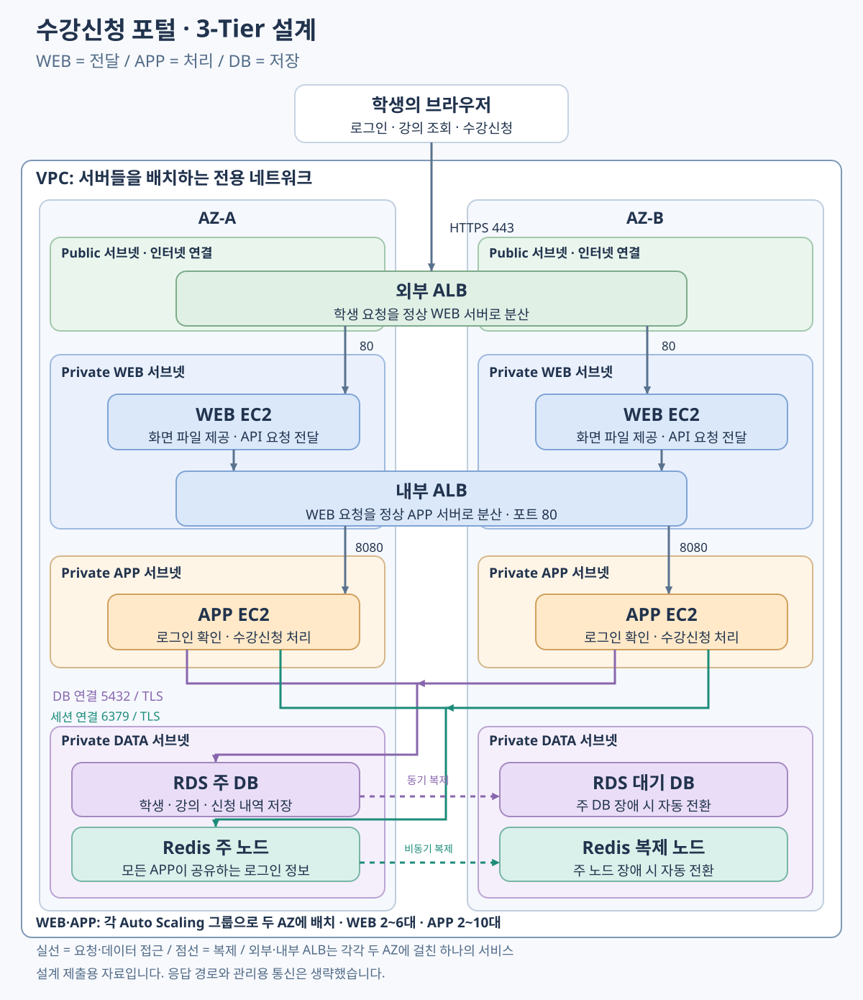

# Session 02 · 안정적인 수강신청 포털 설계

- 제출자: 위재복
- 제출 범위: 아키텍처 설계와 검증 계획
- 구현 여부: 선택 구현은 진행하지 않았으며, 실제 실행 결과는 포함하지 않습니다.

## 1. What I Built

학생들이 동시에 접속해도 안정적으로 사용할 수 있도록 수강신청 포털을 설계했습니다. 역할을 세 부분으로 나누는 **3-Tier(세 계층)** 구조입니다.

- **WEB:** 화면에 필요한 파일을 제공하고, 로그인·수강신청 요청을 APP으로 전달합니다.
- **APP:** 로그인 여부를 확인하고, 강의 조회와 수강신청을 처리합니다.
- **DB:** 학생 정보, 강의 정원, 수강신청 내역을 저장합니다.

기본 흐름은 **사용자 → 외부 ALB → WEB → 내부 ALB → APP → DB**입니다. ALB는 여러 서버로 요청을 나눠주는 장치입니다. 로그인 정보는 모든 APP이 함께 사용하는 별도 저장소에 보관합니다.

## 2. Design Decisions

### 서비스 구성

| AWS 서비스 | 이 설계에서 하는 일 |
| --- | --- |
| VPC | 서버들을 배치할 전용 네트워크 공간입니다. |
| EC2 | WEB과 APP을 실행하는 서버입니다. |
| ALB | 외부 ALB는 WEB에, 내부 ALB는 APP에 요청을 나눠줍니다. |
| EC2 Auto Scaling | WEB·APP 서버가 고장 나면 교체하고, 부하가 변하면 서버 수를 조절합니다. |
| RDS PostgreSQL | 학생·강의·신청 데이터를 저장하는 관리형 데이터베이스입니다. |
| ElastiCache for Redis OSS | 모든 APP이 공유하는 로그인 정보 저장소입니다. |
| CloudWatch | 응답 시간, 오류, 요청량, 서버 수를 확인합니다. |

### 배치: 한 곳에 문제가 생겨도 다른 곳에서 처리

VPC 안에 서로 다른 **AZ 두 곳**을 사용합니다. AZ는 같은 AWS 리전 안에서 분리된 데이터센터 구역입니다. 각 AZ에 WEB과 APP을 한 대 이상 배치하는 것을 기본으로 합니다.

**서브넷**은 VPC 안을 나눈 작은 네트워크 구역입니다. 외부 ALB는 인터넷과 연결되는 Public 서브넷에 둡니다. WEB·APP·DB·로그인 저장소는 직접 인터넷에서 들어올 수 없는 Private 서브넷에 둡니다. 내부 ALB도 Private 서브넷에 둡니다.

서울 리전의 VPC에 배치하고 Public 서브넷은 Internet Gateway로 연결합니다. 관리용 다운로드가 필요한 WEB·APP은 같은 AZ의 NAT Gateway 또는 필요한 VPC Endpoint를 사용합니다. DB·Redis 서브넷에는 인터넷 기본 경로를 두지 않습니다. 이 관리용 통신은 그림에서 생략했습니다.

RDS는 **Multi-AZ DB instance**로 구성해 주 DB와 다른 AZ의 대기 DB를 둡니다. 주 DB에 장애가 발생하면 대기 DB로 전환합니다. 대기 DB는 평상시에 조회 요청을 처리하지 않습니다. Redis도 서로 다른 AZ에 주 노드와 복제 노드를 두고 자동 장애 전환을 켭니다.

### 문제 1. 다른 APP으로 연결돼도 로그인 유지

로그인 정보를 APP 한 대의 메모리에만 저장하면, 다음 요청이 다른 APP으로 가거나 그 APP이 교체될 때 로그인 정보를 찾지 못합니다.

이 설계에서는 로그인 성공 시 Redis에 로그인 정보를 저장하고, 브라우저에는 그 정보를 찾기 위한 **세션 ID**를 쿠키로 줍니다. 이후 어느 APP이 요청을 받든 세션 ID로 같은 Redis를 조회합니다. 따라서 APP을 늘리거나 줄이거나 교체해도, 세션이 유효하고 저장소가 정상이라면 로그인 상태를 유지할 수 있습니다.

- 모든 APP은 같은 Redis와 같은 쿠키·세션 설정을 사용합니다.
- 세션 만료는 예시로 60분으로 정하고, 쿠키 만료와 Redis의 보관 시간을 맞춥니다.
- 쿠키에는 HTTPS에서만 전송하는 `Secure`, 자바스크립트 접근을 막는 `HttpOnly`, 다른 사이트에서의 쿠키 전송을 제한하는 `SameSite=Lax`를 설정합니다.
- 특정 APP에 사용자를 계속 연결하는 ALB의 세션 고정 기능은 끕니다. 공유 저장소로 로그인 상태를 유지하기 때문입니다.

### 문제 2. 장애 서버 제외와 자동 교체

ALB는 `/healthz`라는 점검 주소를 주기적으로 호출합니다. 서버가 정상이라면 HTTP 200을 반환합니다. APP이 응답하지 않으면 다음 순서로 처리합니다.

1. 내부 ALB가 APP의 점검 실패를 감지합니다.
2. 다른 정상 APP이 있으면 신규 요청을 그쪽으로 보냅니다.
3. Auto Scaling이 같은 서버 구성으로 장애 EC2를 교체합니다. 새 서버 구성은 Launch Template(서버 생성 설정)에 저장합니다.
4. 새 APP이 준비되고 ALB의 정상 판정을 받으면 요청을 처리합니다.

**ALB는 요청 분산·장애 대상 제외를, Auto Scaling은 서버 교체를 맡습니다.** APP 프로세스가 멈췄지만 EC2는 켜져 있는 경우도 교체하도록, Auto Scaling에 **ELB health checks(ALB 점검 결과 반영)**를 활성화합니다. WEB에도 같은 방식을 적용합니다.

점검 주소는 해당 서버의 처리 상태를 확인합니다. 공용 DB·Redis의 장애만으로 모든 APP을 반복 교체하지 않도록, 공용 저장소 상태는 별도 지표와 서비스 요청 테스트로 확인합니다.

### 문제 3. 시작 전에 준비하고, 부하에 따라 확장·축소

수강신청 시작 직후에는 서버를 새로 켜는 동안에도 요청이 몰립니다. 그래서 **예약 확장**으로 시작 15분 전에 서버를 미리 늘립니다. 이후에는 **Target Tracking(지표가 목표 값에 가까워지도록 서버 수를 조절하는 정책)**을 사용합니다.

| 설정 | 예시 값 | 선택 이유 |
| --- | --- | --- |
| 평상시 WEB·APP 서버 수 | WEB: 최소·희망 2대, 최대 6대 / APP: 최소·희망 2대, 최대 10대 | 두 AZ에 분산하고, 예약 확장 이후에도 APP을 추가로 늘릴 여유를 둡니다. |
| 시작 15분 전 | WEB 최소·희망 4대, APP 최소·희망 6대 | 서버가 준비되는 시간을 확보합니다. 최소 수량도 올려 시작 전에 다시 줄어들지 않게 합니다. |
| 동적 확장 지표 | 각 ALB 대상 그룹의 서버당 1분 요청 수(`ALBRequestCountPerTarget`) | 요청량에 맞춰 해당 계층의 서버 수를 조절합니다. |
| APP 지표 목표 | 예시로 서버당 600건/분 | 확장 동작을 설명하기 위한 가정입니다. 실제 목표는 부하 테스트로 정합니다. WEB 목표는 별도로 측정합니다. |
| 초기 준비 시간 | 상태 검사 유예·서버 준비 대기 각각 180초 | 시작 중인 서버가 잘못 교체되는 것과 준비 중 부하를 성급하게 판단하는 것을 줄입니다. |
| ALB 점검 | 10초 간격, 3초 제한, 연속 실패 3회 | 일시적인 지연과 지속적인 장애를 구분합니다. |
| 서버 제거 전 대기 | 60초 | 처리 중인 요청이 끝날 시간을 줍니다. |

피크가 끝나면 예약으로 올렸던 최소 수량을 2대로 복원합니다. 이후 낮아진 부하에 따라 자동 축소하게 합니다. 예약 확장의 반복 시간대는 한국 시간인 `Asia/Seoul`로 설정합니다. 위 숫자는 설계 예시이며 실제 성능을 측정한 값은 아닙니다.

### 접근 제어와 데이터 보호

**Security Group(서버 접근 허용 규칙)**으로 바로 앞 계층에서 오는 요청만 허용합니다.

| 접근 대상 | 허용하는 출발점과 포트 |
| --- | --- |
| 외부 ALB | 인터넷의 HTTPS 443. HTTP 80은 HTTPS 전환용 |
| WEB | 외부 ALB의 Security Group에서 오는 80 |
| 내부 ALB | WEB의 Security Group에서 오는 80 |
| APP | 내부 ALB의 Security Group에서 오는 8080 |
| RDS | APP의 Security Group에서 오는 5432 |
| Redis | APP의 Security Group에서 오는 6379 |

WEB·APP에 공인 IP를 주지 않고 RDS의 공개 접속도 끕니다. 외부 접속은 HTTPS, DB·Redis 접속은 TLS 암호화를 사용합니다. 내부 WEB·APP 구간은 Private 네트워크와 접근 규칙으로 제한하며, 내부 통신 암호화가 필요하면 HTTPS를 추가합니다.

DB·서버 디스크·Redis 저장 데이터는 암호화합니다. DB 비밀번호는 Secrets Manager에서 관리하고 코드나 GitHub에 넣지 않습니다. RDS 자동 백업은 예시로 7일 보관합니다. Multi-AZ는 잘못 삭제한 데이터도 복제하므로 백업도 필요합니다.

### 남아 있는 한계

- 장애 감지와 새 서버 준비에는 시간이 걸려 일부 요청이 실패할 수 있습니다. 모든 대상이 장애 상태라면 ALB가 장애 대상으로도 요청을 보낼 수 있습니다.
- Redis의 비동기 복제 때문에 장애 전환 직전의 일부 로그인 정보가 사라질 수 있습니다. 모든 장애에서 로그인 유지가 보장되는 것은 아닙니다.
- AZ 하나가 중단되면 남은 AZ의 서버가 부하를 감당할 여유가 필요합니다. APP을 늘려도 DB 성능은 자동으로 늘지 않습니다. DB 연결 수와 느린 쿼리도 확인해야 합니다.
- 동시 신청으로 정원을 넘거나 중복 신청이 생기지 않게 DB 트랜잭션과 중복 방지 제약을 적용해야 합니다.
- 두 AZ 구성은 리전 전체 장애에 대응하지 않으며, 서버·ALB·DB·Redis 비용이 발생합니다.

## 3. Troubleshooting & Validation

### 문서 기반 설계 점검: ALB에 연결하면 자동 교체까지 되는가?

- **점검 대상:** APP 프로그램만 중단되고 EC2는 켜져 있는 상황입니다.
- **확인 과정과 조치:** AWS 문서에서 EC2 기본 상태 검사와 ALB 점검 결과를 반영하는 설정이 다름을 확인했습니다. Auto Scaling에 ELB health checks를 활성화하도록 설계했습니다.
- **결과와 근거:** 장애 서버를 제외하는 ALB와 교체하는 Auto Scaling을 연결했습니다. 이것은 문서 기반 설계 점검이며, 실제 교체를 실행해 확인한 결과는 아닙니다.
- **검증 범위와 한계:** 이번 제출은 설계 범위입니다. 아래 표는 구현할 경우 적용할 검증 계획입니다.

| 확인할 항목 | 테스트 방법 | 성공 기준의 예시 |
| --- | --- | --- |
| 로그인 유지 | 한 번 로그인한 쿠키로 사용자 확인 요청을 100회 보냅니다. 두 APP에서 처리되는지 확인하고 APP 교체·증설·축소 후에도 반복합니다. | 세션 유효기간 내 정상 요청에서 같은 사용자 유지, 불필요한 재로그인 0회 |
| 장애 제외·교체 | APP 한 대의 프로그램을 중단하고 ALB 대상 상태와 Auto Scaling 기록을 봅니다. | 제외 60초 이내, 정상 용량 복구 10분 이내를 목표로 측정. 다른 정상 APP에서 서비스 지속 |
| 예약 확장 | 가까운 테스트 시각으로 예약을 설정합니다. | 테스트 시작 전에 WEB 4대·APP 6대가 정상 상태로 준비 |
| 동적 확장·축소 | 낮은 부하 → 높은 부하 10분 → 낮은 부하 20분 순서로 요청을 보냅니다. | 서버 수 증가 후 부하 감소 시 축소, 최소 2대 유지. p95 응답 시간(요청의 95%가 완료되는 시간) 1초 이내·예상 밖 오류율 1% 미만을 목표로 측정 |

위 기준은 테스트 목표입니다. 측정된 결과나 AWS가 보장하는 시간이 아닙니다. APP 식별자·응답 결과, ALB 정상 상태, Auto Scaling 활동 기록, CloudWatch 지표를 증빙으로 수집합니다. 쿠키와 개인정보는 가립니다.

## 4. Screenshots

이번 제출은 설계와 검증 계획입니다.
선택 구현은 진행하지 않았으므로 실제 실행 결과 화면은 없습니다.

### 로그인 유지

**완료 조건: APP이 교체되거나 요청이 다른 APP으로 전달되어도 로그인 유지**

- 확인 방법: 동일한 로그인 쿠키로 여러 APP에 요청하고,
  APP 교체·확장·축소 전후에 동일한 사용자로 확인되는지 검증할 계획입니다.
- 확인 결과: 실제 실행은 하지 않았습니다.
  공용 Redis 세션을 사용하는 설계와 검증 계획을 작성했습니다.

### 장애 대응

**완료 조건: 장애 APP 제외 및 정상 서버로 서비스 지속, 자동 교체**

- 확인 방법: APP 한 대의 프로그램을 중단하고,
  ALB의 장애 대상 제외와 Auto Scaling의 새 서버 생성 기록을 확인할 계획입니다.
- 확인 결과: 실제 실행은 하지 않았습니다.
  ALB 상태 검사와 Auto Scaling의 ELB health checks를 적용하도록 설계했습니다.

### 자동 확장·축소

**완료 조건: 시작 전에 서버를 확보하고 요청량에 따라 서버 수 조절**

- 확인 방법: 예약 시각 전에 서버가 준비되는지 확인하고,
  부하를 증가·감소시키며 서버 수와 응답 시간의 변화를 측정할 계획입니다.
- 확인 결과: 실제 실행은 하지 않았습니다.
  예약 확장과 요청량 기반 Target Tracking을 사용하는 설계를 작성했습니다.

