# 수강신청 서비스 AWS 구축과 검증 기록

간단한 수강신청 서비스를 AWS에 배포하고, 서버 교체 후 로그인 유지와 접속량에 따른 자동 확장 및 축소, DB 장애 조치 후 복구를 확인했다.

설계와 실험 결과만 빠르게 보려면 [제출 보고서](./README.md)를 보면 된다. 실행에 필요한 코드는 같은 폴더의 [source](./source/)에 넣었다.

| 읽을 범위 | 다루는 내용 |
|---|---|
| 1~14단계 | 도구와 권한 준비 → 네트워크, DB, 캐시 → WEB과 APP 배포 |
| 15~16단계 | 서비스 확인 → 장애 대응, 예약 확장, 부하 실험 |
| 17단계 | APP 기동 오류와 WEB 확장 정책을 수정한 과정 |

**실습 환경:** 2026년 10월 9~10일, 서울 리전 `ap-northeast-2`, 가용 영역 `ap-northeast-2a`와 `ap-northeast-2c`.

### 사진과 입력값을 보는 방법

- 빨간 번호는 선택하거나 확인할 위치다. 사진을 누르면 크게 볼 수 있다.
- **입력값은 각 단계의 최종 설정 표를 기준으로 한다.**

리소스 이름과 CIDR은 예시대로 사용해도 된다. 다만 사진에 보이는 계정 ID, VPC ID, ARN, DNS는 내 환경에서 생성된 값이므로 본인 값으로 바꿔야 한다. S3 버킷 이름도 본인만의 고유한 이름을 사용한다.

## 찾아보기

| 준비와 네트워크 | 데이터 계층과 배포 준비 | 서버 구축과 검증 |
|---|---|---|
| [1. 준비와 권한](#step-1) | [7. RDS MySQL](#step-7) | [13. 시작 템플릿](#step-13) |
| [2. 구조와 이름](#step-2) | [8. Valkey 세션 저장소](#step-8) | [14. ASG와 정책](#step-14) |
| [3. VPC와 서브넷](#step-3) | [9. 연결값 정리](#step-9) | [15. 서비스 확인](#step-15) |
| [4. IGW와 NAT](#step-4) | [10. 배포 파일과 세션 키](#step-10) | [16. 장애 대응과 부하 실험](#step-16) |
| [5. 라우팅과 S3 엔드포인트](#step-5) | [11. EC2 IAM 역할](#step-11) | [17. 트러블슈팅](#step-17) |
| [6. 보안 그룹](#step-6) | [12. 대상 그룹과 ALB](#step-12) | — |

<a id="step-1"></a>

## 1. 계정, 도구, 권한부터 준비하기

### 1.1 명령을 실행할 위치와 도구 준비

이 문서에서는 내 PC 터미널과 EC2 터미널을 모두 사용한다. 명령을 복사하기 전에 어느 쪽에서 실행하는지 확인한다.

| 작업 위치 | 하는 일 |
|---|---|
| 내 PC의 터미널 | 배포 파일 압축, `watch.mjs` 관찰, `hey` 부하 테스트 |
| AWS 콘솔 | 네트워크, DB, ALB, 시작 템플릿, ASG 생성 |
| EC2의 Session Manager 터미널 | 서버 로그와 서비스 상태 확인, 장애 실험 |

나는 macOS에서 진행했다. 로컬에는 Node.js `22` 이상과 npm이 필요하고, 부하 테스트에는 `hey`를 사용한다. Homebrew를 이미 사용한다면 다음 순서로 준비한다.

**내 PC 터미널 — 도구 설치**

```bash
brew install node@24 hey
export PATH="$(brew --prefix node@24)/bin:$PATH"
```

**설치 확인**

```bash
node --version
npm --version
hey -h
```

`node@24`는 기본 실행 경로에 자동으로 연결되지 않는 별도 버전 패키지여서 `PATH`를 지정했다. 이 설정은 현재 터미널에만 적용된다. 새 터미널에서 `node`를 찾지 못하거나 버전이 `22`보다 낮다면 위의 `export PATH=...` 줄을 다시 실행한다. [Homebrew node@24 안내](https://formulae.brew.sh/formula/node@24)

Homebrew를 사용하지 않는 경우에는 [Node.js 공식 설치 페이지](https://nodejs.org/en/download)와 [hey 설치 안내](https://github.com/rakyll/hey)를 따른다. 파일 업로드는 AWS 콘솔에서 진행하므로 로컬 AWS 액세스 키가 꼭 필요한 것은 아니다.

뒤에서 제시하는 인스턴스 수와 크기는 실습 설정이다. 운영 환경의 처리 용량을 측정해 정한 값은 아니다.

### 1.2 콘솔 사용자 권한 확인

실습용 IAM 사용자로 로그인한 뒤 우측 위에서 **아시아 태평양(서울)** 리전을 선택한다. VPC, EC2, RDS, 캐시는 서울에서 만든다. IAM은 글로벌 서비스여서 리전 표시가 달라도 괜찮다.

VPC와 EC2 외에도 RDS, 캐시, S3, Secrets Manager를 사용하므로 각 서비스를 생성하고 조회할 권한을 먼저 준비한다.

**이번 실습에서 사용한 관리형 정책**

| 정책 | 필요한 작업 |
|---|---|
| `AmazonEC2FullAccess` | VPC, EC2, ALB, Auto Scaling 관련 작업 |
| `AmazonRDSFullAccess` | DB 서브넷 그룹, RDS 생성과 조회, 장애 실험 |
| `AmazonElastiCacheFullAccess` | Valkey 캐시 생성과 조회 |
| `AmazonS3FullAccess` | 배포 버킷 생성과 파일 업로드 |
| `SecretsManagerReadWrite` | 공통 세션 키 생성과 ARN 조회 |

위 정책은 실습을 위해 넓게 부여한 권한이다. 운영용 최소 권한 정책으로 그대로 사용하지 않는다. 조직 계정이라면 관리자에게 실습 범위에 맞는 권한을 요청한다.

정책을 연결할 때는 권한을 부여할 수 있는 관리자 계정에서 진행한다.

1. **IAM → 사용자 → 실습 사용자 → 권한**을 연다.
2. **권한 추가 → 직접 정책 연결**에서 필요한 정책을 검색하고 선택한다.
3. 저장한 뒤 원래 실습 사용자로 돌아와 콘솔을 새로 고친다.

실습 사용자가 자기 권한을 직접 추가할 수 있다고 가정하지 않는다.

**EC2 역할 생성과 Session Manager 접속 권한**

IAM과 SSM 관련 보충 권한은 [operator-extra.json](./source/policies/operator-extra.json)에 따로 넣었다. 적용하기 전에 아래 항목을 맞춘다.

| 정책 안의 값 | 처리 방법 |
|---|---|
| `888195519399` | 본인의 12자리 AWS 계정 ID로 변경 |
| `user/i2na-asbg` | 실습 사용자 이름이 다르면 변경 |
| 역할 이름과 인스턴스 `Name` 태그 | 이 가이드와 다르게 정했다면 실제 이름에 맞게 변경 |
| `${aws:username}`, `${aws:userid}` | IAM 정책 변수이므로 그대로 유지 |

관리자에게 **IAM 사용자 → 권한 → 인라인 정책 생성 → JSON**에서 수정한 정책을 검토하고 등록하도록 한다.

`iam:PassRole`은 지정한 WEB과 APP 역할을 EC2에 전달하는 권한이다. Session Manager 접속은 `i2na-asbg-ec2-web/app`의 `Name` 태그를 가진 인스턴스로 제한했다.

<a id="step-2"></a>

## 2. 만들 구조와 이름 정하기

[](./images/diagrams/three-tier-architecture.svg)

사용자 요청은 다음 순서로 전달되도록 구성했다.

```text
브라우저 → Public ALB → WEB(Nginx) → Internal ALB → APP(Node.js)
APP → RDS: 사용자, 강좌, 신청 내역
APP → Valkey: 로그인 세션
```

WEB은 정적 화면을 제공하고 `/api/` 요청을 APP으로 넘긴다. APP이 바뀌어도 같은 RDS 데이터와 Valkey 세션을 사용하므로, 로그인 상태를 특정 APP에 묶어 둘 필요가 없다.

서브넷 배치는 아래처럼 나눴다. WEB과 APP은 같은 private app 서브넷에 놓고, ALB와 보안 그룹으로 통신 범위를 구분했다.

| 영역 | 배치한 리소스 |
|---|---|
| public 서브넷 | Public ALB, NAT Gateway |
| private app 서브넷 | WEB EC2, APP EC2, Internal ALB |
| private data 서브넷 | RDS, Valkey |

외부 사용자 요청은 Public ALB로만 받는다. EC2에는 공인 IP나 SSH 인바운드를 주지 않는다.

### 리소스 이름

뒤에서 `app-a`, `sg-web`처럼 짧게 부르는 경우에도 실제 생성 이름은 아래의 `i2na-asbg-` 접두사를 포함한다.

| 네트워크 리소스 | 이름과 수량 |
|---|---|
| VPC | `i2na-asbg-vpc`, CIDR `10.20.0.0/16` |
| Internet Gateway | `i2na-asbg-igw`, 1개 |
| NAT Gateway | `i2na-asbg-nat-a`, 1개 |
| 라우팅 테이블 | `i2na-asbg-rt-public`, `i2na-asbg-rt-app`, `i2na-asbg-rt-data` |

| 서버와 데이터 리소스 | 이름 |
|---|---|
| ALB | `i2na-asbg-alb-public`, `i2na-asbg-alb-internal` |
| 대상 그룹 | `i2na-asbg-tg-web`, `i2na-asbg-tg-app` |
| 시작 템플릿 | `i2na-asbg-lt-web`, `i2na-asbg-lt-app` |
| Auto Scaling 그룹 | `i2na-asbg-asg-web`, `i2na-asbg-asg-app` |
| RDS / Valkey | `i2na-asbg-db` / `i2na-asbg-cache` |
| EC2 역할 | `i2na-asbg-role-web`, `i2na-asbg-role-app` |
| S3 버킷 / 세션 키 | 본인 고유 배포 버킷 / `i2na-asbg/session-secret` |

NAT는 비용을 줄이려고 `public-a`에 한 개만 뒀다. 이 AZ에 문제가 생기면 다른 AZ에서도 외부 패키지 다운로드나 일부 AWS API 접근이 영향을 받을 수 있다. 따라서 모든 경로의 단일 장애 지점을 없앤 구성은 아니다.

도메인, ACM, HTTPS, WAF는 이번 실습에 포함하지 않았고, HTTP로 테스트했다.

<a id="step-3"></a>

## 3. VPC와 여섯 개 서브넷 만들기

### 3.1 VPC 생성과 DNS 설정

콘솔에서 **VPC → VPC → VPC 생성**을 연다. 네트워크를 직접 연결해 보기 위해 자동 생성 마법사 대신 **VPC만**을 선택했다.

| 입력 항목 | 값 |
|---|---|
| 생성할 리소스 | **VPC만** |
| 이름 태그 | `i2na-asbg-vpc` |
| IPv4 CIDR | 수동 입력, `10.20.0.0/16` |
| IPv6 CIDR | 없음 |
| 테넌시 | 기본값 |

1. 위 값을 입력하고 **VPC 생성**을 누른다.
2. 생성한 VPC를 선택해 **작업 → VPC 설정 편집**으로 간다.
3. **DNS 확인 활성화**와 **DNS 호스트 이름 활성화**를 모두 체크한다.
4. 저장한다. 이후 ALB, RDS, 캐시의 DNS 이름을 사용할 환경이다.

[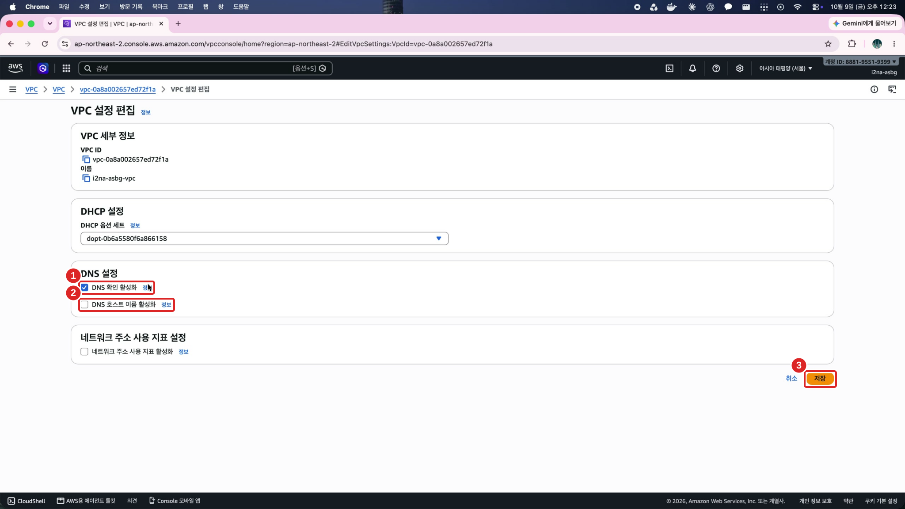](./images/setup/01-vpc-dns-settings.svg)

- ① **DNS 확인**은 활성화 상태로 유지한다.
- ② 사진에서는 아직 꺼져 있는 **DNS 호스트 이름**도 체크한다.
- ③ 저장한다.

**완료 확인:** VPC 이름과 CIDR이 맞고, 세부 정보의 DNS 두 항목이 모두 활성화되어 있으면 다음으로 넘어간다.

### 3.2 서브넷 생성

콘솔에서 **VPC → 서브넷 → 서브넷 생성**을 연다.

1. VPC ID에 `i2na-asbg-vpc`를 고른다. 기본 VPC가 아닌지 이름과 CIDR을 함께 확인한다.
2. 아래 표의 이름, AZ, CIDR을 입력한다. **새 서브넷 추가**를 눌러 같은 화면에서 여섯 개를 만들 수 있다.
3. 생성한 뒤 여섯 개가 모두 있고 CIDR이 겹치지 않는지 확인한다.

| 서브넷 이름 | AZ | IPv4 CIDR |
|---|---|---|
| `i2na-asbg-subnet-public-a` | `ap-northeast-2a` | `10.20.0.0/24` |
| `i2na-asbg-subnet-public-c` | `ap-northeast-2c` | `10.20.1.0/24` |
| `i2na-asbg-subnet-app-a` | `ap-northeast-2a` | `10.20.10.0/24` |
| `i2na-asbg-subnet-app-c` | `ap-northeast-2c` | `10.20.11.0/24` |
| `i2na-asbg-subnet-data-a` | `ap-northeast-2a` | `10.20.20.0/24` |
| `i2na-asbg-subnet-data-c` | `ap-northeast-2c` | `10.20.21.0/24` |

`public-a/c`에는 Public ALB를, `public-a`에는 NAT를 추가로 둔다. `app-a/c`에는 WEB EC2, APP EC2, Internal ALB를 배치하고, `data-a/c`에는 RDS와 Valkey를 배치한다.

[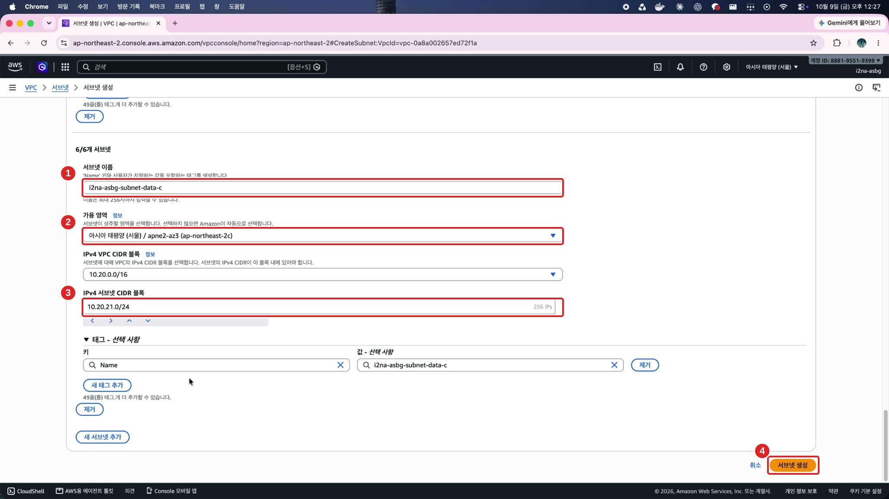](./images/setup/02-private-subnet-creation.svg)

- ① 이름, ② 가용 영역, ③ CIDR을 한 세트로 입력한다.
- 사진은 마지막 `data-c` 입력 장면이다. 다른 다섯 개도 표대로 추가한다.
- ④ 입력을 마치고 생성한다.

**공인 IP 자동 할당 확인**

`app`과 `data` 서브넷에서는 **작업 → 서브넷 설정 편집 → 퍼블릭 IPv4 주소 자동 할당**을 꺼 둔다. Public ALB는 자체적으로 공인 주소를 가지므로, 이 실습에서는 `public` 서브넷의 EC2 자동 공인 IP 할당도 필요하지 않다.

이름에 `public`을 붙이는 것만으로 인터넷 통신이 되지는 않는다. 다음 단계에서 IGW로 나가는 라우트를 연결해야 한다.

<a id="step-4"></a>

## 4. Internet Gateway와 NAT Gateway 연결하기

### 4.1 Internet Gateway

1. **VPC → 인터넷 게이트웨이 → 인터넷 게이트웨이 생성**을 연다.
2. 이름을 `i2na-asbg-igw`로 지정해 생성한다.
3. 생성한 게이트웨이를 선택하고 **작업 → VPC에 연결**을 누른다.
4. `i2na-asbg-vpc`를 선택해 연결한다.

**완료 확인:** 상태가 `Attached`이고, 연결된 VPC ID가 내가 만든 VPC인지 확인한다.

### 4.2 NAT Gateway

콘솔에서 **VPC → NAT 게이트웨이 → NAT 게이트웨이 생성**을 연다.

| 입력 항목 | 값 |
|---|---|
| 이름 | `i2na-asbg-nat-a` |
| 가용성 모드 | **영역별(Zonal)** |
| 서브넷 | `i2na-asbg-subnet-public-a` |
| 연결 유형 | **퍼블릭** |
| Elastic IP 주소 | **Elastic IP 할당**으로 새 주소 연결 |

생성 후 상태가 `Pending`에서 `Available`로 바뀔 때까지 기다린다.

[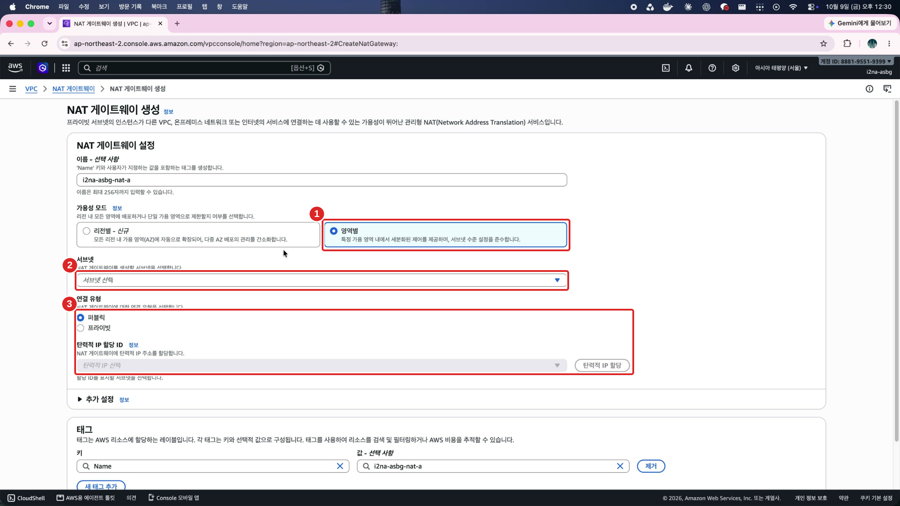](./images/setup/03-nat-gateway-creation.svg)

- ① **영역별** 모드를 선택한다.
- ② `public-a` 서브넷을 선택한다. 사진은 선택하기 전의 화면이다.
- ③ **퍼블릭** 연결을 선택하고 Elastic IP를 할당한다.

NAT는 private EC2가 패키지를 내려받거나 외부 AWS API에 접속할 때 사용하는 출구다. 외부에서 EC2로 들어오는 입구는 아니다. Public ALB를 거친 사용자 요청이나 VPC 내부 DB 연결은 NAT를 경유할 필요가 없다.

<a id="step-5"></a>

## 5. 라우팅 테이블과 S3 엔드포인트 만들기

### 5.1 라우팅 테이블 생성과 서브넷 연결

콘솔에서 **VPC → 라우팅 테이블 → 라우팅 테이블 생성**을 연다. 아래 세 개를 만들고, VPC는 모두 `i2na-asbg-vpc`로 선택한다.

| 라우팅 테이블 | 명시적으로 연결할 서브넷 |
|---|---|
| `i2na-asbg-rt-public` | `public-a`, `public-c` |
| `i2na-asbg-rt-app` | `app-a`, `app-c` |
| `i2na-asbg-rt-data` | `data-a`, `data-c` |

각 테이블의 **라우팅 → 라우팅 편집 → 라우팅 추가**에서 다음 경로를 설정한다.

```text
rt-public: 0.0.0.0/0 → Internet Gateway (i2na-asbg-igw)
rt-app:    0.0.0.0/0 → NAT Gateway (i2na-asbg-nat-a)
rt-data:   인터넷 기본 경로를 추가하지 않음

공통: 10.20.0.0/16 → local 경로는 그대로 유지
```

이어 **서브넷 연결 → 서브넷 연결 편집**에서 표에 적은 두 서브넷을 체크하고 저장한다. 라우트만 만들고 연결을 빠뜨리면 해당 서브넷에 적용되지 않는다. `data` 서브넷에는 IGW나 NAT 기본 경로를 넣지 않는다.

[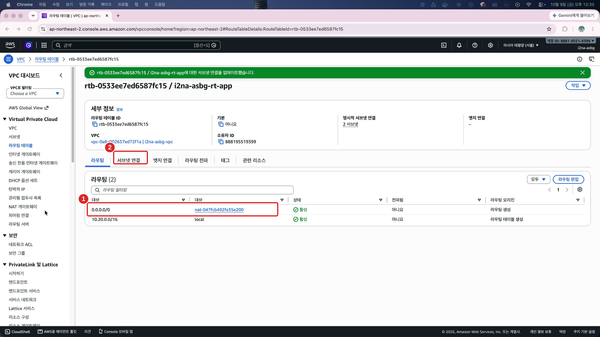](./images/setup/04-private-route-table.svg)

- ① `0.0.0.0/0`의 대상이 NAT인지 확인한다.
- ② **서브넷 연결**에서 `app-a`와 `app-c`가 모두 연결되어 있는지 확인한다.

**완료 확인:** 이번에는 각 서브넷의 **라우팅 테이블** 탭에서 연결을 역으로 확인한다. VPC **리소스 맵**에서도 서브넷, 라우팅 테이블, IGW, NAT의 연결을 볼 수 있다.

### 5.2 S3 Gateway Endpoint

배포 파일을 받는 S3 경로는 NAT를 거치지 않도록 구성했다.

1. **VPC → 엔드포인트 → 엔드포인트 생성**을 연다.
2. 이름에 `i2na-asbg-vpce-s3`, 서비스 범주에 **AWS 서비스**를 선택한다.
3. 서비스 이름 `com.amazonaws.ap-northeast-2.s3`를 검색한다.
4. 유형이 **Gateway**인 행을 선택한다. 같은 S3라도 **Interface** 유형과 구분한다.
5. VPC는 `i2na-asbg-vpc`, 라우팅 테이블은 `rt-app`을 선택한다.
6. 엔드포인트 정책은 실습에서 사용한 **전체 액세스**로 두고 생성한다.

[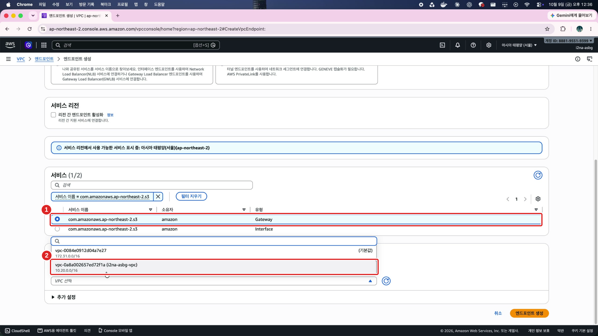](./images/setup/05-s3-gateway-endpoint.svg)

- ① S3의 **Gateway** 행을 선택한다.
- ② 내가 만든 VPC를 선택한다.
- 이어지는 라우팅 테이블 선택에서 `rt-app`을 연결한다.

**완료 확인:** `rt-app` 라우팅에 S3 관리형 접두사 목록에서 엔드포인트로 향하는 경로가 추가되어야 한다.

```text
대상: S3 관리형 접두사 목록 (pl-…)
연결: 생성한 Gateway Endpoint (vpce-…)
```

이 경로는 서울 리전 S3 접근에 사용한다. Secrets Manager와 SSM 등 나머지 AWS 서비스와 일반 패키지 다운로드는 현재 구성에서 NAT를 사용한다.

엔드포인트 정책을 허용했다고 S3 객체 읽기 권한까지 생기는 것은 아니다. 뒤에서 EC2 역할에도 필요한 권한을 연결한다. [AWS S3 Gateway Endpoint 설명](https://docs.aws.amazon.com/vpc/latest/privatelink/vpc-endpoints-s3.html)

<a id="step-6"></a>

## 6. 보안 그룹으로 각 계층의 통신 범위 정하기

콘솔에서 **VPC → 보안 그룹 → 보안 그룹 생성**을 연다. 모든 그룹은 `i2na-asbg-vpc`에 만든다.

아래 표의 순서대로 만들면 앞서 생성한 그룹을 다음 그룹의 소스로 선택할 수 있다. 설명은 `Public ALB`, `WEB servers`처럼 역할을 알 수 있게 적는다.

| 보안 그룹 이름 | 인바운드 유형과 포트 | 소스 |
|---|---|---|
| `i2na-asbg-sg-alb-public` | HTTP / TCP `80` | `0.0.0.0/0` |
| `i2na-asbg-sg-web` | HTTP / TCP `80` | `i2na-asbg-sg-alb-public` |
| `i2na-asbg-sg-alb-internal` | HTTP / TCP `80` | `i2na-asbg-sg-web` |
| `i2na-asbg-sg-app` | 사용자 지정 TCP / `8080` | `i2na-asbg-sg-alb-internal` |
| `i2na-asbg-sg-db` | MYSQL/Aurora / TCP `3306` | `i2na-asbg-sg-app` |
| `i2na-asbg-sg-cache` | 사용자 지정 TCP / `6379–6380` | `i2na-asbg-sg-app` |

**각 그룹의 생성 순서**

1. 이름, 설명, VPC를 입력한다.
2. 인바운드의 **규칙 추가**에서 표에 적은 유형과 포트를 선택한다.
3. 소스가 보안 그룹이면 **사용자 지정**을 선택한다. 입력칸에 `sg-` 또는 그룹 이름을 입력하고, 드롭다운에서 실제 그룹을 고른다. 이름만 문자로 남겨 두지 않는다.
4. 아웃바운드는 실습에서 사용한 기본값인 **모든 트래픽**, 대상 `0.0.0.0/0`을 유지한다.
5. 생성 후 상세 화면에서 규칙과 VPC를 확인한다. SSH `22` 인바운드는 추가하지 않는다.

[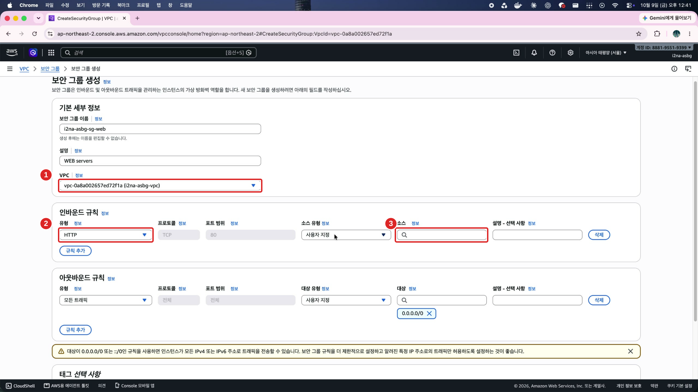](./images/setup/06-web-security-group.svg)

- ① 내가 만든 VPC를 선택한다.
- ② HTTP `80`을 선택한다.
- ③ 소스에 Public ALB의 보안 그룹을 선택한다. 사진에서는 아직 비어 있는 칸이다.

캐시는 Serverless 연결에 필요한 `6379–6380`을 APP에서만 허용했다. 실제 세션 코드에서는 TLS를 사용하는 기본 엔드포인트의 `6379` 포트에 연결한다.

DB와 캐시에는 `0.0.0.0/0`이나 내 PC의 공인 IP를 열지 않는다. DB 접속 확인도 APP을 통해 진행한다.

<a id="step-7"></a>

## 7. RDS MySQL Multi-AZ 만들기

DB를 배치할 서브넷 그룹을 먼저 만든다. 그다음 MySQL DB를 생성하고, APP에서 사용할 엔드포인트와 보안 암호 ARN을 확인한다.

### 7.1 DB 서브넷 그룹 만들기

1. **Aurora and RDS → 서브넷 그룹 → DB 서브넷 그룹 생성**을 연다.
2. 아래 값을 입력한다.

   | 항목 | 입력값 |
   |---|---|
   | 이름 | `i2na-asbg-db-subnet-group` |
   | 설명 | `ASBG private data subnets` |
   | VPC | `i2na-asbg-vpc` |

3. 가용 영역은 `ap-northeast-2a`, `ap-northeast-2c`를 선택한다.
4. 서브넷은 `data-a`(`10.20.20.0/24`)와 `data-c`(`10.20.21.0/24`) 두 개만 추가한다.
5. 생성한 그룹을 다시 열어 두 AZ와 두 CIDR이 맞는지 확인한다.

### 7.2 MySQL 데이터베이스 생성하기

**Aurora and RDS → 데이터베이스 → 데이터베이스 생성**을 연다. 생성 화면이 길기 때문에 아래 구역을 순서대로 확인한다.

#### 생성 방식과 배포 형태

| 항목 | 입력하거나 선택할 값 |
|---|---|
| 생성 방식 | `표준 생성 / 전체 구성`. 세부 항목을 직접 정하는 방식 |
| 엔진 | `MySQL` / `MySQL Community` |
| 엔진 버전 | `MySQL 8.4` 계열. 당시에는 `8.4.9`를 사용했으며, 재현할 때는 콘솔에서 지원하는 버전을 확인 |
| 템플릿 | `개발/테스트` |
| 가용성과 내구성 | `다중 AZ DB 인스턴스 배포(인스턴스 2개)` |

이번 구성은 Primary와 Standby를 사용하는 `Multi-AZ DB 인스턴스`다. 인스턴스가 3개인 `Multi-AZ DB 클러스터`와 구분해서 선택한다. 템플릿을 선택한 뒤에도 아래 설정을 직접 확인한다.

[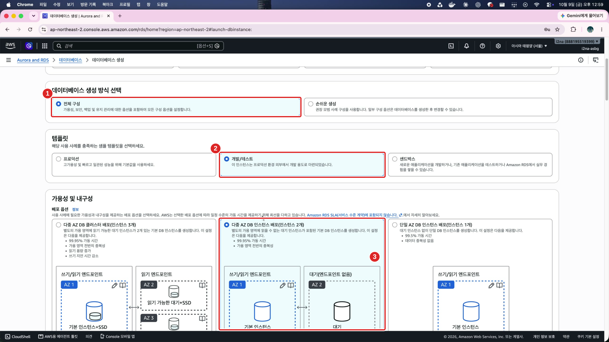](./images/setup/08-rds-multi-az-selection.svg)

- ① **전체 구성**을 선택한다.
- ② **개발/테스트**를 선택한다.
- ③ `인스턴스 2개`의 Multi-AZ 배포인지 확인한다.

화면 이름이 바뀌더라도 DB 인스턴스 배포인지 DB 클러스터인지 확인하고, 템플릿 기본값에만 의존하지 않는다.

#### 이름, 자격 증명, 인스턴스와 스토리지

| 항목 | 입력하거나 선택할 값 |
|---|---|
| DB 인스턴스 식별자 | `i2na-asbg-db` |
| 마스터 사용자 이름 | `admin` |
| 자격 증명 관리 | `AWS Secrets Manager에서 관리` |
| 자격 증명 암호화 키 | `aws/secretsmanager` |
| 인스턴스 클래스 | `버스터블 클래스` → `db.t4g.micro` |
| 스토리지 유형 / 크기 | `범용 SSD gp3` / `20 GiB` |
| 스토리지 자동 조정 | 생성 전에 사용 여부와 최대값을 확인 |

[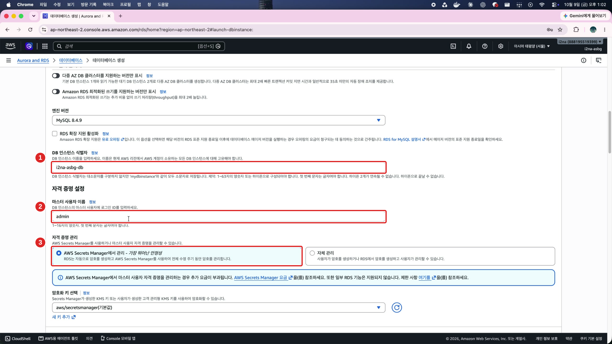](./images/setup/09-rds-credentials-settings.svg)

- ① DB 인스턴스 식별자를 `i2na-asbg-db`로 입력한다.
- ② 마스터 사용자 이름을 `admin`으로 입력한다.
- ③ 자격 증명을 `Secrets Manager`에서 관리하도록 선택한다.

이 방식에서는 사용자 데이터에 DB 비밀번호를 직접 쓰지 않는다.

#### 연결과 인증

| 항목 | 입력하거나 선택할 값 |
|---|---|
| EC2 컴퓨팅 리소스 연결 | 자동 연결하지 않음 |
| 네트워크 유형 | `IPv4` |
| VPC | `i2na-asbg-vpc` |
| DB 서브넷 그룹 | `i2na-asbg-db-subnet-group` |
| 퍼블릭 액세스 | `아니요` |
| VPC 보안 그룹 | 기존 그룹 선택. `default`를 제거하고 `sg-db`만 선택 |
| 포트 | `3306` |
| 데이터베이스 인증 | `암호 인증` |

[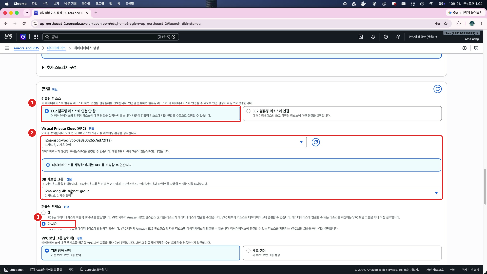](./images/setup/10-rds-private-network.svg)

- ① EC2 자동 연결을 사용하지 않는다.
- ② 전용 VPC와 DB 서브넷 그룹을 선택한다.
- ③ 퍼블릭 액세스를 `아니요`로 선택한다.

아래 보안 그룹 항목에서도 `default`가 빠지고 `sg-db`만 선택되었는지 확인한다.

#### 추가 구성, 백업과 삭제 방지

| 항목 | 입력하거나 선택할 값 |
|---|---|
| 초기 데이터베이스 이름 | 비워 둠. 앱이 `portal`을 생성 |
| 파라미터 그룹과 옵션 그룹 | 선택한 MySQL 버전의 기본 그룹 |
| 스토리지 암호화 | 활성화, 키는 `aws/rds` |
| 자동 백업 / 보존 기간 | 활성화 / `7일` |
| 백업과 유지 관리 시간대 | 기본값인 `선호 없음` |
| 삭제 방지 | 활성화 |

이 실습에서는 유료 플랜에서 백업 보존 기간을 `7일`로 설정했다. 생성 전에 본인 계정 플랜에서 해당 설정을 사용할 수 있는지 확인한다.

추가 모니터링과 스토리지 자동 조정 상한은 생성 화면에서 기본값을 확인하고 실습 환경에 맞게 선택한다.

이 과제에서 확인할 핵심은 Multi-AZ, private 연결, 보안 그룹, 백업이다. 인스턴스 규모는 본인 환경에 맞게 검토한다.

### 7.3 생성 후 확인하기

1. **데이터베이스 생성**을 누르고 상태가 `사용 가능`이 될 때까지 기다린다.
2. DB의 **구성**에서 Multi-AZ가 활성화되어 있는지 확인한다.
3. **연결 및 보안**에서 아래 값을 확인한다.

   | 확인 항목 | 확인할 내용 |
   |---|---|
   | 엔드포인트 / 포트 | DB 엔드포인트와 `3306` |
   | 네트워크 | 선택한 VPC와 DB 서브넷 그룹 |
   | 보안 그룹 | `sg-db` |
   | 퍼블릭 액세스 | 비활성화 |

4. **마스터 자격 증명 ARN**을 복사한다. 비밀 값을 조회하거나 비밀번호를 복사할 필요는 없다.
5. **유지 관리 및 백업**에서 백업 보존 기간을 확인한다.

목록에 DB 인스턴스 이름이 하나만 보여도 Single-AZ라는 뜻은 아니다. 이 구성의 Standby는 별도 읽기 서버처럼 직접 사용하지 않는다.

DB를 생성하는 동안 다음 단계의 캐시 준비를 진행할 수 있다. 다만 APP을 배포하기 전에는 DB와 캐시가 모두 준비되어 있어야 한다.

DB 엔드포인트와 ARN은 뒤에서 APP 사용자 데이터와 IAM 정책에 넣는다. Multi-AZ 장애 조치는 16장에서 따로 검증한다. [AWS Multi-AZ 장애 조치 설명](https://docs.aws.amazon.com/AmazonRDS/latest/UserGuide/Concepts.MultiAZ.Failover.html)

<a id="step-8"></a>

## 8. 로그인 세션을 공유할 Valkey 만들기

### 8.1 캐시와 네트워크 설정하기

**ElastiCache → 캐시 → 캐시 생성**을 연다.

1. 엔진은 `Valkey`, 배포 옵션은 `Serverless`, 생성 방법은 `새 캐시`로 선택한다.
2. 이름에 `i2na-asbg-cache`를 입력한다. 당시 엔진 버전은 `Valkey 9.0`이었다.
3. 연결에서 `IPv4`와 `i2na-asbg-vpc`를 선택한다.
4. 가용 영역과 서브넷 목록에서 `data-a`, `data-c` 두 개만 선택한다.

`app-a`와 같은 AZ에 있더라도 app 서브넷을 대신 선택하지 않는다.

[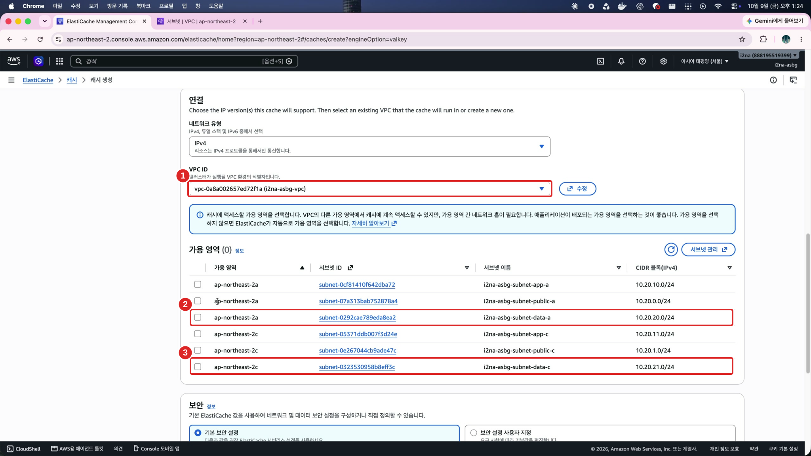](./images/setup/11-valkey-subnet-selection.svg)

- ① VPC가 맞는지 확인한다.
- ② `data-a`를 선택한다.
- ③ `data-c`를 선택한다.

목록의 다른 app/public 서브넷과 혼동하지 않는다.

### 8.2 보안과 사용량 한도 설정하기

1. 보안 설정을 `사용자 지정`으로 바꾼다.
2. 암호화와 액세스 제어를 아래와 같이 설정한다.

   | 항목 | 선택값 |
   |---|---|
   | 암호화 키 | `AWS 소유 키` |
   | 전송 중 암호화 | 활성화된 상태로 사용 |
   | 액세스 제어 | `액세스 제어 없음` |

3. 보안 그룹의 **관리**를 연다. `default` 선택을 해제하고 `i2na-asbg-sg-cache`만 선택한다.

[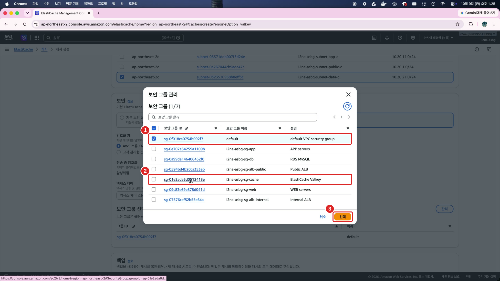](./images/setup/12-valkey-security-group.svg)

- ① `default`의 체크를 해제한다.
- ② `sg-cache`를 체크한다.
- ③ **선택**을 누른다.

사진은 변경 전 화면이다. 이번 실습에서는 `액세스 제어 없음`을 사용했지만, 캐시를 외부에 공개하지 않고 VPC와 `sg-cache`로 APP 접근을 제한했다.

4. 자동 백업과 사용량 한도를 설정한다.

   | 항목 | 실습 설정 |
   |---|---|
   | 자동 백업 | 사용하지 않음 |
   | 최대 데이터 스토리지 | `1 GB` |
   | 최대 ECPU | `1,000 ECPU/초` |
   | 최소 사용량 | 별도로 지정하지 않음 |

5. 검토 후 생성하고 상태가 `사용 가능`으로 바뀌는지 확인한다.

### 8.3 APP에서 사용할 주소 확인하기

생성한 캐시를 열어 기본 엔드포인트와 포트 `6379`를 복사한다. 리더 엔드포인트인 `6380`을 선택하지 않는다.

APP의 캐시 주소는 다음 형식으로 작성한다.

```text
rediss://본인-캐시-DNS:6379
```

- 복사한 주소에 이미 `:6379`가 있으면 포트를 다시 붙이지 않는다.
- `rediss`의 마지막 `s`는 TLS 사용을 뜻하므로 빼지 않는다.
- Redis 호환 클라이언트를 쓰지만, 이번에 생성한 서비스 엔진은 `Valkey`다.

세션을 공유하면 로그인 상태가 특정 APP의 프로세스 메모리에만 묶이지 않는다. 다만 세션 저장소에 연결하지 못하면 로그인 관련 요청도 영향을 받을 수 있다. 캐시를 사용했다는 이유만으로 모든 장애에서 세션이 보장된다고 해석하지 않는다.

<a id="step-9"></a>

## 9. 배포 전에 본인 환경 값 정리하기

이제 네트워크, DB, 캐시가 준비되었다. 다음 단계에서 입력할 값을 본인 메모에 모아 둔다. 비밀번호처럼 비밀 값 자체는 기록하지 않는다.

### 9.1 계정과 네트워크 값

| 적어 둘 값 | 확인할 위치 | 사용하는 곳 |
|---|---|---|
| 계정 ID / 리전 | 우측 계정 메뉴 / `서울` | IAM ARN, 사용자 데이터 |
| VPC ID | VPC 상세 | 생성 화면에서 같은 VPC 선택 |
| `public-a/c` ID | 서브넷 상세 | Public ALB |
| `app-a/c` ID | 서브넷 상세 | Internal ALB, WEB과 APP ASG |
| `data-a/c` ID | 서브넷 상세 | DB 서브넷 그룹, 캐시 |
| 보안 그룹 6개 ID | 보안 그룹 상세 | ALB, 시작 템플릿, RDS, 캐시 |

### 9.2 APP 연결에 사용할 값

| 적어 둘 값 | 확인할 위치 | 사용하는 곳 |
|---|---|---|
| RDS 엔드포인트 | **RDS → 연결 및 보안** | APP의 `DB_HOST` |
| RDS 보안 암호 ARN | **RDS → 마스터 자격 증명 ARN** | APP 역할, `DB_SECRET_ID` |
| 캐시 엔드포인트 | ElastiCache 캐시 상세 | APP의 `REDIS_URL` |

### 9.3 다음 단계로 넘어가기 전 확인

- VPC의 DNS 설정 두 항목이 활성화되어 있고, 서브넷 6개의 CIDR과 AZ가 앞의 표와 맞는다.
- IGW가 VPC에 연결되어 있고 NAT 상태가 `Available`이다.
- `rt-public`, `rt-app`, `rt-data`의 경로와 서브넷 연결이 맞는다.
- RDS와 캐시에 Public ALB용 보안 그룹이나 `default` 그룹을 잘못 연결하지 않았다.
- RDS와 캐시 상태가 `사용 가능`이며, DB 비밀번호 대신 ARN을 준비했다.

다음 작업은 아래 순서로 진행한다.

```text
배포 파일 준비 → EC2 역할 생성 → ALB 생성
→ ALB DNS를 사용자 데이터에 입력 → ASG 생성
```

따라서 아직 EC2를 수동으로 만들 필요는 없다.

<a id="step-10"></a>

## 10. 배포 파일과 공통 세션 키 준비

앞에서 만든 VPC, 보안 그룹, RDS, ElastiCache를 애플리케이션과 연결한다. 필요한 파일은 이 문서 옆의 [source](./source/)에 모아 두었다.

| 구분 | 역할 |
|---|---|
| WEB | Nginx로 화면을 제공하고 API 요청을 전달 |
| APP | Node.js로 로그인과 수강신청을 처리 |

문서의 `i2na-asbg`는 이번 실습에서 사용한 접두사다. 같은 이름을 사용해도 되지만, 아래 값은 반드시 본인 콘솔에서 복사한 값으로 바꾼다.

- 계정 ID와 ARN
- 버킷 이름과 DNS 이름
- 리소스 ID

사진 속 ARN을 그대로 사용하면 다른 계정의 리소스를 가리킨다. 비밀번호와 세션 비밀 값은 문서나 Git에 적지 않는다.

### 10.1 로컬에서 배포 파일 만들기

1. 터미널에서 이 문서가 있는 `이예나` 폴더로 이동한다. 위치는 본인이 내려받은 폴더에 맞춘다. 그다음 `source`로 들어가 배포 파일을 만든다.

   ```bash
   cd source
   node --version
   npm --version
   bash pack.sh
   ```

2. Node.js는 `22` 이상이 필요하다. `command not found`가 나오면 Node.js를 먼저 설치하고, 새 터미널에서 다시 확인한다. 이번 배포의 서버에서는 Node.js `24`를 사용했다.
3. `pack.sh`는 `npm ci --omit=dev`로 APP 의존성을 설치하고 아래 두 파일을 만든다.

   | 결과 파일 | 들어 있는 내용 | 사용하는 서버 |
   |---|---|---|
   | `dist/web.tar.gz` | Nginx 설정, 정적 화면 | WEB |
   | `dist/app.tar.gz` | API 코드, 의존성, systemd 서비스 파일 | APP |

4. 압축 파일 안의 APP 서비스 설정을 확인한다.

   ```bash
   tar -xOf dist/app.tar.gz app/portal-app.service
   ```

   출력에는 아래 세 줄이 있어야 한다. 실제 배포 중 APP 시작 실패를 해결하면서 추가한 `HOME` 설정이다.

   ```ini
   StateDirectory=portal-app
   StateDirectoryMode=0700
   Environment=HOME=/var/lib/portal-app
   ```

`pack.sh`는 `source` 아래의 `build`, `dist`를 새로 만든다. 별도 작업 파일을 이 두 폴더에 두지 않는다.

AWS 사용자 데이터 파일은 압축 파일에 포함하지 않는다. 뒤에서 시작 템플릿에 따로 입력한다.

### 10.2 S3에 배포 파일 올리기

1. **S3 → 범용 버킷 → 버킷 만들기**를 연다.
2. 리전이 `아시아 태평양(서울)`, `ap-northeast-2`인지 확인한다.
3. 아래 값으로 버킷을 생성한다.

   | 항목 | 입력하거나 선택할 값 |
   |---|---|
   | 버킷 유형 | `범용` |
   | 버킷 이름 | `i2na-asbg-artifacts`를 기준으로 본인만의 고유한 이름 |
   | 객체 소유권 | `ACL 비활성화` |
   | 모든 퍼블릭 액세스 차단 | 체크 유지 |
   | 버킷 버전 관리 | 비활성화 |
   | 기본 암호화 | Amazon S3 관리형 키를 사용하는 서버 측 암호화, `SSE-S3` |
   | 나머지 항목 | 기본값 |

   이름이 이미 사용 중이면 자신의 접두사나 숫자를 붙인다. 바꾼 이름은 이후 IAM 정책과 `userdata/*.sh`에도 똑같이 입력한다.

4. 생성한 버킷 이름을 클릭한다. **업로드 → 파일 추가**에서 `web.tar.gz`, `app.tar.gz`를 선택하고 **업로드**한다.
5. **객체** 목록에 두 파일이 있는지 확인한다. 폴더 안이 아니라 버킷 최상위에 있어야 한다.

   ```text
   s3://본인-버킷-이름/web.tar.gz
   s3://본인-버킷-이름/app.tar.gz
   ```

[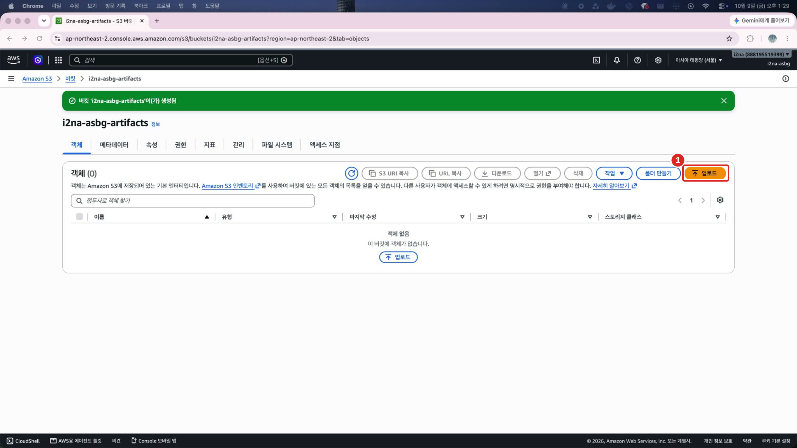](./images/setup/13-deployment-upload.svg)

① 생성한 버킷에서 **업로드**를 누른다. 사진은 파일을 올리기 전 화면이다. 업로드가 끝나면 두 객체가 목록에 있는지 확인한다.

버킷을 공개할 필요는 없다. EC2에 연결할 IAM 역할이 자기 계층의 파일만 읽도록 설정한다.

- S3 게이트웨이 엔드포인트: APP 서브넷의 EC2가 S3로 접근할 경로를 제공한다.
- IAM 정책: 실제 객체를 읽을 권한을 정한다.

### 10.3 모든 APP이 공유할 세션 서명 키 만들기

세션 데이터는 ElastiCache에 저장하고, 브라우저의 세션 쿠키에는 서명을 붙인다. APP마다 서명 키가 다르면 요청이 다른 APP으로 넘어갔을 때 기존 쿠키를 해석하지 못할 수 있다. 그래서 모든 APP이 같은 보안 암호를 읽도록 한다.

1. 로컬 터미널에서 다음 명령을 실행한다.

   ```bash
   openssl rand -hex 32
   ```

2. 출력된 64자리 값을 복사한다. 이 값은 보안 암호에만 입력한다.
3. **Secrets Manager → 보안 암호 → 새 보안 암호 저장**을 연다.
4. 아래 값으로 입력하고 **다음**을 누른다.

   | 항목 | 입력하거나 선택할 값 |
   |---|---|
   | 보안 암호 유형 | `다른 유형의 보안 암호` |
   | 키/값 페어의 키 | `secret` |
   | 키/값 페어의 값 | 방금 만든 64자리 값 |
   | 암호화 키 | `aws/secretsmanager` |
   | 보안 암호 이름 | `i2na-asbg/session-secret` |
   | 자동 교체 | 끔 |

5. 검토 화면에서 **저장**을 누른다.
6. 생성한 보안 암호를 열어 **보안 암호 ARN**을 복사한다. 이름 끝의 임의 문자열까지 포함한 전체 ARN이 필요하다.
7. RDS 상세 화면의 **연결 및 보안 → 마스터 자격 증명 ARN**도 함께 기록한다. 이것은 RDS가 관리하는 DB 로그인 정보의 ARN이다.

[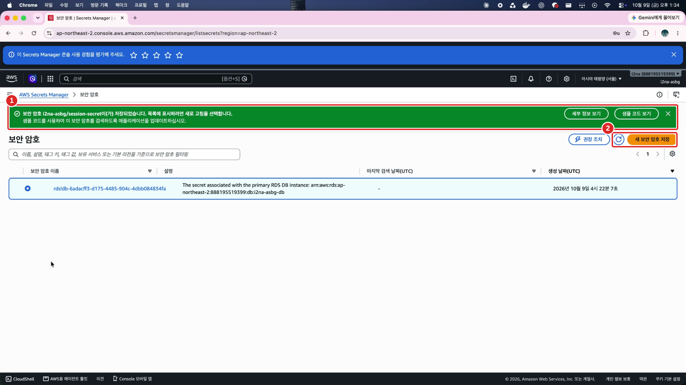](./images/setup/14-session-secret-created.svg)

- ① `i2na-asbg/session-secret` 저장 완료 메시지를 확인한다.
- ② 목록에 바로 보이지 않으면 **새로 고침**을 누른다.

비밀 값을 입력하는 화면은 싣지 않았다.

[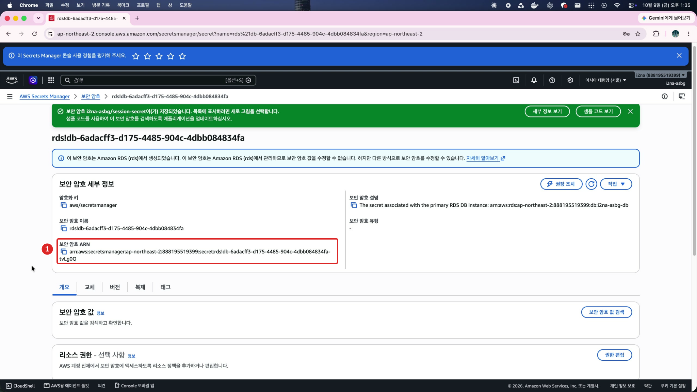](./images/setup/15-database-secret-arn.svg)

① ARN 옆의 **복사** 아이콘을 사용한다. 이 화면의 보안 암호는 RDS가 관리하는 값으로, 앞에서 만든 세션 키와 별개다.

여기까지 끝나면 다음 세 값을 준비한 상태가 된다.

- 배포 버킷 이름
- DB 보안 암호 ARN
- 세션 보안 암호 ARN

세션 이름을 다르게 만들었다면 APP 사용자 데이터의 `SESSION_SECRET_ID`에도 같은 이름을 사용한다.

<a id="step-11"></a>

## 11. WEB과 APP에 각각 IAM 역할 연결하기

EC2 안에 AWS 액세스 키를 저장하는 대신 IAM 역할을 사용했다. 두 역할의 권한은 다음과 같이 나눴다.

| 역할 | 필요한 권한 |
|---|---|
| WEB | WEB 배포 파일 읽기, Session Manager 연결 |
| APP | APP 배포 파일 읽기, Session Manager 연결, DB와 세션의 보안 암호 읽기 |

### 11.1 WEB 역할 만들기

1. **IAM → 역할 → 역할 생성**을 연다.
2. **신뢰할 수 있는 엔터티 유형**에서 `AWS 서비스`를 선택한다.
3. **서비스 또는 사용 사례**에서 `EC2`를 선택하고 **다음**을 누른다.
4. 권한 정책 검색창에서 `AmazonSSMManagedInstanceCore`를 검색하고 체크한다. EC2가 Systems Manager와 통신할 권한이다.
5. 역할 이름을 `i2na-asbg-role-web`으로 입력하고 생성한다.
6. 생성한 역할을 열어 **권한 → 권한 추가 → 인라인 정책 생성 → JSON**을 선택한다.
7. 아래 JSON을 입력한다. `본인-버킷-이름`은 10.2에서 생성한 이름으로 바꾼다.

   ```json
   {
     "Version": "2012-10-17",
     "Statement": [
       {
         "Effect": "Allow",
         "Action": "s3:GetObject",
         "Resource": "arn:aws:s3:::본인-버킷-이름/web.tar.gz"
       }
     ]
   }
   ```

8. 정책 이름을 `i2na-asbg-read-web`으로 저장한다.
9. 권한 목록에 `AmazonSSMManagedInstanceCore`와 `i2na-asbg-read-web`이 있는지 확인한다.

### 11.2 APP 역할 만들기

같은 **IAM → 역할 → 역할 생성** 화면에서 역할을 하나 더 만든다.

1. 신뢰할 수 있는 엔터티는 `AWS 서비스`, 사용 사례는 `EC2`로 선택한다.
2. 관리형 정책 `AmazonSSMManagedInstanceCore`를 연결한다.
3. 역할 이름을 `i2na-asbg-role-app`으로 입력한다.
4. **권한 추가 → 인라인 정책 생성 → JSON**에서 다음을 입력한다. 버킷 이름과 두 ARN은 본인 환경의 값으로 바꾼다.

   ```json
   {
     "Version": "2012-10-17",
     "Statement": [
       {
         "Effect": "Allow",
         "Action": "s3:GetObject",
         "Resource": "arn:aws:s3:::본인-버킷-이름/app.tar.gz"
       },
       {
         "Effect": "Allow",
         "Action": "secretsmanager:GetSecretValue",
         "Resource": [
           "본인-RDS의-마스터-자격-증명-ARN",
           "본인-세션-보안-암호의-전체-ARN"
         ]
       }
     ]
   }
   ```

5. 정책 이름을 `i2na-asbg-read-app`으로 저장한다.
6. APP 역할의 권한 목록과 **신뢰 관계**를 확인한다. 신뢰 관계에는 서비스 `ec2.amazonaws.com`과 `sts:AssumeRole`이 있어야 한다.

[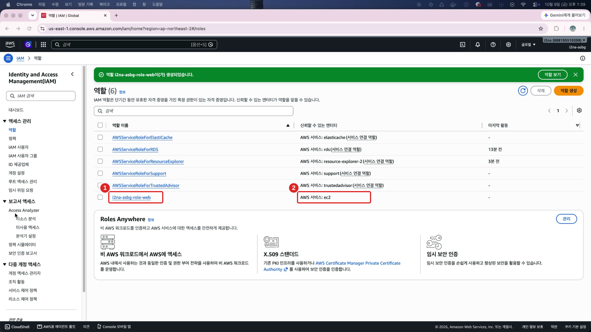](./images/setup/16-ec2-iam-role.svg)

- ① WEB 역할 이름을 확인한다.
- ② 신뢰할 수 있는 엔터티가 `AWS 서비스: ec2`인지 확인한다.

목록의 역할을 열어 SSM 관리형 정책과 각 역할의 인라인 정책을 추가한다.

#### ARN과 인스턴스 프로파일 확인

정책 원본은 [role-web.json](./source/policies/role-web.json), [role-app.json](./source/policies/role-app.json)에 있다.

- S3 ARN에는 계정 ID가 들어가지 않는다.
- Secrets Manager ARN에는 계정 ID와 리전이 들어간다. 숫자만 바꾸기보다 본인 콘솔에서 전체 ARN을 복사하는 편이 정확하다.

콘솔에서 EC2용 역할을 만들면 같은 이름의 인스턴스 프로파일도 만들어진다. 뒤의 시작 템플릿에서는 **IAM 인스턴스 프로파일**에 이 이름을 선택한다.

목록에 역할이 보이지 않으면 먼저 새로 고침하고, 역할의 사용 사례가 `EC2`인지 확인한다. [AWS 인스턴스 프로파일 설명](https://docs.aws.amazon.com/IAM/latest/UserGuide/id_roles_use_switch-role-ec2_instance-profiles.html)

### 11.3 로그인한 사용자와 EC2 역할의 권한 구분하기

다음 작업에서 `AccessDenied`가 나오면 현재 콘솔에 로그인한 사용자의 권한을 확인한다.

- IAM 역할 생성
- 인라인 정책 저장
- `iam:PassRole`
- Session Manager 접속

EC2 역할에 SSM 정책을 붙였다고 사용자에게 접속 권한까지 생기는 것은 아니다.

이번 실습에서는 필요한 역할과 인스턴스로 범위를 좁힌 [operator-extra.json](./source/policies/operator-extra.json)을 보충 권한으로 사용했다. 이 파일은 기존 실습 권한에서 부족한 IAM과 Session Manager 작업을 보완한다. 이 파일 하나만으로 VPC와 RDS 등 모든 리소스를 생성할 수 있는 것은 아니다.

적용하기 전에 아래 항목을 구분한다.

| 구분 | 해당 값 |
|---|---|
| 본인 환경에 맞게 바꿀 값 | 계정 ID, 사용자 이름, 리전, 역할 이름, EC2 `Name` 태그. ARN에 직접 적힌 계정 ID와 리소스 이름도 포함 |
| 그대로 둘 정책 변수 | `${aws:username}`, `${aws:userid}` |

정책 변수는 AWS가 요청 시 해석하므로 실제 사용자 이름이나 ID로 바꾸지 않는다.

권한 변경이 필요하면 해당 계정의 권한 관리자가 정책을 연결해야 한다. 오류 메시지에 나온 작업 이름과 대상 ARN을 기준으로 부족한 권한을 보완한다. 문제를 우회하려고 EC2에 관리자 권한이나 장기 액세스 키를 넣지 않는다.

<a id="step-12"></a>

## 12. 대상 그룹 두 개와 ALB 두 개 만들기

인터넷에서 들어오는 요청과 WEB이 APP으로 전달하는 요청의 입구를 나눴다. 요청은 아래 순서로 이동한다.

```text
Public ALB → WEB → Internal ALB → APP
```

대상 그룹은 각 ALB가 어느 EC2의 어느 포트로 요청을 보낼지 정한다. 먼저 APP과 WEB 대상 그룹을 만든 뒤, 각각 연결할 ALB를 생성한다.

### 12.1 APP 대상 그룹 만들기

**EC2 → 로드 밸런싱 → 대상 그룹 → 대상 그룹 생성**을 연다.

#### 기본 구성과 상태 검사

1. **대상 유형**에서 `인스턴스`를 선택한다.
2. 기본 구성을 입력한다.

   | 항목 | APP 대상 그룹 값 |
   |---|---|
   | 대상 그룹 이름 | `i2na-asbg-tg-app` |
   | 프로토콜 / 포트 | `HTTP` / `8080` |
   | IP 주소 유형 | `IPv4` |
   | VPC | `i2na-asbg-vpc` |
   | 프로토콜 버전 | `HTTP1` |

3. 상태 검사를 설정한다.

   | 항목 | APP 상태 검사 값 |
   |---|---|
   | 상태 검사 프로토콜 | `HTTP` |
   | 상태 검사 경로 | `/health` |
   | 고급 상태 검사: 포트 | `트래픽 포트` |
   | 정상 / 비정상 임계값 | `3` / `2` |
   | 제한 시간 / 간격 | `5초` / `10초` |
   | 성공 코드 | `200` |

4. 다음 화면의 **대상 등록**은 비워 둔 채 대상 그룹을 생성한다. 인스턴스는 나중에 ASG가 등록한다.

#### 생성 후 속성 변경

생성한 그룹을 열어 **속성 → 편집**에서 아래 값을 설정하고 저장한다.

| 항목 | 설정값 |
|---|---|
| 등록 취소 지연 | `30초` |
| 로드 밸런싱 알고리즘 | `라운드 로빈` |
| 고정 세션 | `끔` |

### 12.2 WEB 대상 그룹 만들기

같은 **대상 그룹 생성** 화면에서 WEB 대상 그룹을 만든다. VPC, 상태 검사, 등록 취소 지연, 고정 세션도 빠뜨리지 않고 설정한다.

#### 기본 구성

| 항목 | WEB 대상 그룹 값 |
|---|---|
| 대상 유형 | `인스턴스` |
| 이름 | `i2na-asbg-tg-web` |
| 프로토콜 / 포트 | `HTTP` / `80` |
| IP 주소 유형 / 프로토콜 버전 | `IPv4` / `HTTP1` |
| VPC | `i2na-asbg-vpc` |

#### 상태 검사와 속성

| 항목 | WEB 대상 그룹 값 |
|---|---|
| 상태 검사 프로토콜 / 포트 | `HTTP` / `트래픽 포트` |
| 상태 검사 경로 / 성공 코드 | `/health` / `200` |
| 정상 / 비정상 임계값 | `3` / `2` |
| 제한 시간 / 간격 | `5초` / `10초` |
| 등록 취소 지연 | `30초` |
| 알고리즘 / 고정 세션 | `라운드 로빈` / `끔` |

APP과 마찬가지로 대상 등록은 비워 두고 생성한다. 생성 후 **속성 → 편집**에서 등록 취소 지연과 알고리즘, 고정 세션을 확인한다.

[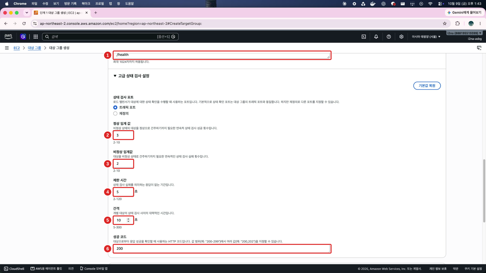](./images/setup/17-app-target-health-check.svg)

- ① 상태 검사 경로: `/health`
- ② 정상 임계값: `3회`
- ③ 비정상 임계값: `2회`
- ④ 제한 시간: `5초`
- ⑤ 간격: `10초`
- ⑥ 성공 코드: `200`

WEB의 상태 검사 간격은 생성 당시 `30초`였고, 이후 변경 여부는 확인하지 못했다. 다시 구축할 때는 위 표처럼 APP과 같은 `10초`로 설정한다. 기존 환경을 점검할 때는 WEB 대상 그룹의 **상태 검사** 탭에서 현재 간격을 확인한다.

#### `Healthy`와 실제 API 응답을 함께 확인하는 이유

`/health`는 프로세스가 HTTP 응답을 할 수 있는지 확인하는 간단한 경로다. 여기에는 DB와 캐시 조회를 넣지 않았다. APP이 실행 중일 때 DB나 캐시에 일시적인 문제가 생겼다는 이유로 모든 APP이 한꺼번에 교체되지 않게 하기 위해서다.

따라서 상태가 `Healthy`여도 실제 로그인과 조회 요청은 따로 확인한다. APP 시작 시에는 DB와 캐시에 먼저 연결하므로, 초기 연결 자체가 실패하면 포트가 열리지 않는다.

### 12.3 Internal ALB 만들기

**EC2 → 로드 밸런서 → 로드 밸런서 생성 → Application Load Balancer → 생성**을 연다.

#### 기본 구성과 네트워크

| 항목 | 입력하거나 선택할 값 |
|---|---|
| 이름 | `i2na-asbg-alb-internal` |
| 체계 | `내부(Internal)` |
| IP 주소 유형 | `IPv4` |
| VPC | `i2na-asbg-vpc` |
| 가용 영역 1 / 서브넷 | `ap-northeast-2a` / `i2na-asbg-subnet-app-a` |
| 가용 영역 2 / 서브넷 | `ap-northeast-2c` / `i2na-asbg-subnet-app-c` |

#### 보안 그룹과 리스너

| 항목 | 입력하거나 선택할 값 |
|---|---|
| 보안 그룹 | `i2na-asbg-sg-alb-internal`만 선택. 자동 선택된 `default`는 제거 |
| 리스너 | `HTTP` / `80` |
| 기본 작업 | `i2na-asbg-tg-app`으로 전달 |
| 선택 기능과 추가 서비스 | 추가하지 않음 |

[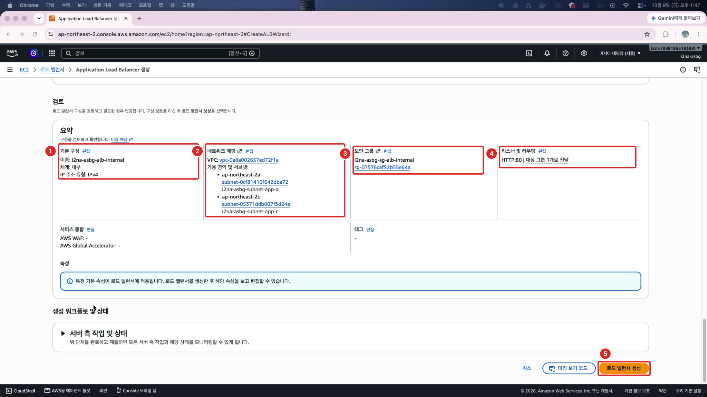](./images/setup/18-internal-alb-creation.svg)

- ① 체계가 `내부`인지 확인한다.
- ② VPC와 `app-a`, `app-c`를 확인한다.
- ③ Internal ALB 보안 그룹을 확인한다.
- ④ `HTTP:80` 리스너와 APP 대상 그룹으로 전달하는 설정을 확인한다.
- ⑤ **생성**을 누른다.

#### 생성 후 확인과 DNS 복사

1. 입력값을 확인하고 **로드 밸런서 생성**을 누른다.
2. ALB 상세 화면에서 상태가 `활성(Active)`으로 바뀌는지 확인한다.
3. 세부 정보의 **DNS 이름**을 복사한다. `internal-`로 시작하는 이름이다.
4. **리스너 및 규칙**에서 `HTTP:80`의 기본 전달 대상이 APP 대상 그룹인지 확인한다.

복사한 DNS는 WEB 사용자 데이터의 `APP_ALB`에 넣는다. `http://`와 끝의 `/` 없이 DNS 이름만 기록한다.

Internal ALB는 VPC 내부에서 사용한다. 로컬 브라우저에서 직접 열리지 않는다는 이유만으로 고장이라고 판단하지 않는다.

[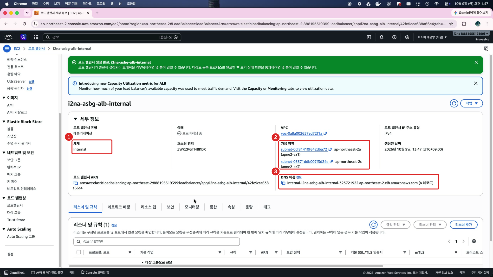](./images/setup/19-internal-alb-details.svg)

- ① 체계가 `Internal`인지 확인한다.
- ② 두 AZ의 app 서브넷이 연결되어 있는지 확인한다.
- ③ 내부 DNS를 복사한다.

사진은 생성 직후라 상태가 `프로비저닝 중`이다. 이후 `Active`로 바뀌는지 확인한다.

### 12.4 Public ALB 만들기

같은 화면에서 **Application Load Balancer**를 하나 더 만든다.

#### 기본 구성과 네트워크

| 항목 | 입력하거나 선택할 값 |
|---|---|
| 이름 | `i2na-asbg-alb-public` |
| 체계 | `인터넷 경계(Internet-facing)` |
| IP 주소 유형 | `IPv4` |
| VPC | `i2na-asbg-vpc` |
| 가용 영역 1 / 서브넷 | `ap-northeast-2a` / `i2na-asbg-subnet-public-a` |
| 가용 영역 2 / 서브넷 | `ap-northeast-2c` / `i2na-asbg-subnet-public-c` |

#### 보안 그룹과 리스너

| 항목 | 입력하거나 선택할 값 |
|---|---|
| 보안 그룹 | `i2na-asbg-sg-alb-public`만 선택 |
| 리스너 | `HTTP` / `80` |
| 기본 작업 | `i2na-asbg-tg-web`으로 전달 |
| 선택 기능과 추가 서비스 | 추가하지 않음 |

[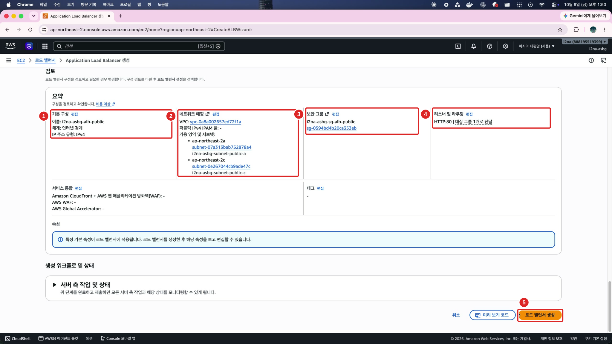](./images/setup/20-public-alb-creation.svg)

- ① 체계가 `인터넷 경계`인지 확인한다.
- ② VPC와 `public-a`, `public-c`를 확인한다.
- ③ Public ALB 보안 그룹을 확인한다.
- ④ `HTTP:80` 리스너를 확인한다.
- ⑤ **생성**을 누른다.

#### 생성 후 확인과 DNS 복사

1. 상태가 `활성`인지 확인한다.
2. `HTTP:80` 리스너와 WEB 대상 그룹 연결을 확인한다.
3. DNS 이름을 복사한다. 브라우저에서는 아래 주소를 사용한다.

   ```text
   http://본인-Public-ALB-DNS
   ```

아직 WEB을 만들지 않았으므로 이 단계에서 `503`이 나와도 이상하지 않다.

[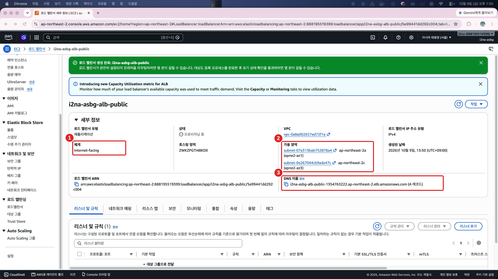](./images/setup/21-public-alb-details.svg)

- ① 체계가 `Internet-facing`인지 확인한다.
- ② 두 AZ의 public 서브넷이 연결되어 있는지 확인한다.
- ③ 브라우저에서 사용할 DNS를 복사한다.

Internal ALB의 DNS와 혼동하지 않는다.

이번 구현은 동작 확인을 위한 `HTTP` 구성이며 HTTPS 인증서는 연결하지 않았다. 실제 운영에는 도메인, ACM 인증서, HTTPS 리스너를 추가하고 HTTP에서 HTTPS로 전환해야 한다. 세션 쿠키의 `Secure` 속성도 함께 조정해야 한다.

<a id="step-13"></a>

## 13. 시작 템플릿에 서버 설치 방법 저장하기

시작 템플릿에는 EC2의 AMI, 크기, 보안 그룹, 역할, 부팅 스크립트를 넣는다. 이 설정이 있어야 장애로 서버가 교체되거나 수가 늘어날 때 같은 애플리케이션이 자동으로 설치된다.

### 13.1 사용자 데이터에 본인 환경 값 입력

먼저 [APP 사용자 데이터](./source/userdata/app.sh)와 [WEB 사용자 데이터](./source/userdata/web.sh)를 에디터에서 연다. 두 파일의 `BUCKET`에는 S3 버킷 목록에서 확인한 **배포 파일을 올린 버킷 이름**을 넣는다.

#### APP에 넣을 값

| 변수 | 넣을 값 | 복사하는 위치 |
|---|---|---|
| `DB_HOST` | RDS 엔드포인트, 포트 제외 | **RDS → DB → 연결 및 보안** |
| `DB_SECRET_ID` | DB 마스터 자격 증명 전체 ARN | **RDS → 연결 및 보안** |
| `REDIS_URL` | `rediss://캐시-DNS:6379` | **ElastiCache → 캐시 상세** |
| `SESSION_SECRET_ID` | `i2na-asbg/session-secret` 또는 자신이 만든 이름 | **Secrets Manager** |

#### WEB에 넣을 값

| 변수 | 넣을 값 | 복사하는 위치 |
|---|---|---|
| `APP_ALB` | Internal ALB DNS 이름 | **EC2 → 로드 밸런서 → Internal ALB** |

주소를 붙여 넣을 때는 다음을 확인한다.

- 캐시는 TLS 연결을 뜻하는 `rediss://`와 기본 포트 `6379`를 사용한다. 복사한 주소에 이미 `:6379`가 있으면 포트를 한 번만 적는다.
- `DB_HOST`와 `APP_ALB`에는 `http://`, `https://`, `/`, 포트 번호를 넣지 않는다.
- DB 보안 암호 ARN에는 느낌표가 포함될 수 있으므로 작은따옴표로 감싼다.

#### APP 사용자 데이터

아래 `본인-...` 자리를 본인 환경 값으로 바꾼 뒤 사용한다.

```bash
#!/bin/bash
set -euo pipefail

BUCKET='본인-버킷-이름'
DB_HOST='본인-RDS-엔드포인트'
DB_SECRET_ID='본인-RDS-마스터-자격-증명-ARN'
REDIS_URL='rediss://본인-캐시-엔드포인트:6379'

dnf install -y nodejs24
mkdir -p /srv/portal
aws s3 cp "s3://$BUCKET/app.tar.gz" /tmp/app.tar.gz --region ap-northeast-2
tar -xzf /tmp/app.tar.gz -C /srv/portal --no-same-owner

cat > /etc/portal-app.env <<ENV
AWS_REGION=ap-northeast-2
DB_HOST=$DB_HOST
DB_SECRET_ID=$DB_SECRET_ID
SESSION_SECRET_ID=i2na-asbg/session-secret
REDIS_URL=$REDIS_URL
ENV

cp /srv/portal/app/portal-app.service /etc/systemd/system/
systemctl daemon-reload
systemctl enable --now portal-app
```

APP 스크립트의 실행 순서는 다음과 같다.

```text
Node.js 설치 → S3 파일 다운로드 → 환경 설정 저장 → systemd 서비스 시작
```

DB 비밀번호와 세션 키 값 자체는 스크립트에 넣지 않는다. APP이 시작되면서 EC2 역할로 Secrets Manager에서 읽는다.

#### WEB 사용자 데이터

```bash
#!/bin/bash
set -euo pipefail

BUCKET='본인-버킷-이름'
APP_ALB='본인-Internal-ALB-DNS'

dnf install -y nginx
mkdir -p /srv/portal
aws s3 cp "s3://$BUCKET/web.tar.gz" /tmp/web.tar.gz --region ap-northeast-2
tar -xzf /tmp/web.tar.gz -C /srv/portal --no-same-owner

TOKEN=$(curl -sX PUT http://169.254.169.254/latest/api/token -H "X-aws-ec2-metadata-token-ttl-seconds: 60")
meta() { curl -sH "X-aws-ec2-metadata-token: $TOKEN" "http://169.254.169.254/latest/meta-data/$1"; }
WEB_INSTANCE="$(meta instance-id) $(meta placement/availability-zone)"

sed -e "s|__APP_ALB__|$APP_ALB|" -e "s|__WEB_INSTANCE__|$WEB_INSTANCE|" \
  /srv/portal/web/nginx.conf > /etc/nginx/nginx.conf
systemctl enable --now nginx
```

WEB은 IMDSv2로 자신의 인스턴스 ID와 AZ를 읽어 응답 헤더에 넣고, Nginx 설정의 Internal ALB 자리도 채운다. Nginx는 `/api/` 요청을 Internal ALB로 전달하고 나머지 요청에는 화면을 제공한다.

두 스크립트 모두 NAT 경로를 통해 패키지 저장소 등에 접속한다. 실행하기 전에 앞 단계의 라우팅을 완성해 둔다.

### 13.2 APP 시작 템플릿 생성

**콘솔 경로: EC2 → 인스턴스 → 시작 템플릿 → 시작 템플릿 생성**

#### 이름과 EC2 기본 설정

| 항목 | 입력값 |
|---|---|
| 시작 템플릿 이름 | `i2na-asbg-lt-app` |
| 템플릿 버전 설명 | 예: `APP 초기 배포` |
| Auto Scaling 지침 | 체크 |
| AMI | Amazon Linux 2023, 64비트 x86_64, 일반 AMI |
| 인스턴스 유형 | `t3.micro` |
| 키 페어 | 시작 템플릿에 포함하지 않음 |
| 서브넷 | 시작 템플릿에 포함하지 않음 |
| 방화벽 | 기존 보안 그룹 → `i2na-asbg-sg-app` |
| 스토리지 | 루트 EBS `8 GiB`, `gp3`, **종료 시 삭제** 켬 |

#### 고급 세부 정보

기본 설정을 입력한 뒤 **고급 세부 정보**를 펼친다.

| 항목 | 입력값 |
|---|---|
| IAM 인스턴스 프로파일 | `i2na-asbg-role-app` |
| 메타데이터 액세스 | **활성화** |
| 메타데이터 버전 | **V2만(토큰 필수)** |
| 메타데이터 응답 홉 제한 | `2` |
| 사용자 데이터 | 13.1에서 본인 값으로 수정한 APP 스크립트 전체 |
| 사용자 데이터 Base64 인코딩 여부 | 직접 스크립트를 붙이므로 인코딩된 데이터로 지정하지 않음 |

설정을 확인한 뒤 **시작 템플릿 생성**을 누른다.

#### AMI와 네트워크 설정에서 확인할 점

이번 실습에서 사용한 AMI는 `ami-0870825cefcaafcc8`이었다. AMI ID는 리전과 시점에 따라 달라지므로 새로 따라 할 때는 이 ID를 고정해서 검색하기보다 현재 서울 리전의 **Amazon Linux 2023 x86_64 일반 이미지**를 선택한다. `minimal` 이미지에는 이 스크립트가 전제하는 도구가 없을 수 있다.

같은 템플릿으로 `2a`와 `2c`에 서버를 만들기 위해 서브넷을 템플릿에 고정하지 않는다. 퍼블릭 IP를 연결하는 별도 네트워크 인터페이스 설정도 추가하지 않는다. 인스턴스 배치는 다음 ASG 단계에서 정한다.

### 13.3 WEB 시작 템플릿 생성

아래 차이만 적용하고 나머지 공통 설정은 APP과 동일하게 입력한다.

| 항목 | WEB 값 |
|---|---|
| 템플릿 이름 | `i2na-asbg-lt-web` |
| 버전 설명 | 예: `WEB 초기 배포` |
| 보안 그룹 | `i2na-asbg-sg-web` |
| IAM 인스턴스 프로파일 | `i2na-asbg-role-web` |
| 사용자 데이터 | 본인 값으로 수정한 WEB 스크립트 전체 |

표에 별도로 적지 않은 선택 기능은 기본값을 유지한다. 스팟 인스턴스 요청, 전용 호스트, 추가 네트워크 인터페이스는 사용하지 않는다.

두 템플릿을 만든 뒤에는 각각 **버전 → 버전 1 선택**을 열어 다음을 확인한다.

- AMI와 인스턴스 유형 `t3.micro`가 맞는가.
- APP과 WEB의 보안 그룹과 IAM 인스턴스 프로파일을 바꾸어 연결하지 않았는가.
- 사용자 데이터에 본인 환경 값을 넣었고, 스크립트 끝부분까지 입력됐는가.

#### WEB 템플릿을 만드는 화면 순서

[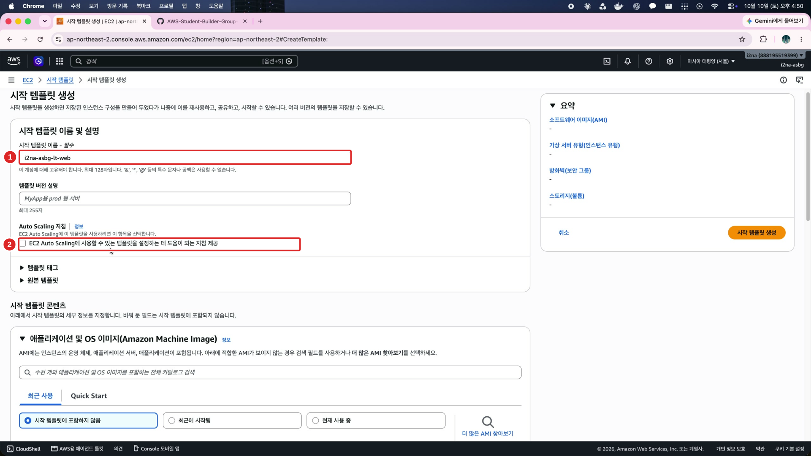](./images/setup/25-web-template-name.svg)

- ① 이름을 넣는다.
- ② **Auto Scaling 안내**를 체크한다. 사진은 체크 전이다.

나머지 설정까지 마친 뒤 생성한다.

[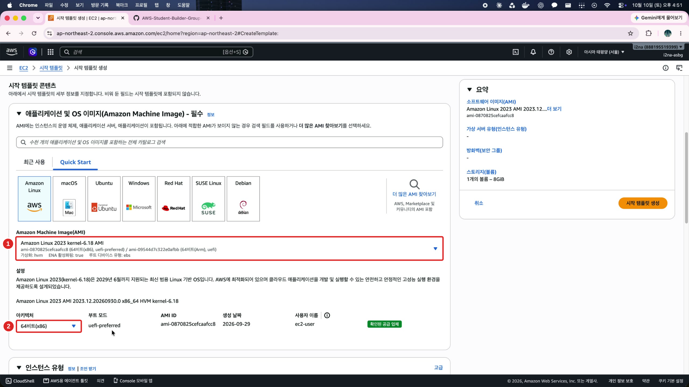](./images/setup/26-web-template-ami.svg)

- ① **Amazon Linux 2023 일반 이미지**를 선택한다.
- ② **x86 아키텍처**를 선택한다.

다음 인스턴스 유형은 표의 `t3.micro`로 설정한다.

[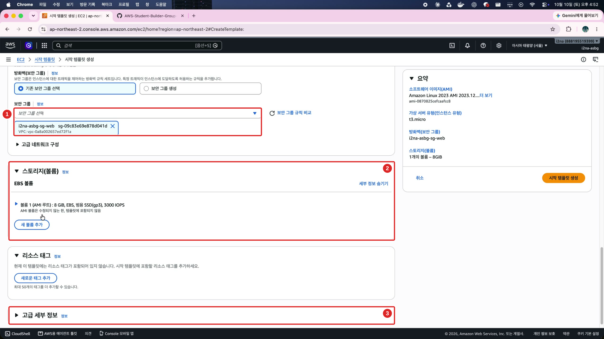](./images/setup/27-web-template-security-storage.svg)

- ① `i2na-asbg-sg-web`을 선택한다. APP 템플릿에서는 `i2na-asbg-sg-app`을 선택한다.
- ② 루트 볼륨이 `8 GiB`, `gp3`인지 확인한다.
- ③ **고급 세부 정보**를 펼친다.

[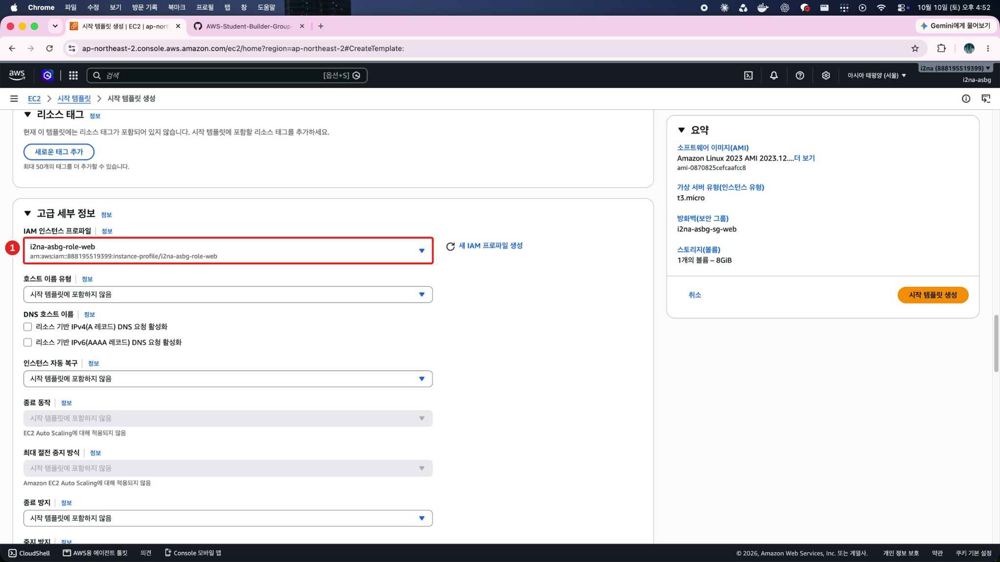](./images/setup/28-web-template-iam-role.svg)

① WEB에는 `i2na-asbg-role-web`, APP에는 `i2na-asbg-role-app`을 선택한다.

[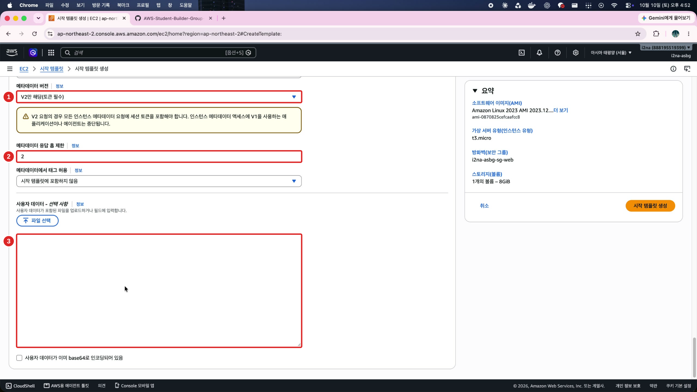](./images/setup/29-web-template-imdsv2.svg)

- ① **V2만**을 선택한다.
- ② 홉 제한은 `2`로 입력한다.
- ③ **사용자 데이터**에 수정한 스크립트를 붙여 넣는다. 사진의 입력칸은 아직 비어 있다.

[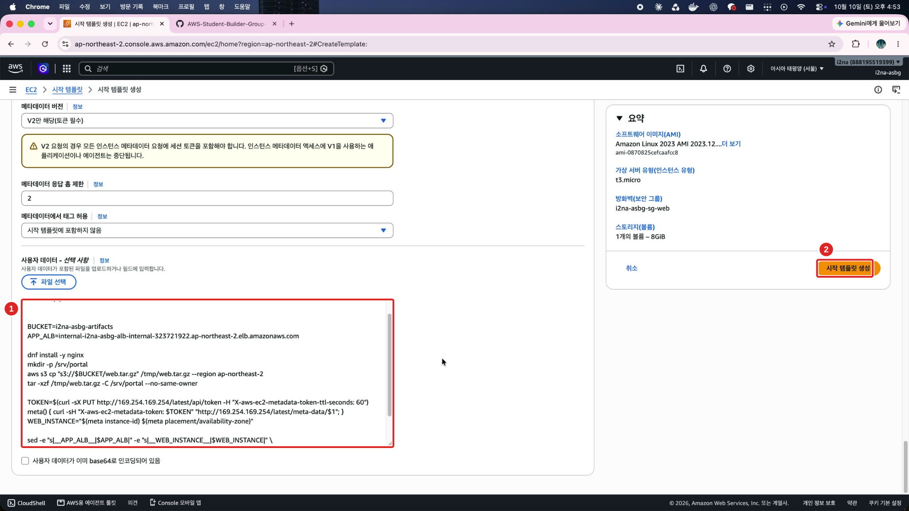](./images/setup/30-web-template-user-data.svg)

- ① 본인 버킷과 Internal ALB DNS를 넣은 스크립트 전체인지 확인한다.
- ② **생성**을 누른다.

복사할 코드는 위 코드 블록 또는 첨부한 `.sh` 파일을 사용한다.

<a id="step-14"></a>

## 14. Auto Scaling 그룹과 요청 수 기반 정책 만들기

APP 그룹을 먼저 만들고 APP 두 대가 정상 상태가 된 뒤 WEB 그룹을 만든다. WEB도 인터넷에 직접 노출되지 않으므로 두 그룹 모두 private APP 서브넷에 배치한다.

```text
APP ASG 생성 → APP Healthy 2대 확인 → WEB ASG 생성 → WEB Healthy 2대 확인
```

### 14.1 APP Auto Scaling 그룹

**콘솔 경로: EC2 → Auto Scaling → Auto Scaling 그룹 → Auto Scaling 그룹 생성**

1. **시작 템플릿 선택**에서 다음 값을 입력한다.

   | 항목 | 값 |
   |---|---|
   | 그룹 이름 | `i2na-asbg-asg-app` |
   | 시작 템플릿 | `i2na-asbg-lt-app` |
   | 버전 | 방금 확인한 버전 `1` |

   이번 실습 화면에서는 기본 버전 `Default`가 버전 `1`을 가리켰다. 재현할 때는 실제로 사용할 버전을 확인한다. 나중에 새 템플릿 버전을 만들어도 기존 ASG에 자동으로 적용되는 것은 아니다.

2. **인스턴스 시작 옵션**에서 VPC `i2na-asbg-vpc`와 두 서브넷 `i2na-asbg-subnet-app-a`, `i2na-asbg-subnet-app-c`를 선택한다. 가용 영역 분산은 **균형 잡힌 최선 노력**을 사용한다.
3. **다른 서비스와 통합 → 기존 로드 밸런서에 연결 → 로드 밸런서 대상 그룹에서 선택**으로 들어가 `i2na-asbg-tg-app`을 선택한다.
4. **상태 확인**에서 EC2 기본 상태 확인에 더해 **Elastic Load Balancing 상태 확인 켜기**를 체크한다. **상태 확인 유예 기간**은 `180`초로 입력한다.
5. **그룹 크기 및 크기 조정**에서 아래 값을 입력한다.

   | 항목 | 값 |
   |---|---|
   | 원하는 용량 | `2` |
   | 최소 용량 | `2` |
   | 최대 용량 | `6` |

   이어서 요청 수 기반 정책을 입력한다.

   | 정책 항목 | 값 |
   |---|---|
   | 크기 조정 정책 | **대상 추적 크기 조정** |
   | 정책 이름 | `i2na-asbg-policy-app` |
   | 지표 유형 | **대상당 Application Load Balancer 요청 수** |
   | 대상 그룹 | `i2na-asbg-tg-app`(Internal ALB 연결) |
   | 대상 값 | `600` |
   | 인스턴스 워밍업 | `120`초 |
   | 축소 비활성화 | 체크하지 않음. 축소 활성 상태 유지 |

6. 생성 화면에서 정책을 입력하지 않았다면 ASG를 먼저 만든 뒤 14.3의 방법으로 정책을 따로 추가한다.
7. 이 실습에서는 **알림 추가**를 건너뛴다. 태그의 키는 `Name`, 값은 `i2na-asbg-ec2-app`으로 넣고 **새 인스턴스에 태그 지정**을 체크한다.
8. 검토 후 **Auto Scaling 그룹 생성**을 누른다.
9. 그룹의 **인스턴스 관리**에서 인스턴스 두 대가 생기고 `InService`가 되는지 확인한다.
10. **EC2 → 대상 그룹 → `i2na-asbg-tg-app` → 대상**에서 두 대 모두 `Healthy`가 되는지 확인한다. 초기 패키지 설치와 애플리케이션 시작에 시간이 걸린다.

**ELB 상태 확인을 켜는 이유**

EC2가 켜져 있어도 APP 프로세스가 응답하지 않을 수 있다. ELB 상태 확인을 켜야 ASG가 이 인스턴스를 교체 대상으로 판단할 수 있다.

ALB는 장애 대상을 요청 분산에서 제외하고, ASG는 인스턴스를 교체한다. 두 역할을 구분해서 확인한다. [AWS ASG 상태 확인 설명](https://docs.aws.amazon.com/autoscaling/ec2/userguide/health-checks-overview.html)

### 14.2 WEB Auto Scaling 그룹

같은 생성 화면에서 다음 값으로 설정한다. 특히 지표 유형은 APP과 동일한 **대상당 ALB 요청 수**를 선택한다.

#### 그룹과 인스턴스 배치

| 항목 | WEB 값 |
|---|---|
| 그룹 이름 | `i2na-asbg-asg-web` |
| 시작 템플릿 / 버전 | `i2na-asbg-lt-web` / 확인한 버전 `1` |
| VPC | `i2na-asbg-vpc` |
| 서브넷 | `i2na-asbg-subnet-app-a`, `i2na-asbg-subnet-app-c` |
| 가용 영역 분산 | 균형 잡힌 최선 노력 |
| 연결할 대상 그룹 | `i2na-asbg-tg-web` |
| 상태 확인 | ELB 상태 확인 켬, 유예 기간 `180`초 |
| 원하는 / 최소 / 최대 용량 | `2` / `2` / `4` |
| 태그 | `Name` = `i2na-asbg-ec2-web`, **새 인스턴스에 태그 지정** 체크 |

#### WEB 요청 수 기반 정책

| 정책 항목 | WEB 값 |
|---|---|
| 정책 유형 / 이름 | **대상 추적** / `i2na-asbg-policy-web` |
| 지표 유형 | **대상당 Application Load Balancer 요청 수** |
| 대상 그룹 | `i2na-asbg-tg-web`(Public ALB 연결) |
| 대상 값 | `1200` |
| 인스턴스 워밍업 | `120`초 |
| 축소 | 활성 |

생성 후에는 다음 세 가지를 확인한다.

- WEB 그룹의 인스턴스 두 대가 `InService`인가.
- WEB 대상 그룹의 두 대가 `Healthy`인가.
- EC2 두 대가 서로 다른 AZ에 배치됐는가.

#### WEB ASG를 만드는 화면 순서

[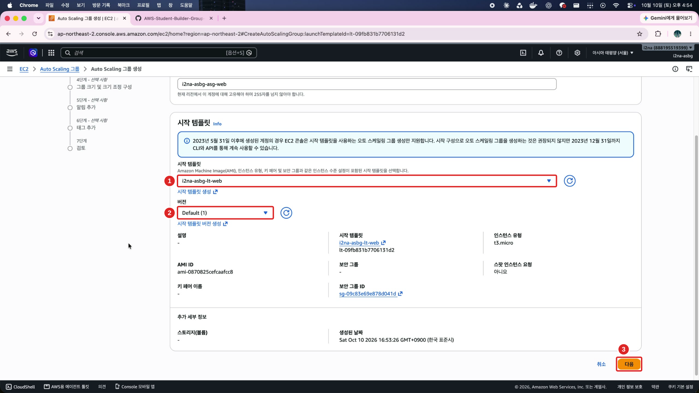](./images/setup/31-web-asg-template.svg)

WEB 그룹을 생성하는 사진이다.

- ① 시작 템플릿 `i2na-asbg-lt-web`을 확인한다. APP은 `i2na-asbg-lt-app`을 고른다.
- ② 버전을 확인한다.
- ③ **다음**을 누른다.

[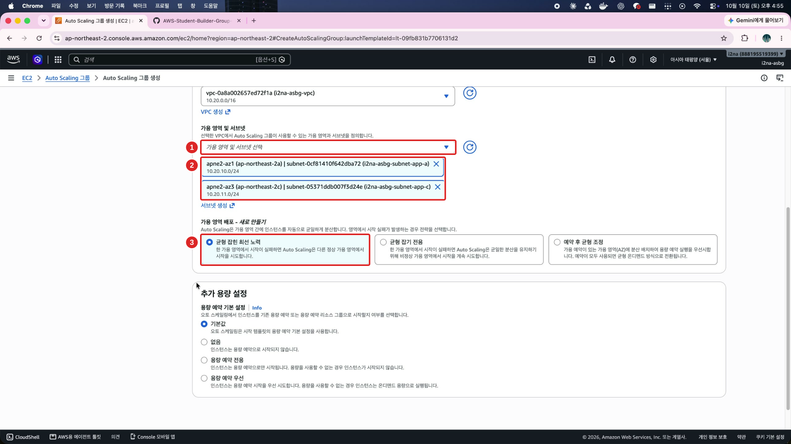](./images/setup/32-web-asg-subnets.svg)

- ① **서브넷 목록**을 연다.
- ② `i2na-asbg-subnet-app-a`와 `i2na-asbg-subnet-app-c`를 선택한다.
- ③ **균형 잡힌 최선 노력**을 선택한다.

WEB과 APP 모두 같은 두 private 서브넷을 사용한다.

[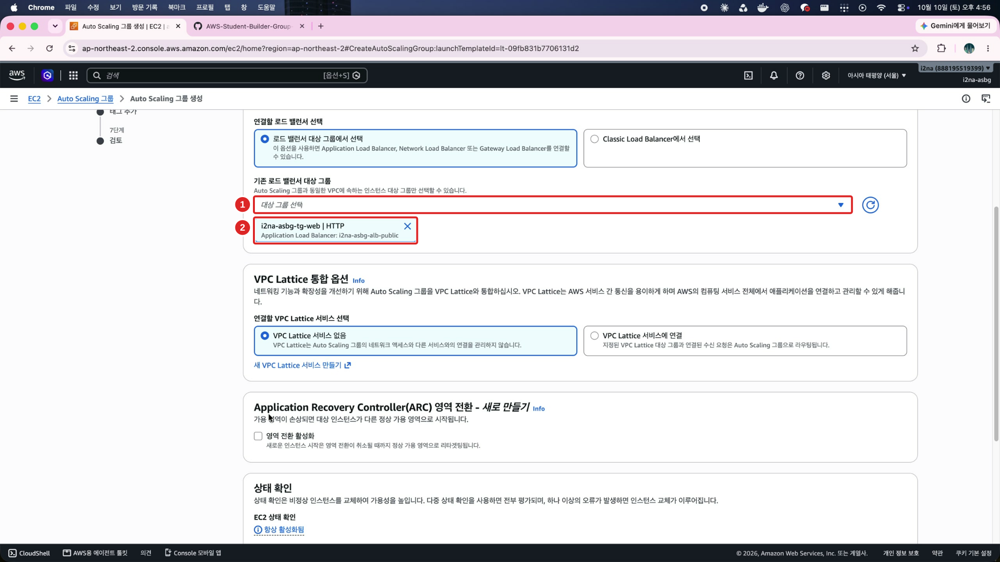](./images/setup/33-web-asg-target-group.svg)

- ① **기존 대상 그룹**을 선택한다.
- ② `i2na-asbg-tg-web`과 Public ALB 연결을 확인한다. APP은 `i2na-asbg-tg-app`과 Internal ALB를 선택한다.

[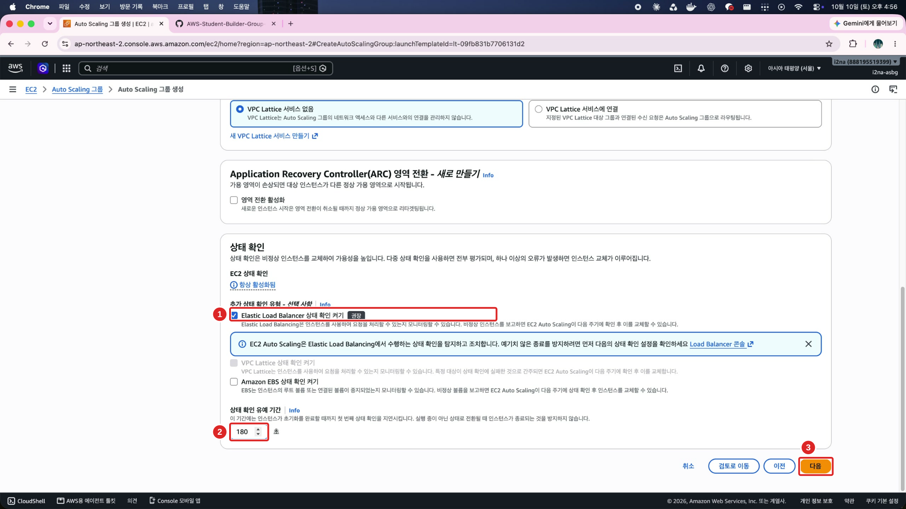](./images/setup/34-web-asg-health-check.svg)

- ① **ELB 상태 확인**을 체크한다.
- ② 유예 기간 `180`초를 입력한다.
- ③ **다음**을 누른다.

WEB과 APP 모두 같은 설정이다.

[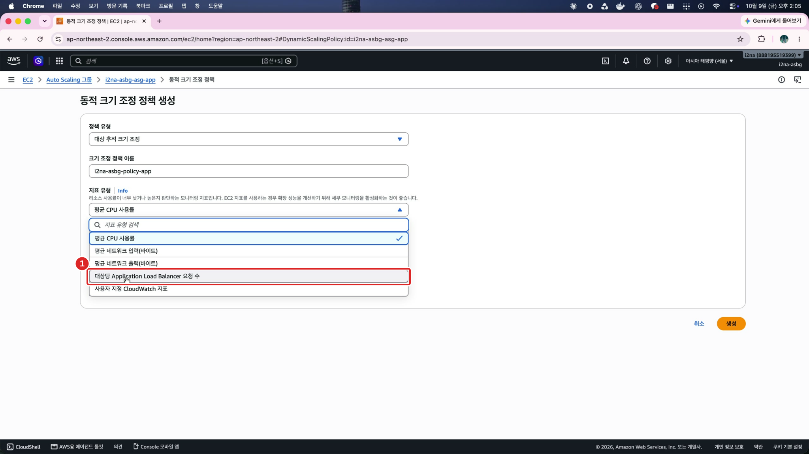](./images/setup/22-app-request-count-policy.svg)

① **대상당 ALB 요청 수**를 선택한 다음 APP 대상 그룹, 목표 `600`, 워밍업 `120`초를 입력한다. 사진은 CPU 기본값에서 지표를 바꾸는 중이다.

[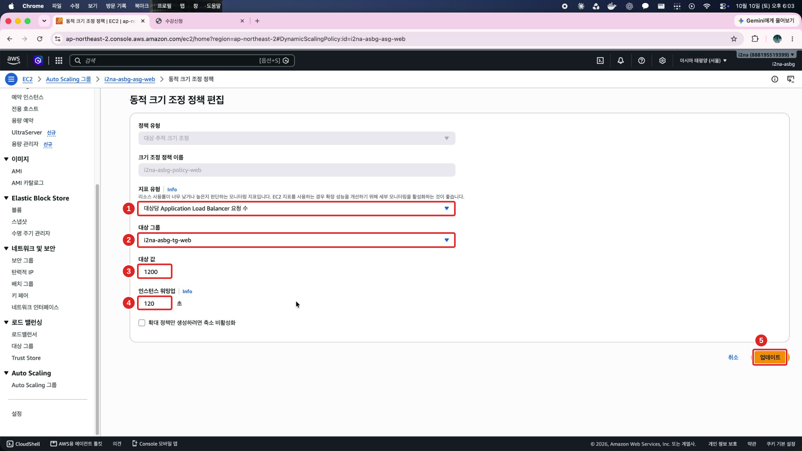](./images/setup/40-web-policy-metric-correction.svg)

- ① 지표가 **대상당 ALB 요청 수**인지 확인한다.
- ② WEB 대상 그룹을 확인한다.
- ③ 대상 값 `1200`을 확인한다.
- ④ 워밍업 `120`초를 확인한다.
- ⑤ **저장**을 누른다.

#### 목표값의 단위

`600`과 `1200`은 각각 **대상 한 대당 1분 동안 처리할 요청 수의 목표값**이다. CPU 사용률이나 초당 요청 수가 아니다.

이번에는 자동 확장을 재현하기 위한 실습 값으로 정했다. 운영값은 실제 지연 시간과 처리 한계를 측정해서 정해야 한다. 대상 추적의 CloudWatch 경보는 ASG가 관리하므로 별도로 만들어 붙이지 않는다. [AWS 대상 추적 정책 설명](https://docs.aws.amazon.com/autoscaling/ec2/userguide/as-scaling-target-tracking.html)

### 14.3 ASG와 별도로 동적 정책을 추가하는 방법

ASG를 먼저 만든 뒤에도 동적 정책을 추가하거나 수정할 수 있다. 기존 그룹에서 다음 순서로 진행한다.

1. **EC2 → Auto Scaling 그룹 → 해당 그룹 → Automatic scaling**을 연다.
2. **동적 크기 조정 정책** 목록에 같은 이름의 정책이 있는지 본다. 없다면 **동적 크기 조정 정책 생성**을 누르고, 있다면 해당 정책을 선택해 **작업 → 편집**한다.
3. 정책 유형은 **대상 추적 크기 조정**을 고른다.
4. APP은 이름 `i2na-asbg-policy-app`, 지표 **대상당 Application Load Balancer 요청 수**, APP 대상 그룹, 목표 `600`, 워밍업 `120초`를 입력한다.
5. WEB은 이름 `i2na-asbg-policy-web`, 같은 지표 유형, WEB 대상 그룹, 목표 `1200`, 워밍업 `120초`를 입력한다.
6. **축소 비활성화**를 선택하지 않은 상태로 생성 또는 저장한다.
7. 정책 카드가 하나씩 보이고 활성 상태인지 확인한다. APP과 WEB의 대상 그룹을 서로 바꾸지 않았는지도 확인한다.

### 14.4 생성 직후 꼭 다시 볼 항목

#### 정책 카드에서 지표를 다시 확인한다

두 ASG의 **Automatic scaling(자동 크기 조정)** 탭을 열고 정책 카드를 읽는다.

| WEB 정책 카드의 문구 | 판단 |
|---|---|
| `평균 CPU 사용률 ... 1200` | 잘못 고른 지표 |
| `대상당 Application Load Balancer 요청 수 ... 1200` | 이번 실습에서 사용할 지표 |

실제로 이 부분을 잘못 선택해 첫 번째 부하 시험에서 WEB이 늘어나지 않았다. 잘못 입력했다면 **정책 선택 → 작업 → 편집**에서 다음을 확인하고 저장한다.

- 지표: **대상당 ALB 요청 수**
- 대상 그룹: WEB 대상 그룹
- 대상 값: `1200`
- 워밍업: `120`초
- 축소: 활성

APP 정책도 같은 방법으로 대상 값 `600`을 확인한다.

#### 부하 시험 전에 그룹 지표 수집을 켠다

두 그룹에서 **모니터링 → Auto Scaling 그룹 지표 수집 → 사용**을 선택한다. 지표는 켠 시점부터 쌓이므로 부하 시험 전에 켜 두어야 서버 수 변화를 그래프로 남기기 좋다.

EC2 상세 모니터링과 ASG 그룹 지표 수집은 별도 설정이다.

<a id="step-15"></a>

## 15. 구축한 서비스의 동작 확인

### 15.1 브라우저와 서버 상태

1. APP 대상 그룹과 WEB 대상 그룹에 각각 `Healthy` 두 대가 있는지 확인한다.
2. 브라우저에서 `http://본인-Public-ALB-DNS`를 연다. HTTPS 리스너를 만들지 않았으므로 `https://`로 열지 않는다.
3. 아이디 `test01`, 비밀번호 `asbg1234`를 입력하고 **로그인**한다. `test01`~`test30`은 실습용 계정이며 비밀번호가 같다.
4. 강좌 목록이 나오면 자료구조 등 과목 하나를 신청한다.
5. 화면을 새로고침해도 로그인과 신청 내역이 유지되는지 확인한다.
6. 화면의 **처리 서버**에서 WEB과 APP 인스턴스 ID와 AZ를 확인한다. 여러 번 요청해 서로 다른 APP에서도 같은 로그인과 신청 내역을 보는지 확인한다. 한 번 새로고침할 때마다 반드시 다른 서버가 나와야 하는 것은 아니다.
7. 과목을 취소하고 정원과 내 신청 내역이 함께 바뀌는지도 확인한다.

[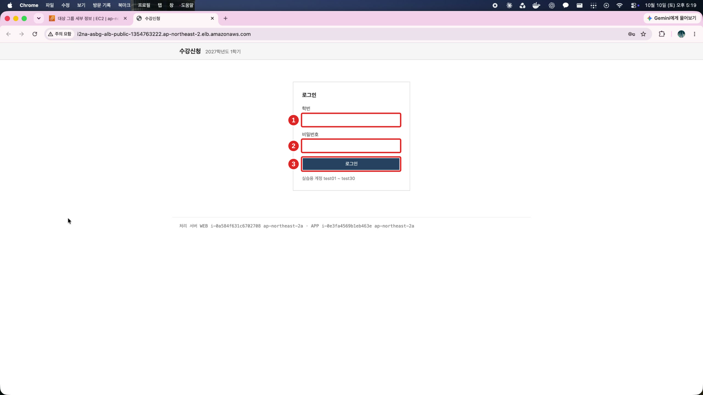](./images/setup/35-portal-login.svg)

- ① 아이디 `test01`을 입력한다.
- ② 실습 비밀번호를 입력한다.
- ③ **로그인**을 누른다.

[](./images/setup/36-enrollment-via-app-a.svg)

- ① 로그인 사용자를 확인한다.
- ② 자료구조 `1`과목, `3`학점이 신청됐는지 확인한다.
- ③ **처리 서버**의 인스턴스 ID와 AZ를 확인한다.

[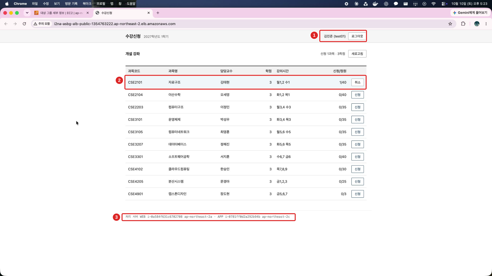](./images/setup/37-enrollment-via-app-c.svg)

서버 표시는 달라졌지만 로그인과 신청 내역은 같았다.

- ① 같은 사용자 `test01`인지 확인한다.
- ② 같은 신청 내역인지 확인한다.
- ③ 인스턴스 ID와 AZ를 앞 사진에 나온 값과 비교한다.

이 실습 코드는 처음 시작하는 APP이 DB와 표, 테스트 계정과 강좌를 준비한다. 테스트 계정과 DB 초기화 코드가 포함된 교육용 애플리케이션이므로 그대로 실제 수강신청 서비스로 공개하는 구성이 아니다.

### 15.2 Session Manager에서 APP 확인

**콘솔 경로: EC2 → 인스턴스 → `i2na-asbg-ec2-app` 한 대 선택 → 연결 → Session Manager → 연결**

서버 셸에서 다음 명령을 각각 실행한다.

```bash
curl -i http://localhost:8080/health
sudo systemctl status portal-app --no-pager
sudo journalctl -u portal-app -n 50 --no-pager
```

APP에서는 다음 결과를 확인한다.

| 확인 대상 | 정상 결과 |
|---|---|
| `/health` 응답 | HTTP `200`, 본문 `ok` |
| 서비스 상태 | `active (running)` |
| 시작 로그 | `portal-app listening on 8080` |
| 로그의 처리 서버 | `i-... ap-northeast-2a`처럼 인스턴스 ID와 AZ 표시 |

WEB 인스턴스에서도 Session Manager로 연결해 다음을 확인할 수 있다. 마지막 명령에는 본인의 Internal ALB DNS를 넣는다.

```bash
sudo nginx -t
curl -i http://localhost/health
curl -i http://본인-Internal-ALB-DNS/health
```

WEB에서는 명령별로 확인하는 범위가 다르다.

| 명령 | 확인하는 범위 |
|---|---|
| `sudo nginx -t` | Nginx 설정 문법 |
| `curl -i http://localhost/health` | WEB 자체 응답 |
| `curl -i http://본인-Internal-ALB-DNS/health` | WEB에서 APP 계층까지의 통신 |

여기까지 정상이라면 기본 배포는 완료다.

### 15.3 장애 대응과 확장 실험을 관찰할 watch 실행

로컬 터미널에서 `source` 폴더로 이동하고 실행한다.

```bash
node scripts/watch.mjs http://본인-Public-ALB-DNS
```

다시 실습할 때는 로그 파일도 남겨 두면 오류 구간을 정확히 비교하기 편하다.

```bash
node scripts/watch.mjs http://본인-Public-ALB-DNS | tee watch.log
```

정상 출력 예시는 다음과 같다. 예시의 시각과 인스턴스 ID는 자신의 결과와 달라도 된다.

```text
17:31:11  me 200  test01  i-... ap-northeast-2c  courses 200 14ms
17:31:12  me 200  test01  i-... ap-northeast-2a  courses 200 18ms
```

| 출력 항목 | 뜻 |
|---|---|
| 맨 앞 시각 | 해당 관찰 요청을 시작한 로컬 시각 |
| `me 200 test01` | 기존 로그인 쿠키로 `/api/me` 요청 성공 |
| 인스턴스 ID / AZ | `/api/me`를 처리한 APP |
| `courses 200` | `/api/courses` 요청 성공, DB 조회 가능 |
| 마지막 `ms` | `/api/courses` 요청에 걸린 시간 |
| `timeout` | 스크립트의 3초 제한 안에 응답하지 않음 |

#### watch를 읽을 때 주의할 점

- watch는 시작할 때 한 번 로그인하고 같은 쿠키를 계속 쓴다. **세션 유지 실험 중에는 watch를 재시작하지 않는다.** 재시작하면 새로 로그인하므로 이전 세션이 유지됐다는 증거가 되지 않는다.
- `/api/me`와 `/api/courses`는 별도 요청이다. 같은 행이어도 서로 다른 APP이 처리할 수 있다.
- 느린 요청이 있으면 행의 시각이 일부 뒤섞여 출력될 수 있다.

<a id="step-16"></a>

## 16. 장애 대응과 확장 실험

실험마다 콘솔의 상태와 실제 요청 결과를 함께 확인한다. 아래 결과의 시각은 `2026년 10월 10일` 한국 시간 기준이다. 같은 구성을 다시 만들더라도 인스턴스 ID와 소요 시간은 달라진다.

### 16.1 APP 한 대 중단 후 자동 교체와 로그인 유지

**실험 목적**

APP 프로세스가 멈췄을 때 다음 세 가지를 확인한다.

- ALB가 장애 대상을 요청 분산에서 제외하는가.
- ASG가 대체 인스턴스를 만드는가.
- 다른 APP에서도 기존 로그인 쿠키를 사용할 수 있는가.

#### 실험 절차

1. APP 대상 두 대가 `Healthy`이고 watch가 `me 200 test01`, `courses 200`을 출력하는지 확인한다.
2. 중단할 APP의 인스턴스 ID를 적는다. WEB을 선택하지 않도록 `Name` 태그와 APP ASG 소속을 확인한다.
3. 해당 APP에 Session Manager로 접속한다.
4. 실행 시각을 기록한 뒤 아래 명령으로 APP 서비스만 멈춘다.

   ```bash
   sudo systemctl stop portal-app
   ```

5. **대상 그룹 → `i2na-asbg-tg-app` → 대상**을 새로고침하며 해당 ID의 `Unhealthy` 상태와 이유를 확인한다.
6. **ASG → `i2na-asbg-asg-app` → 활동 → 작업 기록**에서 ELB 상태 확인 실패 때문에 기존 인스턴스를 종료하고 새 EC2를 시작하는 기록을 확인한다.
7. 새 인스턴스가 `InService`, 대상 그룹에서 `Healthy`가 될 때까지 기다린다.
8. watch에서 새 인스턴스 ID가 나타나는지 확인한다. 새로 로그인하지 않은 상태로 `me 200 test01`이 이어지고 강좌 조회도 회복됐는지 본다.
9. 브라우저에 남겨 둔 신청 내역도 확인한다.

상태 검사 간격이 `10`초라고 장애 후 정확히 `20`초에 모든 처리가 끝나는 것은 아니다. 장애 판정, 요청 제외, ASG 교체, 부팅과 정상 상태 검사에는 각각 시간이 든다.

#### 실제 관찰 결과

기존 APP `i-0781ff0d2a292b94b`를 중단한 뒤 다음 흐름을 확인했다.

| 시점 | 관찰한 내용 |
|---|---|
| `17:26:14` | ELB 상태 확인 실패에 따른 교체 시작 |
| 교체 이후 | 새 APP `i-0de8784bf1e02fa41` 생성, APP 대상 두 대 `Healthy` |
| `17:31` 화면 | 남아 있던 정상 APP과 새 APP을 오가며 `test01` 로그인과 조회 성공 |

**자동 교체와 로그인 유지는 확인했지만, 교체 과정에서 `502`가 발생해 요청 중단은 있었다.**

[](./images/results/01-app-replacement-activity.png)

`17:26:14`의 ELB 상태 확인 실패와 새 인스턴스 생성 행을 함께 확인한다.

[](./images/results/02-session-after-app-replacement.png)

새 인스턴스가 포함된 `Healthy` 두 대와 `me 200 test01`을 확인한다.

[](./images/diagrams/app-recovery-flow.svg)

실제 활동 기록과 화면 확인 시각을 정리한 흐름이다. 보장된 복구 시간이나 모든 요청의 성공을 뜻하지 않는다.

### 16.2 예약된 작업으로 미리 APP을 늘리기

**실험 목적**

신청 시작 전에 APP을 미리 네 대로 준비하고, 종료 후 최소 용량을 원래대로 낮출 수 있는지 확인한다.

#### 예약 작업 설정

**콘솔 경로: ASG → `i2na-asbg-asg-app` → Automatic scaling → 예약된 작업 → 예약된 작업 생성**

다음 두 작업을 각각 만든다. 현재 시각보다 충분히 뒤로 잡고, 예전 실습 날짜를 그대로 입력하지 않는다.

| 항목 | 사전 확장 | 최소 용량 복귀 |
|---|---|---|
| 이름 | `i2na-asbg-sched-open` | `i2na-asbg-sched-close` |
| 원하는 용량 | `4` | 비움 |
| 최소 용량 | `4` | `2` |
| 최대 용량 | 비움(기존 6 유지) | 비움(기존 6 유지) |
| 반복 | 한 번 | 한 번 |
| 시간대 | `Asia/Seoul` | `Asia/Seoul` |
| 시작 시간 | 지금부터 약 10분 뒤 | open보다 약 20분 뒤 |
| 종료 시간 | 비움 | 비움 |

#### 실행 후 확인 순서

1. 저장 후 예약된 작업 목록에서 시작 시각과 용량 값을 확인한다.
2. `open`이 실행되면 **활동** 탭에서 작업 이름과 `min size from 2 to 4`, `desired capacity from 2 to 4`에 해당하는 기록을 확인한다.
3. **인스턴스 관리**에서 `InService` 네 대, APP 대상 그룹에서 `Healthy` 네 대를 확인한다.
4. `close`가 실행되면 ASG **세부 정보**에서 최소 용량이 `2`로 바뀌었는지 확인한다.

#### close가 바꾸는 값

`close`에서는 원하는 용량을 비워 두었다. 따라서 실행 순간 모든 서버를 두 대로 줄이는 작업이 아니다. 먼저 최소 용량 제한을 낮추고, 실제 축소는 이후 요청량에 따라 대상 추적 정책이 결정하게 했다.

예약 작업과 동적 정책은 함께 사용할 수 있다. [AWS 예약된 크기 조정 설명](https://docs.aws.amazon.com/autoscaling/ec2/userguide/ec2-auto-scaling-scheduled-scaling.html)

#### 실제 관찰 결과

| 시각 | 작업과 결과 |
|---|---|
| `17:45:08` | `open` 실행, APP `2 → 4`대 |
| `18:05:09` | `close` 실행, 최소 용량 `2`로 복귀 |
| `18:12` | 원하는 용량 `6`, 크기 조정 범위 `2~6` |

`18:12`에는 부하 확장으로 늘어난 서버를 아직 유지하고 있었다. 최소 용량은 이미 `2`로 돌아왔으므로 예약 작업 실패가 아니었다.

[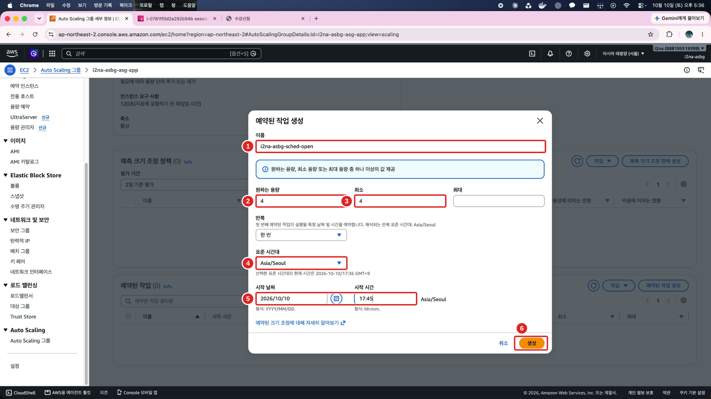](./images/setup/38-scheduled-scale-out.svg)

- ① 작업 이름을 입력한다.
- ② 원하는 용량 `4`를 입력한다.
- ③ 최소 용량 `4`를 입력한다.
- ④ 시간대 `Asia/Seoul`을 선택한다.
- ⑤ 미래 날짜와 시각을 입력한다.
- ⑥ **생성**을 누른다.

[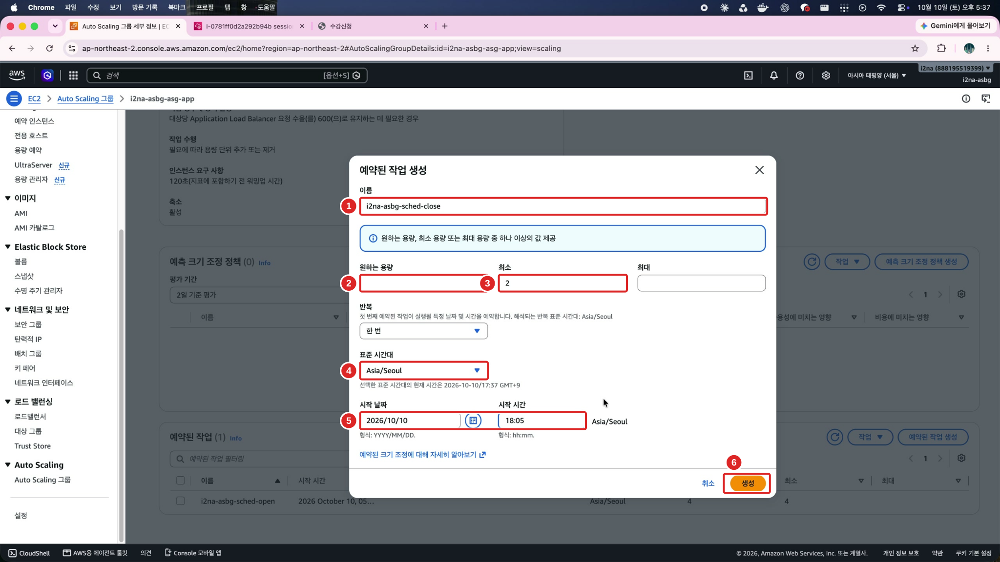](./images/setup/39-scheduled-min-capacity-reset.svg)

- ① 작업 이름을 입력한다.
- ② 원하는 용량은 비워 둔다.
- ③ 최소 용량 `2`를 입력한다.
- ④ 시간대를 확인한다.
- ⑤ 실행 시각을 확인한다.
- ⑥ **생성**을 누른다.

최대 용량도 비워 둔다.

[](./images/results/03-scheduled-capacity-settings.png)

`17:45` 확장과 `18:05` 최소 용량 변경 예약을 확인한다. 예약 실행 성공 기록은 앞의 APP 활동 기록에도 남아 있다.

### 16.3 부하에 따라 WEB과 APP 늘리고 줄이기

**실험 목적**

요청량 증가부터 부하 종료 후 축소까지 이어서 확인한다.

- 요청량이 늘면 확장 정책이 실행되는가.
- 새 서버도 실제 요청을 처리하는가.
- 부하가 끝나면 WEB과 APP 모두 최소 두 대로 돌아오는가.

#### 부하 보내기

1. 기존 watch는 계속 실행한다.
2. macOS에서 `hey`가 없다면 다른 터미널에서 설치한다.

   ```bash
   brew install hey
   ```

3. 자신의 Public ALB를 대상으로 다음 명령을 실행한다.

   ```bash
   hey -z 6m -c 10 -q 10 http://본인-Public-ALB-DNS/api/courses
   ```

   | 옵션 | 의미 |
   |---|---|
   | `-z 6m` | `6`분 동안 실행 |
   | `-c 10` | 동시에 실행하는 작업자 `10`개 |
   | `-q 10` | **작업자 한 개당** 초당 최대 `10`개 요청 |

   목표 요청량은 합계 약 `100 RPS`다. 실행 중에는 상세 출력이 없다가 종료 후 요약이 나온다. [hey 공식 사용법](https://github.com/rakyll/hey)

#### 실행 중 확장 확인

4. 실행 중 APP과 WEB ASG의 **활동** 탭을 새로고침한다. `TargetTracking...AlarmHigh`가 정책을 실행했고 원하는 용량을 바꿨다는 원인이 있는지 본다. 예약된 작업에 의한 증가와 구별한다.
5. `인스턴스 워밍업 대기 중`은 새 인스턴스의 준비 시간을 기다리는 상태다. 작업 기록이 `성공`으로 바뀌는지, 대상 그룹에서 `Healthy`인지 확인한다.
6. APP은 최대 `6`대, WEB은 최대 `4`대로 설정되어 있다. 충분한 부하에도 증가가 없으면 값을 무작정 높이기 전에 지표 유형, 연결한 ALB와 대상 그룹, 최대 용량, CloudWatch 경보 상태를 확인한다.
7. hey 종료 후 `Requests/sec`, `Average`, `95%`, `99%`, `Status code distribution`과 오류 분포를 저장한다.

#### 부하 종료 후 자동 축소 확인

8. 부하 명령은 종료한 채 watch만 유지한다. ASG 최소 용량은 APP `2`, WEB `2`로 확인한다. APP의 예약된 `close`가 아직 실행 전이면 먼저 그 시간이 지나기를 기다린다.
9. 두 ASG의 활동 기록에서 `AlarmLow`에 따른 용량 감소를 확인한다. 대상 그룹에서는 제거 중인 대상이 `Draining`을 거쳐 빠질 수 있다.
10. 최종적으로 APP과 WEB 모두 원하는 용량 `2`, `InService` 두 대, 대상 `Healthy` 두 대가 되는지 확인한다. 축소 시간은 경보 평가와 워밍업, 등록 취소 지연 등에 따라 달라진다.

대상 추적은 감소 시 급하게 줄이지 않는 방향으로 동작한다. 기다리는 동안에는 다음을 구분한다.

- 지표가 결측인 `INSUFFICIENT_DATA` 상태
- 실제 지표 값이 낮거나 `0`인 상태

watch로 낮은 요청을 계속 보내는 이유는 축소를 기다리면서 서비스 응답과 지표를 함께 관찰하기 위해서다. [AWS 대상 추적 정책의 고려 사항](https://docs.aws.amazon.com/autoscaling/ec2/userguide/as-scaling-target-tracking.html)

#### 실제 관찰 결과: 두 번의 부하 시험

총 두 번 같은 조건으로 부하를 보냈다. 첫 번째 시험에서 WEB 지표 오설정을 발견했고, 이를 고친 뒤 두 번째 시험을 실행했다.

| 항목 | 첫 번째 부하 시험 | WEB 정책 수정 후 두 번째 시험 |
|---|---:|---:|
| 실행 시간 | 약 360초 | 약 360초 |
| 응답 수 | 35,958 | 35,971 |
| HTTP 200 | 35,958 | 35,971 |
| 처리량 | 99.8788 RPS | 99.9151 RPS |
| 평균 응답 시간 | 15.2ms | 16.4ms |
| p95 | 18.8ms | 22.7ms |
| p99 | 44.2ms | 85.9ms |
| 확장 관찰 | APP 4→6 | WEB 2→4 |

확장과 축소 시각은 다음과 같이 남았다.

| 계층 | 확장 기록 | 대상 정상 확인 | 부하 종료 후 축소 |
|---|---|---|---|
| APP | `17:58:14`, 원하는 용량 `4 → 6` | `18:02`, `Healthy` 6대 | `18:27~18:31`, `6 → 5 → 4 → 3 → 2` |
| WEB | 정책 수정 후 `18:09:13`, `2 → 4` | `18:11`, `Healthy` 4대 | `18:28~18:31`, `4 → 3 → 2` |

#### 이 결과로 확인한 범위

두 hey 시험에서 응답이 모두 `200`이었다는 결과는 **각 6분의 강좌 조회 시험 범위**에 대한 것이다.

- 앞선 장애 주입 때의 `502`나 뒤의 DB 장애 조치 오류까지 없었다는 뜻은 아니다.
- 수강신청 쓰기 경쟁이나 DB의 최대 처리 성능을 검증한 시험도 아니다.

#### 결과 화면

[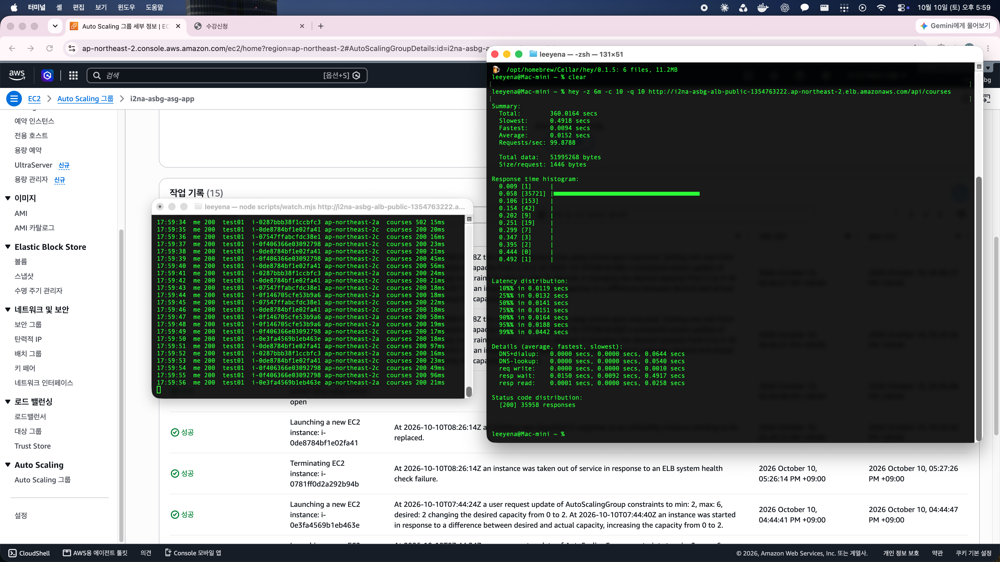](./images/results/06-app-load-test-summary.png)

`[200] 35958 responses`와 응답 시간 분포를 확인한다.

[](./images/results/04-app-scale-out-activity.png)

활동 원인에 `AlarmHigh`, `changing the desired capacity from 4 to 6`이 나타난다.

[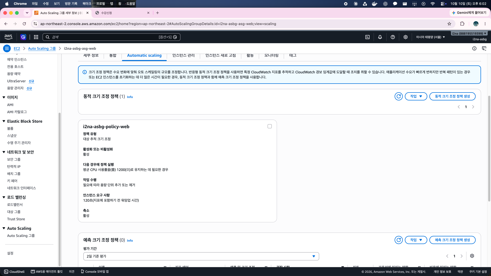](./images/results/07-web-policy-cpu-mistake.png)

**잘못 설정했던 화면**이다. 14장의 ALB 요청 수 `1200` 설정으로 수정했다.

[](./images/results/11-web-load-test-summary.png)

`[200] 35971 responses`를 확인한다.

[](./images/results/10-web-four-healthy-targets.png)

기존 두 대와 새 두 대가 모두 `Healthy`였고, 이상 탐지 결과도 `Normal`이었다.

[](./images/results/12-app-scale-in-activity.png)

`AlarmLow`에 따라 원하는 용량이 `6 → 5 → 4 → 3 → 2`로 줄어든다.

[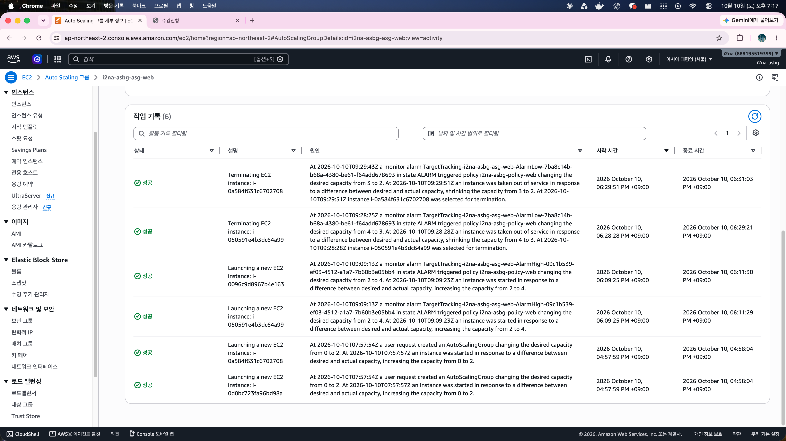](./images/results/13-web-scale-in-activity.png)

WEB도 `4 → 3 → 2`로 줄었고 두 종료 작업이 성공했다.

[](./images/diagrams/scaling-timeline.svg)

활동 기록의 원하는 용량 변화를 정리했다. 매 순간의 `Healthy` 수를 측정한 그래프는 아니다.

### 16.4 RDS Multi-AZ 장애 조치

**실험 목적**

DB 연결이 끊기는 동안 요청에 어떤 영향이 생기는지, RDS 장애 조치 후 애플리케이션이 응답을 회복하는지 확인한다.

이 구성은 RDS **Multi-AZ DB 인스턴스**다. 3노드 Multi-AZ DB 클러스터와는 메뉴가 다를 수 있다.

#### 실험 절차

1. 부하 시험을 종료하고 정상 조회가 이어지는지 확인한다. 이 실험 중에는 수강신청과 취소 등 쓰기 작업을 하지 않는다.
2. 기존 watch를 유지한다. `me 200 test01`, `courses 200`이 나오는 정상 구간을 먼저 저장한다.
3. **RDS → 데이터베이스**에서 `i2na-asbg-db`를 열고, `사용 가능` 상태와 Multi-AZ 구성을 확인한다. **연결 및 보안**의 현재 AZ도 기록한다.
4. 시작 시각을 적고 **작업 → 재부팅 → 장애 조치로 재부팅**을 선택해 실행한다.
5. watch에서 `courses timeout`, `courses 500`, 다시 `courses 200`이 나타나는 시각을 기록한다. 동시에 `me`와 로그인 사용자도 확인한다.
6. RDS가 다시 `사용 가능` 상태인지 확인한다.
7. DB 상세의 **로그 및 이벤트 → 최근 이벤트**에서 사용자 요청, 장애 조치 시작, 장애 조치 완료를 확인한다. 시간 필터는 실험 시각을 포함하도록 설정하고 새로고침한다.
8. **연결 및 보안** 화면에서 AZ도 다시 확인한다. 다만 AZ 표시는 늦게 반영될 수 있으므로 완료 이벤트와 실제 요청 회복을 함께 판단한다. [AWS DB 인스턴스 재부팅 설명](https://docs.aws.amazon.com/AmazonRDS/latest/UserGuide/USER_RebootInstance.html)
9. 기존 로그인으로 강좌 목록이 안정적으로 보이고, 남겨 둔 신청 내역이 있다면 유지되는지 확인한다. 모두 끝난 후 watch는 `Ctrl+C`로 종료한다.

#### 실제 관찰 결과

| 시각 또는 구간 | 관찰한 내용 |
|---|---|
| `19:22:21`부터 | 강좌 조회에 `timeout` 발생, 이어서 `500` 관측 |
| `19:22:33` | 강좌 조회가 다시 `200`으로 회복 |
| 오류 구간의 `/api/me` | 화면에 보이는 요청은 `200 test01` 유지 |
| RDS의 `19:22` 이벤트 | 사용자 요청, Multi-AZ 장애 조치 시작과 완료 기록 |

#### 복구 시간을 해석할 때의 한계

**첫 실패 요청 시각부터 첫 성공 요청 시각까지 약 12초의 오류 구간이 관측됐다.**

watch에는 `3`초 제한, 병렬 요청, 초 단위 출력이 포함된다. 이 값만으로 RDS 자체의 정확한 장애 조치 소요 시간이나 모든 사용자의 중단 시간을 알 수는 없다.

실험 전후 AZ는 모두 `2c`로 표시돼 AZ 변경 여부는 확인하지 못했다. 장애 조치 완료는 RDS 이벤트로 확인했다.

[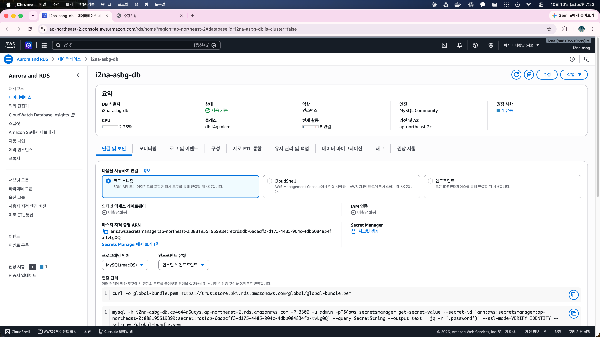](./images/results/18-rds-available-after-failover.png)

DB 상세의 우측 위 **작업** 메뉴에서 **재부팅**을 선택한다. 이 사진 자체는 실험 후 `사용 가능` 상태다. 실험 전에도 같은 위치에서 상태와 Multi-AZ 구성을 확인한다.

[](./images/results/14-database-request-recovery.png)

`courses`는 `timeout`과 `500`을 거쳐 `19:22:33`부터 `200`으로 돌아왔다. 같은 구간의 `me`는 `test01` 사용자와 `200` 응답을 유지했다.

[](./images/results/15-rds-failover-events.png)

`19:22`의 사용자 요청, 시작, 재시작, 완료 이벤트를 확인한다. 화면의 시각 정밀도는 분 단위다.

### 16.5 검증 항목과 확인 기준

| 검증 항목 | 확인할 내용 |
|---|---|
| 로그인 유지 | 같은 watch 실행에서 APP ID가 달라져도 `me 200 test01`인 화면 |
| APP 자동 복구 | ELB 실패를 원인으로 적은 ASG의 종료와 시작 기록, 새 ID의 Healthy |
| 사전 확장 | 예약 작업의 실행 시각과 용량, APP Healthy 4대 |
| 부하 확장 | hey 요약, APP과 WEB 각각의 AlarmHigh 원인과 용량 변경, 대상 상태 |
| 자동 축소 | 각 그룹의 AlarmLow 원인, 원하는 용량 감소, 최종 상태 |
| DB 장애 조치 | RDS의 장애 조치 시작과 완료 이벤트, 조회 오류와 회복, 로그인 확인 |

#### 함께 확인할 모니터링 지표

같은 시간 범위로 맞춰 다음 지표를 확인한다.

- ASG **모니터링**: `GroupDesiredCapacity`, `GroupInServiceInstances`
- ALB와 대상 그룹 **모니터링**: 대상당 요청 수, 정상/비정상 대상 수, 응답 시간
- `5XX`: ALB가 만든 오류와 대상이 반환한 오류를 구분

<a id="step-17"></a>

## 17. 원인을 확인하고 수정한 두 가지 문제

### 17.1 APP이 시작되지 않음: DynamicUser와 HOME

#### 증상

처음에는 EC2가 실행 중이어도 APP 대상이 정상 상태가 되지 않았다. APP 로그에서 AWS SDK의 홈 디렉터리 조회 과정에 `uv_os_homedir`와 `ENOENT`가 나타났다.

#### 원인 확인과 서비스 설정 수정

APP에 Session Manager로 접속해 다음 로그를 확인했다. 같은 증상이라면 아래 명령으로 서비스 상태와 종료 원인, 초기 설치 로그를 확인한다.

```bash
sudo systemctl status portal-app --no-pager
sudo journalctl -u portal-app -n 100 --no-pager
sudo tail -n 100 /var/log/cloud-init-output.log
```

서비스가 `DynamicUser=yes`로 실행되는 환경에서 `HOME`이 정해져 있지 않은 것이 문제였다. [portal-app.service](./source/app/portal-app.service)에 다음 설정을 넣었다.

```ini
DynamicUser=yes
StateDirectory=portal-app
StateDirectoryMode=0700
Environment=HOME=/var/lib/portal-app
```

`StateDirectory`로 서비스용 디렉터리를 마련하고 `HOME`을 명시했다. 수정한 서비스 파일을 배포 압축 파일에 포함해 S3에 다시 올렸다.

[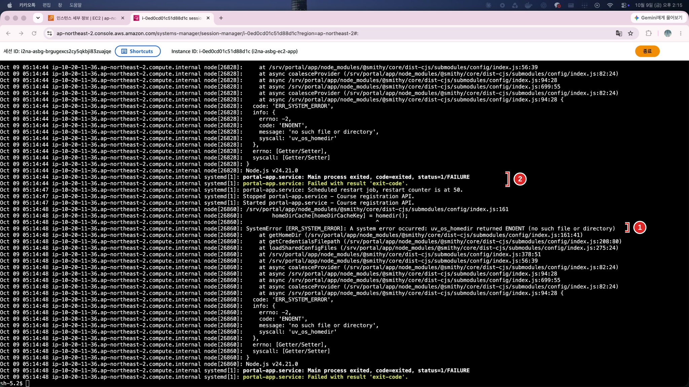](./images/setup/23-app-home-directory-error.svg)

- ① `uv_os_homedir`와 `ENOENT`가 보인다.
- ② 서비스 종료 기록을 확인한다.

#### 수정한 배포 파일을 새 서버에도 적용하기

기존 서버 한 대만 고치면 다음 자동 확장 때 같은 문제가 다시 생길 수 있다. 아래는 같은 변경을 다시 배포할 때의 절차다. 기존 서버까지 교체해야 하는 경우에는 인스턴스 새로 고침을 사용할 수 있다.

1. 로컬의 `source/app/portal-app.service`에 위 설정이 들어 있는지 확인한다.
2. 로컬 `source` 폴더에서 압축 파일을 다시 만든다.

   ```bash
   bash pack.sh
   ```

3. 새로 만든 `dist/app.tar.gz`를 배포용 S3 버킷의 동일한 최상위 객체 `app.tar.gz`로 업로드한다.
4. 사용자 데이터도 바꿨다면 **시작 템플릿 → 해당 템플릿 → 작업 → 템플릿 수정**을 열어 기존 버전을 기준으로 수정하고 새 버전을 만든다. 이어서 **ASG → 세부 정보 → 시작 템플릿 편집**에서 새 버전 번호를 선택한다. 기존 ASG가 `Default`나 특정 버전을 가리킨다면 새 버전 생성만으로는 적용되지 않는다.
5. 기존 EC2는 S3 객체를 자동으로 다시 받지 않는다. 기존 서버에도 반영하려면 **ASG → 인스턴스 새로 고침 → 인스턴스 새로 고침 시작**으로 인스턴스를 교체한다. 시작 전에 **최소 정상 비율**, **추가 용량**과 현재 그룹의 여유를 확인한다.

   S3의 코드만 바꾸고 시작 템플릿 버전은 그대로라면 **일치하는 인스턴스 건너뛰기**(`Skip matching`) 옵션을 끈다. 이 옵션은 사용자 데이터가 내려받는 S3 객체의 내용 변경까지 비교하지 않는다. [AWS 인스턴스 새로 고침 설명](https://docs.aws.amazon.com/autoscaling/ec2/userguide/asg-instance-refresh-skip-matching.html)

6. 새 APP이 대상 그룹에서 `Healthy`가 되고 로그인과 조회가 정상인지 확인한다.

#### 결과

새 APP에서 서비스가 `8080`으로 실행되고 `/health`가 `200`을 반환하는 것을 확인했다. 이후 장애 교체와 자동 확장으로 생성된 APP에서도 같은 수정 사항이 유지됐다.

[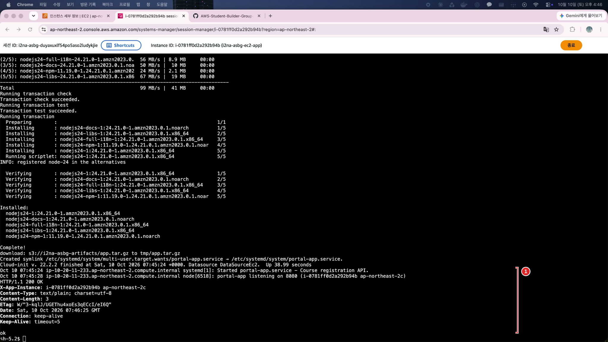](./images/setup/24-app-startup-verification.svg)

① 서비스 실행과 로컬 `/health`의 HTTP `200` 응답을 확인한다.

### 17.2 APP은 늘었지만 WEB이 늘지 않음: 잘못 고른 지표

#### 증상

첫 번째 부하 시험에서 APP은 `4 → 6`대로 늘었지만 WEB은 두 대였다.

#### 원인 확인과 정책 수정

WEB 정책을 열어 보니 `평균 CPU 사용률`에 `1200`을 넣은 상태였다. 대상당 요청 수의 목표값을 CPU 지표에 입력한 것이 원인이었다.

**WEB ASG → Automatic scaling → `i2na-asbg-policy-web` 선택 → 작업 → 편집**에서 다음 값으로 저장했다.

| 항목 | 수정한 값 |
|---|---|
| 지표 | **대상당 Application Load Balancer 요청 수** |
| 대상 그룹 | `i2na-asbg-tg-web` |
| 목표 | `1200` |
| 워밍업 | `120`초 |
| 축소 | 활성 |

#### 결과

같은 부하를 다시 보낸 뒤 WEB의 `AlarmHigh`에 따른 `2 → 4` 확장과 `Healthy` 네 대를 확인했다. 숫자뿐 아니라 지표 이름과 단위를 함께 확인해야 한다는 점을 배웠다.
