# Session 02 Assignment

- 제출자: 이예나

## 1. What I Built

로그인 유지와 장애 대응, 접속량에 따른 서버 수 조정을 테스트하기 위해 간단한 수강신청 포털 서비스를 구현하고 AWS에 배포했다.

로그인하면 개설 강좌의 학점, 강의 시간과 신청 인원을 확인하고 과목을 신청하거나 취소할 수 있다. 아래는 실습용으로 만든 `test01` 계정으로 로그인한 뒤, 자료구조 `1과목`, `3학점`을 신청한 화면이다.

[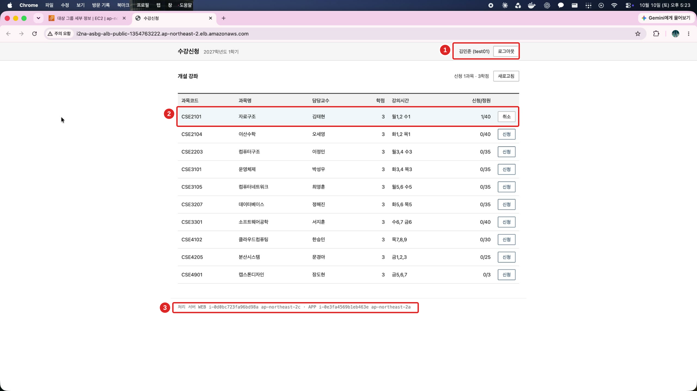](images/setup/36-enrollment-via-app-a.svg)

화면 하단의 **처리 서버** 영역(③)에는 WEB과 APP의 인스턴스 ID와 AZ를 표시했다. 요청을 처리하는 서버가 달라져도 같은 로그인과 신청 내역이 유지되는지 확인하기 위해서다.

이 서비스를 다음 3-Tier 구조로 배포했다.

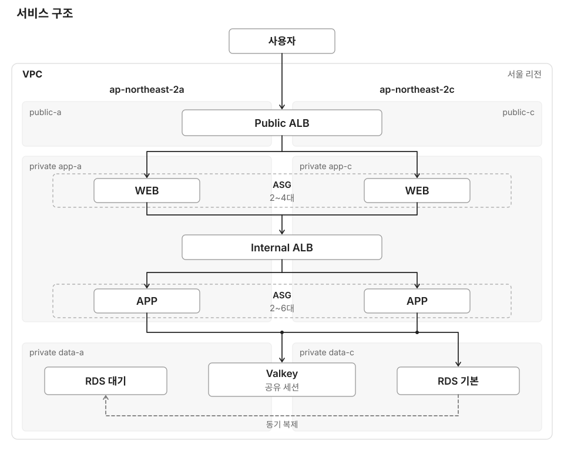

배포한 포털을 대상으로 APP을 중지한 뒤 자동 교체와 로그인 유지를 시험했다. 예약 작업과 조회 부하에 따른 WEB과 APP의 확장 및 축소, RDS 장애 조치 후 조회 회복도 확인했다. 전환 중 요청 실패가 있어 무중단으로 보지는 않았다.

- [구축과 재현 가이드](IMPLEMENTATION.md): 콘솔에서 누를 위치와 전체 구축 및 검증 절차
- [source](source/): 애플리케이션, 배포 파일, 검증 스크립트

## 2. Design Decisions

### 계층을 나누고 두 AZ에 배치했다

VPC는 `10.20.0.0/16`이고, 서울 리전의 `ap-northeast-2a`와 `ap-northeast-2c`에 public, app, data 서브넷을 각각 만들었다. 한 AZ에 서버를 몰지 않고 외부 진입점, 앱, 데이터 영역을 나누기 위해서다.

Public ALB는 `public-a/c`에서 HTTP `80`을 받고, WEB(Nginx)과 APP(Node.js)은 `app-a/c`에 둔 `t3.micro` 인스턴스다. 같은 서브넷의 Internal ALB가 HTTP `80`을 받아 APP의 `8080`으로 전달한다. WEB과 APP에 각각 요청을 분산하므로 APP 주소가 바뀌어도 WEB 설정을 고칠 필요가 없다.

보안 그룹 `i2na-asbg-sg-*`는 다음 경로에 필요한 출발지만 허용했다.

```text
인터넷 → Public ALB:80 → WEB:80 → Internal ALB:80 → APP:8080
APP → RDS:3306
APP → Valkey:6379–6380
```

서버 IP 대신 보안 그룹을 참조해 인스턴스가 교체돼도 규칙을 유지한다. WEB과 APP에는 공인 IP와 SSH 인바운드를 두지 않고, 관리 접속은 Session Manager로 통일했다.

public은 IGW, app은 NAT를 사용하고 data에는 인터넷 기본 경로를 두지 않았다. app 라우팅 테이블에는 S3 게이트웨이 엔드포인트를 연결해 배포 파일을 NAT 없이 내려받는다. 시작 템플릿의 사용자 데이터가 S3 파일을 설치하므로 새 서버도 같은 구성으로 실행된다.

WEB 역할은 `web.tar.gz`만 읽게 했다. APP 역할은 `app.tar.gz`와 DB 접속 및 세션에 필요한 비밀을 읽도록 나눴다. DB 비밀번호와 공통 세션 서명 키는 Secrets Manager에 저장했다.

### 로그인과 신청 데이터를 서버 밖에 저장했다

로그인 세션은 `data-a/c`의 Valkey Serverless에 저장하고 TLS로 연결했다. 모든 APP이 브라우저의 `sid` 쿠키와 공통 서명 키로 같은 세션을 읽는다. 세션 만료는 `30분`이며 요청이 들어올 때 갱신된다.

ALB는 기본 라운드 로빈을 유지하고 고정 세션은 껐다. 같은 역할의 서버로 요청을 분산하면 되고, 로그인 유지를 위해 특정 APP에 묶어 둘 필요가 없기 때문이다.

학생, 강좌, 신청 내역은 RDS에 저장했다. 설정은 다음과 같다.

- 엔진과 사양: `MySQL 8.4`, `db.t4g.micro`, `gp3 20GiB`
- 배포와 보호 설정: Multi-AZ DB 인스턴스, 암호화, 자동 백업 `7일`, 삭제 방지
- 앱 연결: TLS, APP 한 대당 DB 풀 최대 `5개`

Multi-AZ는 DB 서버 장애에, 백업은 잘못 확정한 변경에서 과거 데이터를 복원할 때 필요해 둘 다 사용했다. 신청 인원 증가와 신청 내역 추가는 한 트랜잭션으로 묶고, `enrolled < capacity`일 때만 인원을 늘린다.

APP이 최대 `6대`이면 풀 상한 합계는 `30개`다. 초기화와 관리 작업에 쓰는 연결은 별도이므로 DB 전체 연결 한도를 실측한 값은 아니다. APP을 늘려도 RDS 쓰기 성능까지 함께 늘어나는 것은 아니다.

### 요청량에 따라 확장하고, 시작 전에는 미리 확보했다

WEB과 APP 모두 평소 두 AZ에서 처리하도록 최소 `2대`로 시작했다. 용량은 운영 기준이 아닌 실습 설정이다.

| 구분 | 최소 / 최대 | 대상당 요청 수 목표 |
|---|---:|---:|
| WEB | `2 / 4대` | `1,200` |
| APP | `2 / 6대` | `600` |

대상 추적 지표는 `ALBRequestCountPerTarget`을 사용했다. 목표값은 **대상 한 대가 1분간 처리할 평균 요청 수**이며 CPU 비율이나 초당 요청 수가 아니다. 워밍업은 `120초`, 자동 축소는 활성화했다.

APP 예약은 `Asia/Seoul` 기준으로 설정했다.

- `17:45`: 최소 용량과 원하는 용량을 모두 `4대`로 올려 시작 전에 서버를 확보한다.
- `18:05`: 최소 용량만 `2대`로 낮춘다. 이후 실제 요청량에 따라 서버가 줄어들게 했다.

### 상태 확인과 서버 교체를 연결했다

`/health`는 APP 프로세스의 응답만 확인한다. DB나 캐시처럼 공통으로 사용하는 서비스의 장애 때문에 정상 APP까지 모두 교체하지 않도록, 실제 로그인 및 강좌 조회와 점검 목적을 나눴다.

| 상태 확인 설정 | 값 |
|---|---|
| 제한 시간 / 정상과 비정상 판정 | `5초` / 정상 `3회`, 비정상 `2회` |
| APP 검사 간격 | `10초`로 확인 |
| WEB 검사 간격 | 생성 화면에서는 `30초`. 이후 `10초`로 바꿨는지는 확인하지 못함 |

ASG에 ELB 상태 확인을 켜서 ALB의 요청 제외를 서버 교체로 연결했다. ASG 유예 시간은 `180초`, 등록 취소 지연은 `30초`로 두어 설치와 부팅을 완료하고 진행 중인 요청도 마칠 시간을 줬다.

### 운영 환경이라면 더 보완할 부분

HTTP를 HTTPS와 `Secure` 쿠키로 전환하고, 실습에 사용한 DB 마스터 계정과 캐시 RBAC 미적용도 보완해야 한다.

NAT는 비용을 줄이려고 a AZ에 한 개만 뒀다. 이 AZ에 장애가 나면 다른 AZ의 외부 접근과 신규 서버 부팅도 영향을 받을 수 있다.

## 3. Troubleshooting & Validation

### APP을 교체해도 계속 Unhealthy가 됐다

**문제와 원인**

EC2 생성과 S3 다운로드는 끝났는데 APP이 실행되지 않았다. 서비스 로그를 확인하니 AWS SDK가 홈 디렉터리를 찾는 과정에서 `uv_os_homedir returned ENOENT` 오류로 종료됐다. `DynamicUser=yes`로 실행되는 서비스에 사용할 홈 디렉터리가 지정되지 않은 상태였다.

**수정한 내용**

[portal-app.service](source/app/portal-app.service)에 서비스용 디렉터리와 `HOME`을 지정했다.

```ini
StateDirectory=portal-app
StateDirectoryMode=0700
Environment=HOME=/var/lib/portal-app
```

수정한 원본을 `bash pack.sh`로 다시 패키징하고 S3에 업로드했다. 서버 한 대만 고치면 다음 교체나 확장 때 같은 오류가 반복될 수 있어 배포 파일부터 수정했다.

**확인한 결과**

새 APP에서 서비스가 실행되고 `/health`가 HTTP `200`을 반환했다. [수정 후 실행 로그](images/setup/24-app-startup-verification.svg)에서 확인할 수 있다.

### 부하를 보내도 WEB은 두 대에서 늘지 않았다

**문제와 원인**

첫 번째 부하 시험에서 APP은 `4→6대`로 늘었는데 WEB은 `2대` 그대로였다. WEB의 대상 추적 정책을 확인하니 **평균 CPU 사용률**에 `1200`을 입력해 둔 상태였다. 요청 수 기준으로 확장하려던 의도와 지표가 달랐다.

**수정한 내용**

WEB 정책의 지표를 **대상당 ALB 요청 수**로 바꾸고 목표값은 `1200`으로 유지했다. 이 값은 CPU 비율이 아니라 **대상 한 대가 1분간 처리할 평균 요청 수**다.

- [수정 전: 평균 CPU 사용률](images/results/07-web-policy-cpu-mistake.png)
- [수정 후: 대상당 ALB 요청 수](images/results/08-web-policy-request-count.png)

**확인한 결과**

같은 부하를 다시 보낸 뒤 `18:09:13`에 WEB의 `AlarmHigh`가 정책을 실행했고, 원하는 용량이 `2→4대`로 늘었다. `18:11`에는 **Healthy 4대**를 확인했다. 활동 기록과 부하 결과는 [요청량에 따른 확장과 축소](#evidence-scaling)에 정리했다.

### 검증 조건과 범위

`source` 폴더에서 두 터미널을 사용했다. 첫 번째는 로그인 상태와 응답을 관찰하고, 두 번째는 조회 부하를 보낸다.

```bash
# 터미널 1: 같은 로그인 쿠키로 응답 관찰
node scripts/watch.mjs "http://<Public-ALB-DNS>"

# 터미널 2: 6분간 약 100건/초의 조회 부하
hey -z 6m -c 10 -q 10 "http://<Public-ALB-DNS>/api/courses"
```

watch는 처음 로그인한 쿠키로 `1초`마다 `/api/me`와 `/api/courses`를 호출한다. 로그인 유지 시험 중에는 재시작하지 않았다. 로그의 APP ID와 AZ는 `me`를 처리한 서버이며, 별도 요청인 `courses`의 처리 서버까지 나타내지는 않는다.

부하 시험은 정책 수정 전후로 `6분`씩 실행했다. `-q 10`은 작업자당 요청 수이므로 작업자 `10개`의 전체 목표는 약 `100건/초`다. API 응답뿐 아니라 ASG의 정책 실행 원인과 **Healthy** 대상 수를 함께 확인했다. 기록의 시각은 모두 `2026년 10월 10일` 한국 시간이다.

이번 검증은 단일 APP 중지, 조회 부하에 따른 확장과 축소, 사용자 요청 RDS 장애 조치까지다. AZ 전체 장애, 캐시 장애, 백업 복원, 동시 신청의 데이터 정합성이나 운영 최대 처리량은 검증하지 않았다. 관측한 복구 시간과 응답 속도도 이 시험 조건에서의 결과다.

수정 명령과 배포 반영 절차는 [구축 가이드의 트러블슈팅](IMPLEMENTATION.md#step-17)에 정리했다.

## 4. Screenshots

<a id="evidence-session"></a>

### 로그인 유지

**완료 조건: APP이 추가되거나 제거돼도, 요청이 다른 APP으로 전달돼도 로그인 상태를 유지한다.**

- 확인 방법: 한 번 로그인한 watch를 유지하며 APP 중지와 교체 전후의 인스턴스 ID와 `me 200 test01`을 비교했다.
- 확인 결과: 관찰한 범위에서는 로그인 유지 조건을 충족했다. `17:31`에 기존 정상 APP과 새 APP을 오가면서 같은 `test01`로 응답했다. 요청 실패가 전혀 없었다는 의미는 아니다.

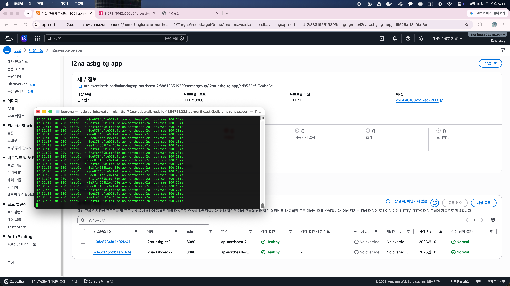

<a id="evidence-recovery"></a>

### 장애 APP 감지와 자동 교체

**완료 조건: 장애 APP을 감지해 요청 대상에서 제외하고 정상 APP으로 서비스를 지속하며 자동 복구한다.**

APP 한 대를 멈췄다.

```bash
sudo systemctl stop portal-app
```

- 확인 방법: 대상 상태, ASG 교체 원인, 새 인스턴스 생성과 실제 API 응답을 확인했다.
- 확인 결과: 자동 교체와 응답 회복은 확인했지만, 무중단 지속까지는 확인하지 못해 부분 충족으로 봤다. 전환 중과 일부 이후 요청에서 `502`가 발생했다.

`17:26:14`에 ELB 상태 확인 실패에 따른 교체가 기록됐고, `17:28`에는 새 APP을 포함해 **Healthy** `2대`를 확인했다.

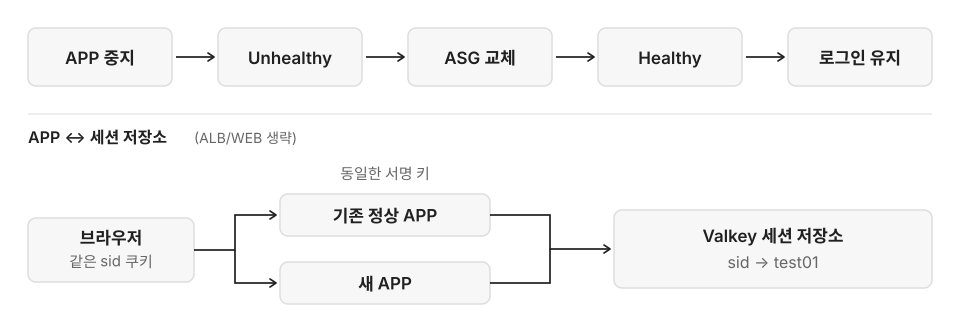

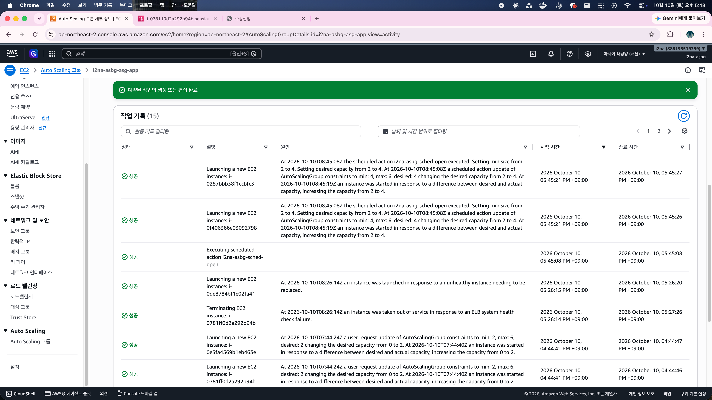

<a id="evidence-schedule"></a>

### 시작 전 예약 확장

**완료 조건: 수강신청 시작 전에 서버를 미리 확보한다.**

- 확인 방법: APP `open`과 `close` 예약의 시간과 용량을 실제 활동 기록과 대상 그룹 상태에 대조했다.
- 확인 결과: 사전 확보 조건을 충족했다. `17:45:08`에 최소 용량과 원하는 용량이 `2→4대`로 바뀌었고, `17:48`에 **Healthy** `4대`를 확인했다.

`18:05:09`의 `close`는 최소 용량만 `2대`로 되돌렸다. `18:12`에 원하는 용량이 `6대`, 범위가 `2~6대`였던 것은 부하로 늘어난 서버가 아직 남아 있었기 때문이다. 예약 실패가 아니었다.

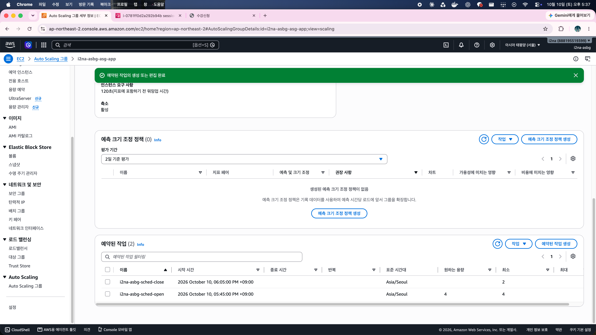

<a id="evidence-scaling"></a>

### 요청량에 따른 확장과 축소

**완료 조건: 요청량에 따라 서버를 늘리고, 부하가 줄면 추가 서버를 줄인다.**

- 확인 방법: 두 번의 hey 시험에서 `AlarmHigh` 원인과 **Healthy** 대상 수를 확인했다. 부하 종료 후 watch만 유지하며 `AlarmLow`와 종료 기록을 봤다.
- 확인 결과: 이번 조회 부하 조건에서 확장과 축소를 모두 확인해 조건을 충족했다.

| 구분 | 확장과 정상 대상 확인 | 부하 종료 후 축소 | 마지막 종료 완료 |
|---|---|---|---|
| APP | `17:58:14`에 `4→6대`, `18:02`에 Healthy 6대 | `6→5→4→3→2대` | `18:31:37` |
| WEB | 정책 수정 후 `18:09:13`에 `2→4대`, `18:11`에 Healthy 4대 | `4→3→2대` | `18:31:03` |

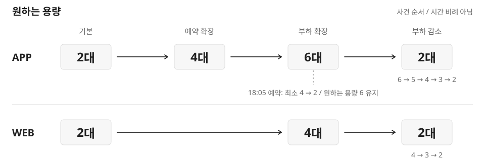

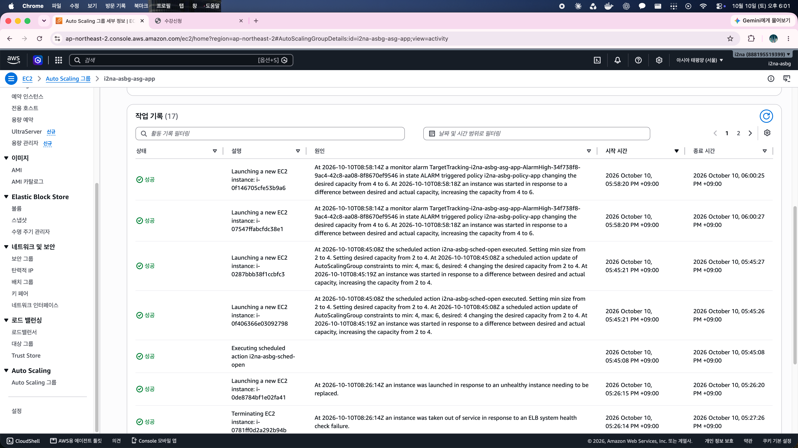

| 항목 | 첫 시험: APP 확장 | 두 번째: WEB 정책 수정 후 |
|---|---:|---:|
| 실행 시간 | 약 `360초` | 약 `360초` |
| HTTP `200` 응답 | `35,958건` | `35,971건` |
| 처리량 | `99.8788건/초` | `99.9151건/초` |
| 평균 응답 시간 | `15.2ms` | `16.4ms` |
| p95 / p99 | `18.8ms / 44.2ms` | `22.7ms / 85.9ms` |

두 hey 집계에는 `200`만 있었다. 각 `6분` 동안의 강좌 조회 결과이므로, 별도 watch나 다른 장애 시험에서 발생한 `502`까지 없었다는 뜻은 아니다.

- [WEB 정책 수정 전](images/results/07-web-policy-cpu-mistake.png)
- [수정 후](images/results/08-web-policy-request-count.png)
- [WEB 확장 활동](images/results/09-web-scale-out-activity.png)
- [APP Healthy 6대](images/results/05-app-six-healthy-targets.png)

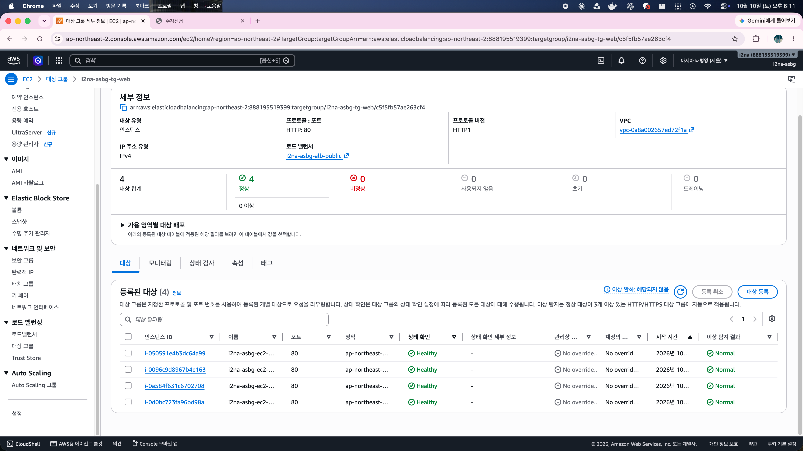

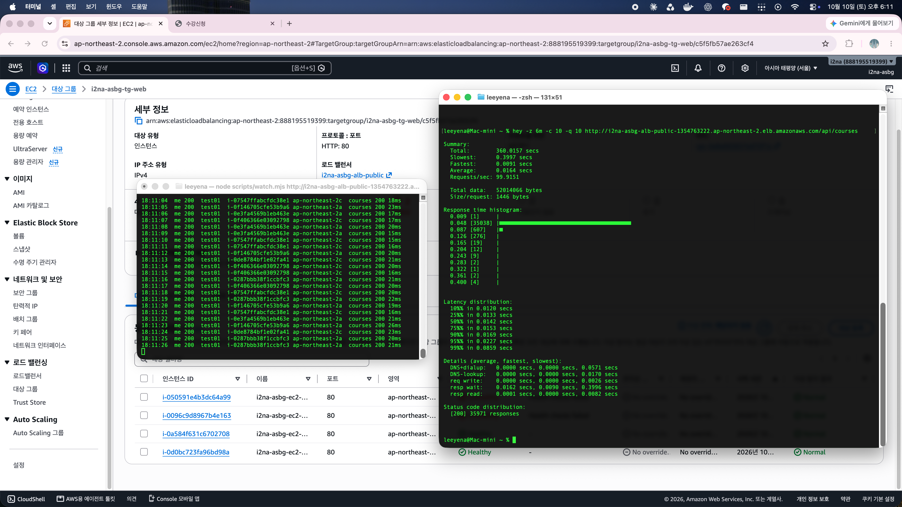

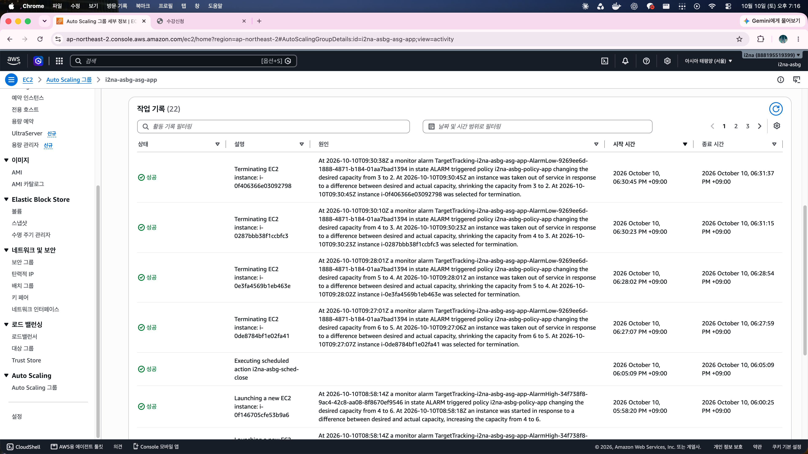

- [첫 부하 시험 결과](images/results/06-app-load-test-summary.png)
- [WEB 4대에서 2대 자동 축소](images/results/13-web-scale-in-activity.png)

<a id="evidence-rds"></a>

### 추가 시험: RDS 장애 조치

**추가 완료 조건: RDS Multi-AZ 장애 조치 후 DB 조회가 회복되는지 확인한다.**

- 확인 방법: 기존 watch를 유지하며 RDS에서 장애 조치로 재부팅했다. 요청 결과와 **최근 이벤트**의 시작과 완료 기록을 비교했다.
- 확인 결과: 조회 회복과 완료 이벤트를 확인해 이 추가 조건을 충족했다. `19:22:21`부터 `courses`에 timeout과 `500`이 나타났고, `19:22:33`부터 `200`으로 회복했다.

보이는 구간에서 `me 200 test01`은 유지됐다. RDS에도 `19:22`에 사용자 요청, 장애 조치 시작과 완료 이벤트가 남았다.

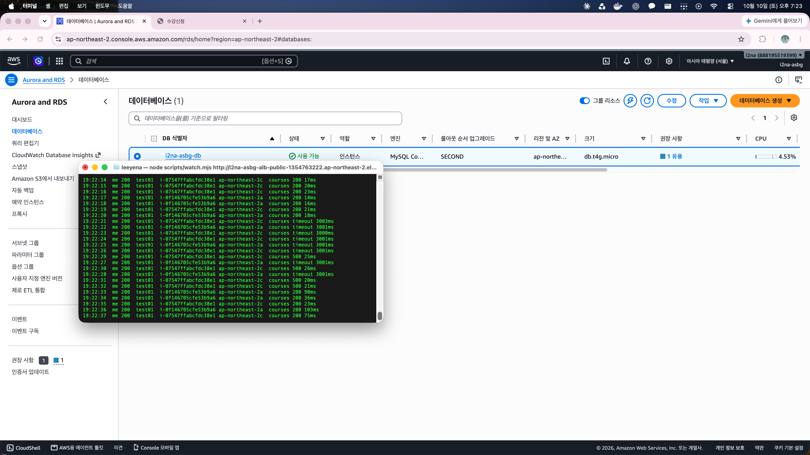

약 `12초`는 첫 실패 요청 시각부터 첫 성공 요청 시각까지 관측한 오류 구간이다. watch 제한 시간은 `3초`이고 RDS 이벤트는 분 단위라, 이 수치를 RDS 전체 장애 조치 시간이나 모든 사용자의 중단 시간으로 계산하지 않았다. 전후 요약 화면의 AZ는 모두 `2c`여서 AZ 변경 자체도 확인하지 못했다.

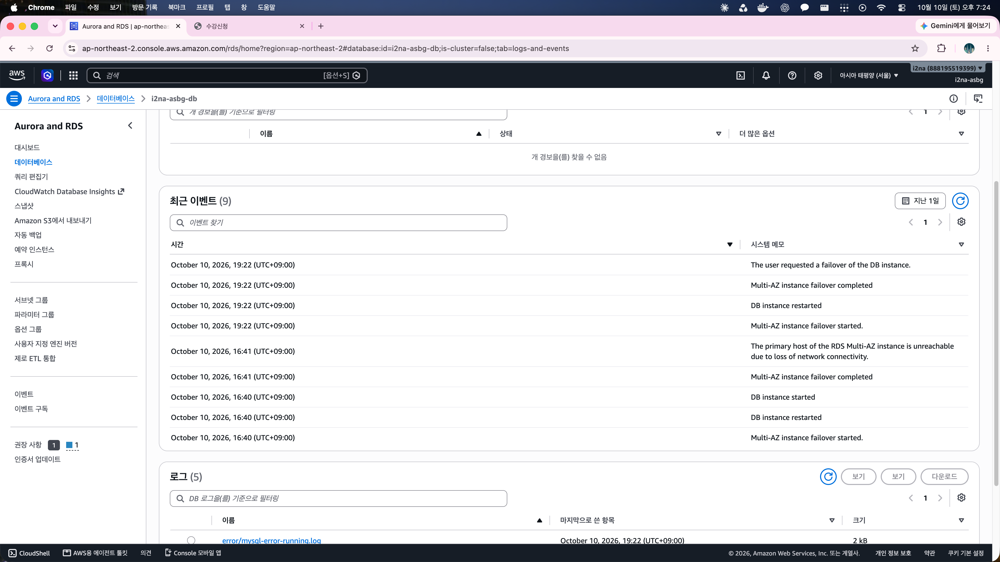
