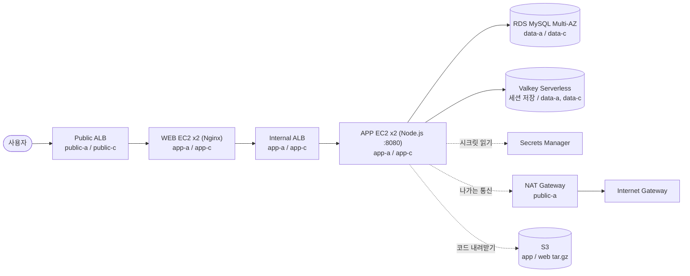

# Session 02 · Assignment

- 제출자: 이채우

## 1. What I Built

수강신청 포털을 **WEB · APP · DB 3-Tier**로 AWS에 직접 구축했습니다.

| 문제 | 해결 방법 |
|---|---|
| 로그인 끊김 | 로그인 세션을 ElastiCache Valkey에 저장해 모든 APP 서버가 공유, 세션 서명 키도 Secrets Manager의 같은 값을 사용 |
| 장애 대응 지연 | ALB 상태 검사(`/health`)로 죽은 서버를 자동 제외, Auto Scaling이 새 서버로 자동 교체 |
| 접속량 변화 대응 | APP Auto Scaling에 평균 CPU 50% 목표 추적 정책 적용 |

요청 흐름: 사용자 → Public ALB → WEB(Nginx) → Internal ALB → APP(Node.js :8080) → RDS / Valkey

소스 코드

```text
source/
├── pack.sh              app.tar.gz, web.tar.gz 생성
├── app/                 APP (Node.js, 포트 8080)
├── web/                 WEB (Nginx)
├── userdata/            시작 템플릿 사용자 데이터 (app.sh, web.sh)
├── policies/            EC2 역할 인라인 정책
└── scripts/watch.mjs    관찰 스크립트 (1초마다 로그인 상태와 응답 확인)
```

## 2. Design Decisions

### 아키텍처 다이어그램




### 서비스 구성

| 계층 | 구성 | 위치 | 역할과 선택 이유 |
|---|---|---|---|
| 입구 | Public ALB | public-a, public-c | 인터넷 요청을 받아 WEB으로 분산, 2개 AZ에 걸쳐 한 AZ가 죽어도 유지 |
| WEB | Nginx on EC2 (Auto Scaling) | app-a, app-c | 화면 파일 제공, `/api` 요청은 Internal ALB로 전달 |
| 내부 연결 | Internal ALB | app-a, app-c | APP 서버 상태 검사와 분산, WEB이 APP 서버 주소를 몰라도 되게 함 |
| APP | Node.js on EC2 (Auto Scaling, 포트 8080) | app-a, app-c | 로그인과 수강신청 처리 |
| DB | RDS MySQL (Multi-AZ) | data-a, data-c | 본 DB 장애 시 예비 DB로 전환 |
| 세션 저장소 | ElastiCache Valkey Serverless | data-a, data-c | 모든 APP이 세션을 공유해 서버가 바뀌어도 로그인 유지 |
| 출구 | NAT Gateway (public-a), Internet Gateway | public-a | 사설 서브넷 서버의 나가는 통신 |

### 주요 설정

**네트워크**

| 설정 | 값 | 이유 |
|---|---|---|
| VPC | `10.20.0.0/16`, DNS 확인·DNS 호스트 이름 활성화 | VPC 안에서 AWS DNS를 쓰고, DNS 이름을 자동으로 붙이기 위함 |
| 서브넷 6개 | public / app / data × a, c | 계층을 나누고 2개 AZ에 배치. 퍼블릭 IPv4 자동 할당은 **비활성화** |
| NAT Gateway | 영역별(Zonal), public-a 1개 | 비용 절감 |
| `rt-public` | 인터넷 게이트웨이 | 양방향 통신 |
| `rt-app` | NAT 게이트웨이 | 나가는 통신만 허용 |
| `rt-data` | 인터넷 경로 없음 | 인터넷과 완전히 분리 |
| S3 게이트웨이 엔드포인트 | `fill-asbg-vpce-s3` | 부팅 시 S3 다운로드가 NAT와 인터넷을 거치지 않음 |

**보안 그룹 (앞 단계 그룹에서 온 트래픽만 받음)**

| 보안 그룹 | 인바운드 | 소스 |
|---|---|---|
| `fill-asbg-sg-alb-public` | HTTP 80 | 0.0.0.0/0 |
| `fill-asbg-sg-web` | HTTP 80 | `sg-alb-public` |
| `fill-asbg-sg-alb-internal` | HTTP 80 | `sg-web` |
| `fill-asbg-sg-app` | TCP 8080 | `sg-alb-internal` |
| `fill-asbg-sg-db` | MySQL 3306 | `sg-app` |
| `fill-asbg-sg-cache` | TCP 6379-6380 | `sg-app` |

→ 인터넷에서 직접 닿는 곳은 Public ALB뿐이고, DB와 캐시는 APP에서만 접근할 수 있습니다.

**데이터 보호와 권한**

| 설정 | 값 | 이유 |
|---|---|---|
| DB 비밀번호 | RDS 관리형 시크릿 (Secrets Manager) | 코드와 사용자 데이터에 비밀번호를 적지 않기 위함 |
| 세션 서명 키 | `fill-asbg/session-secret` (Secrets Manager) | 모든 APP이 같은 키를 읽어, 어느 서버가 발급한 쿠키든 다른 서버가 인정 |
| 접속 방식 | Valkey `rediss://` (TLS), RDS는 인증서 검증 TLS | 서버 간 통신 암호화 |
| IAM `fill-asbg-rold-web` | S3 `web.tar.gz` 읽기만 | 최소 권한. WEB은 DB 비밀번호를 읽을 수 없음 |
| IAM `fill-asbg-role-app` | S3 `app.tar.gz` 읽기, Secrets Manager 2개 읽기 | APP에 필요한 것만 허용 |
| 공통 | `AmazonSSMManagedInstanceCore` | SSH 키 없이 Session Manager로 접속 |
| S3 버킷 | 최상위에 `app.tar.gz`, `web.tar.gz`, IAM 역할을 가진 서버만 접근 | 서버가 부팅할 때마다 같은 파일을 받게 함 |

**로드 밸런서 · 시작 템플릿 · Auto Scaling**

| 설정 | 값 | 이유 |
|---|---|---|
| 대상 그룹 | `tg-web` (포트 80), `tg-app` (포트 8080) | 계층별로 상태 검사 |
| 상태 검사 | `/health`, HTTP 200, 간격 10초, 정상 3회, 비정상 2회, 제한 시간 5초 | 비정상 2회 × 10초로 약 20초 안에 장애 서버 제외 |
| `/health` 검사 범위 | APP 프로세스 응답만 확인 (DB·캐시 제외) | 정상 APP까지 교체되는 연쇄 교체 방지 |
| 시작 템플릿 | Amazon Linux 2023, t3.micro, `lt-app` / `lt-web` | 서버가 늘거나 교체될 때마다 같은 설정으로 시작 |
| Auto Scaling 그룹 | `asg-app`, `asg-web` | 죽으면 새로 만들고 AZ a, c에 나눠 배치 |
| 크기 조정 정책 (APP) | 대상 추적, 평균 CPU 50%, 워밍업 300초 | 로그인이 CPU를 많이 쓰는 작업임을 고려 |

###

## 3. Troubleshooting & Validation

### 3.1 트러블슈팅: WEB / APP이 Unhealthy (`Request timed out`)로 나타나는 현상

- 점검 대상: 대상 그룹 상태가 Unhealthy, 접속 시 `Request timed out`
- 확인 과정과 조치:
  - 원인 확인: EC2 → 인스턴스 → 보안 탭에서 서버에 `sg-web`설정 누락
  - 조치: 시작 템플릿 새 버전에서 보안 그룹 변경 → Auto Scaling 그룹의 템플릿 버전 변경 → 기존 서버 종료
- 결과와 근거: 새로 뜬 서버가 `sg-web`, `sg-app`을 붙이고 대상 그룹에서 Healthy로 전환됨
- 검증 범위와 한계: 서브넷·라우팅 문제는 따로 시험하지 않음

### 3.2 트러블슈팅: APP 서버가 계속 재시작 (`AccessDenied`)

- 점검 대상: APP이 Healthy가 되지 않고 계속 재시작
- 확인 과정과 조치:
  - 원인 확인: Session Manager 접속 → `journalctl -u portal-app`에서 `AccessDenied`. APP 역할 인라인 정책에 세션 시크릿 ARN이 빠져 있었음 (RDS 시크릿 ARN만 두 번 들어감)
  - 조치: 정책 Resource에 `...:secret:fill-asbg/session-secret-*` 추가 (서버 교체 없이 자동 복구)
- 결과와 근거: APP이 시작되어 `tg-app`이 Healthy로 전환, 로그인 가능
- 검증 범위와 한계: 다른 권한(S3, RDS 시크릿)은 정상 동작한 상태에서 따로 점검하지 않음

### 3.3 검증: 서버 종료 실험

- 점검 대상: 로그인 유지, 장애 서버 제외와 자동 복구
- 확인 과정과 조치: 관찰 스크립트 `scripts/watch.mjs`로 한 번 로그인한 쿠키를 가지고 1초마다 `/api/me`, `/api/courses`를 호출하며, 이때 EC2에서 서버 한 대를 종료함. (`me 401`이 나오면 로그인이 풀린 것)

```bash
node scripts/watch.mjs http://<Public-ALB-DNS>
```

- 결과와 근거:
  - **A. APP 1대 종료**: 브라우저에서 잠깐 504가 뜬 뒤 비밀번호 입력 없이 수강신청 화면으로 돌아옴. 관찰 스크립트에서 `me 401`이 한 번도 나오지 않음. 약 19초 동안 502 / timeout이 섞인 뒤 정상 복구. Auto Scaling이 새 서버를 만들어 Healthy 2대로 복구. (4번 "APP 서버 종료")
    - 약 19초는 상태 검사(10초 간격 × 연속 2회 실패)로 ALB가 죽은 서버를 제외하기까지의 시간이며 정상 동작
    - `me 401`이 없는 것은 세션이 Valkey에 공유되고 서명 키가 같다는 근거
  - **B. WEB 1대 종료**: WEB 서버 1대를 종료하자 15:43:56부터 15:44:13까지 약 18초 동안 오류가 섞였다. 처음 약 7초는 `me 502`, 이어서 약 4초는 timeout, 이후에는 timeout과 정상(`me 200`)이 번갈아 나오다가 15:44:14부터 `me`와 `courses`가 모두 정상으로 이어졌다. 이 구간 동안 `me 401`은 한 번도 나오지 않았고, `me 200 test01`이 APP 서버가 바뀌어도(`i-0b0fe...`, `i-074e9...`) 계속 같은 사용자로 응답했다. 정상 응답은 남은 WEB 서버 `i-021cce7311`(2c)이 처리했다. (4번 "WEB 서버 종료")
    - 오류가 약 18초 이어진 것은 상태 검사(10초 간격 × 연속 2회 실패)로 ALB가 종료된 WEB 서버를 제외하기까지의 시간이며, A와 같은 패턴이다.
    - WEB은 세션을 저장하지 않고 쿠키는 APP이 Valkey 세션으로 검증하므로, WEB 서버가 바뀌어도 로그인이 유지된다.
  - **C. 부하로 서버 자동 증가**: 평균 CPU가 50%를 넘으면 3대, 약 75%를 넘으면 4대(최대)로 늘어난다. 서버를 한 대 줄여도 평균 CPU가 50%를 넘지 않을 때 줄어든다. 4대 → 3대는 약 37% 미만, 3대 → 2대는 약 33% 미만이며, 확장보다 느리게 반영된다.
- 검증 범위와 한계: 서버 한 대 종료까지만 확인했고, AZ 전체 장애나 DB Multi-AZ 전환은 시험하지 않음.

```bash
hey -z 5m -c 100 http://<Public-ALB-DNS>/api/courses
```

## 4. Screenshots

**완료 조건: 로그인 유지**

- 확인 방법: 관찰 스크립트로 로그인 후 1초마다 `/api/me`를 호출하면서 APP 서버 1대를 종료
- 확인 결과: `401`이 나오지 않음 → **충족**

**완료 조건: 장애 서버 감지·제외와 자동 복구 (APP)**

- 확인 방법: APP 서버 1대를 종료하고 대상 그룹과 응답 확인
- 확인 결과: 상태 검사 시간(약 20초) 안에 장애 서버를 제외하고 새 서버로 교체됨. 실제로 약 19초 동안 502 / timeout 후 정상 복구, Healthy 2대로 돌아옴 → **충족**

| 서버 종료 전 | 서버 종료 중 | 서버 종료 후 |
|---|---|---|
|  |  |  |

**완료 조건: 장애 서버 감지·제외와 자동 복구 (WEB)**

- 확인 방법: WEB 서버 1대를 종료하고 대상 그룹과 응답 확인
- 확인 결과: 예상은 종료된 서버가 제외되고 남은 서버로 요청이 이어지며 로그인이 유지됨. 실제로 약 18초(15:43:56~15:44:13) 동안 502 / timeout이 섞인 뒤 정상 복구, Healthy 2대로 돌아옴 → **충족**

| 서버 종료 전 | 서버 종료 중 | 서버 종료 후 |
|---|---|---|
|  |  |  |

완료 조건: 요청량에 따른 서버 수 자동 조정**

- 확인 방법: `hey`로 `/api/courses`에 5분간 동시 100 요청을 보내고 Auto Scaling 그룹의 CPU와 서버 수를 확인
- 확인 결과: 예상은 평균 CPU가 50%를 넘으면 서버가 늘어나는 것. 실제로 평균 CPU가 약 51%까지 올랐고 서버가 2대에서 3대로 늘어남 → **충족**