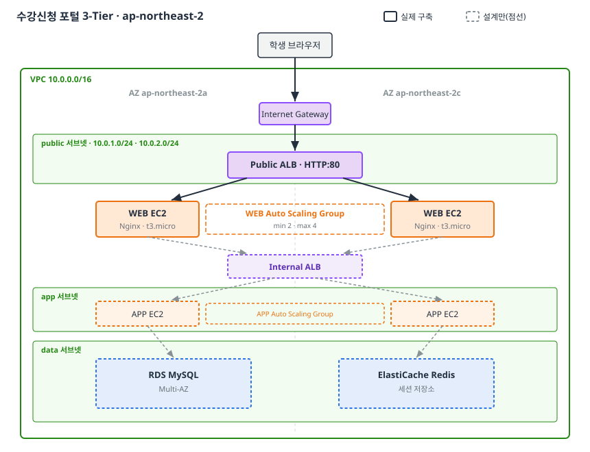
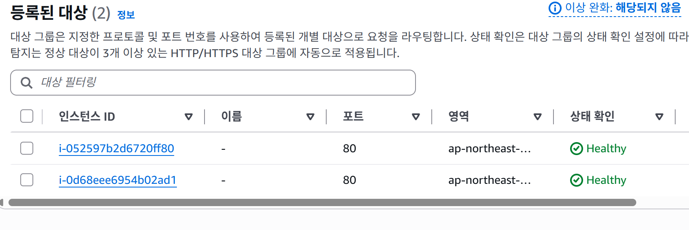
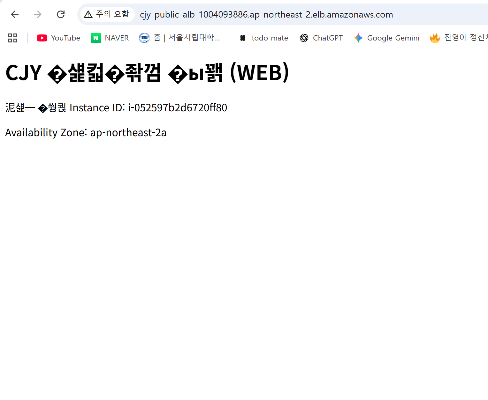
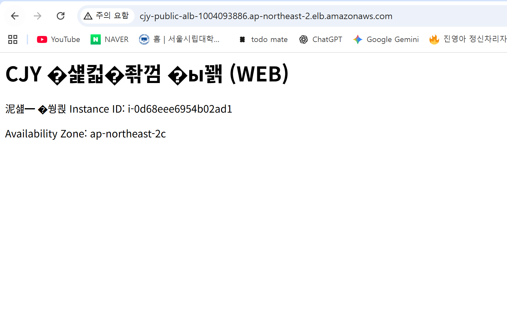
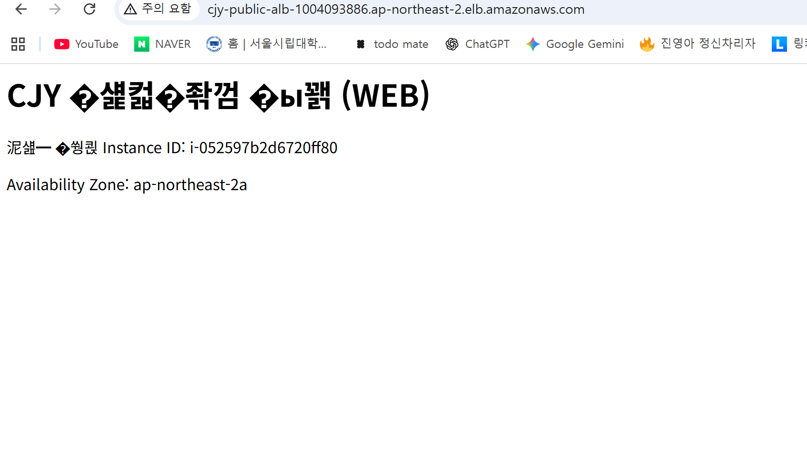
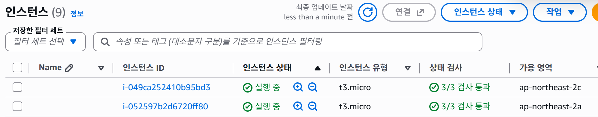
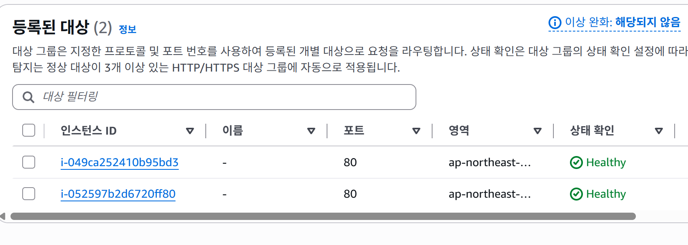
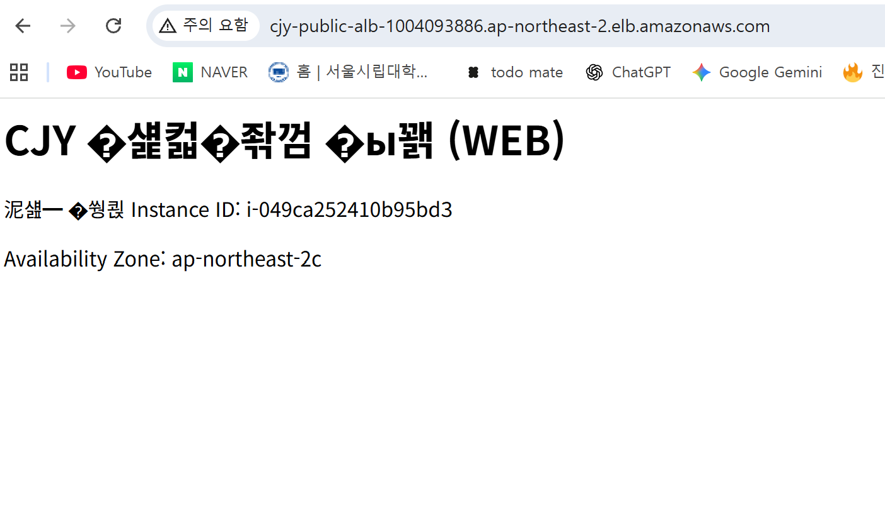

# Session 02 · 안정적인 수강신청 포털을 위한 3-Tier 인프라 설계

- 제출자: 최진영

## 1. What I Built

수강신청 포털에서 생긴 세 가지 문제

- 서버가 바뀌면 로그인이 풀림
- 장애 서버에 요청이 계속 감
- 신청이 몰릴 때 서버가 부족한 문제

를 해결하는 **WEB·APP·DB 3계층(3-Tier) 아키텍처**를 설계했다.

- **WEB 계층:** 사용자에게 화면을 보여주고 `/api/` 요청을 APP으로 넘긴다. (Nginx)
- **APP 계층:** 로그인·강좌 조회·수강신청 같은 실제 로직을 처리한다.
- **DB 계층:** 사용자·강좌·신청내역을 저장한다. (RDS MySQL)

여기에 로그인 상태를 서버 밖 **공용 캐시(ElastiCache)** 에 저장해 어느 서버로 요청이 가도 로그인이 유지되게 했고, **ALB + Auto Scaling** 으로 장애 서버를 자동 제외·교체하고 요청량에 따라 서버 수를 자동 조절하도록 구성했다. 모든 핵심 리소스는 **2개의 가용 영역(AZ)** 에 나눠 배치했다.

리전은 서울(`ap-northeast-2`)을 사용했다.

**이번 과제에서 실제로 구축한 범위:** 전체 설계 중 **WEB 계층(VPC·서브넷·IGW·라우팅·보안그룹·Public ALB·WEB EC2·Auto Scaling)** 까지는 AWS 콘솔에서 직접 구축하고 동작을 검증했다. APP·DB·캐시 계층은 설계로 설명한다. (아래 다이어그램에서 실선 = 실제 구축, 점선 = 설계만)

## 2. Design Decisions

### 서비스 구성과 연결 흐름

요청은 `학생 브라우저 → Public ALB → WEB → (Internal ALB) → APP → RDS / 캐시` 순서로 진행된다.
계층을 나눈 이유는 화면을 담당하는 WEB과 로직을 담당하는 APP을 분리해, 각각 독립적으로 늘리고 줄일 수 있게 하기 위해서다.

### 구축한 리소스 (이름 · 설정)

실제로 콘솔에서 만든 리소스는 다음과 같다. (모든 이름은 `cjy-` 접두사로 통일)

**네트워크**

| 리소스              | 이름                            | 주요 설정                                                       |
| ------------------- | ------------------------------- | --------------------------------------------------------------- |
| VPC                 | `cjy-vpc`                       | IPv4 CIDR `10.0.0.0/16`, **DNS 호스트 이름 활성화**             |
| 서브넷 (public)     | `cjy-public-a` / `cjy-public-c` | `10.0.1.0/24`(2a) / `10.0.2.0/24`(2c), 퍼블릭 IPv4 자동 할당 ON |
| 서브넷 (app, 설계)  | `cjy-app-a` / `cjy-app-c`       | `10.0.11.0/24`(2a) / `10.0.12.0/24`(2c)                         |
| 서브넷 (data, 설계) | `cjy-data-a` / `cjy-data-c`     | `10.0.21.0/24`(2a) / `10.0.22.0/24`(2c)                         |
| 인터넷 게이트웨이   | `cjy-igw`                       | `cjy-vpc`에 연결                                                |
| 라우팅 테이블       | `cjy-public-rt`                 | `0.0.0.0/0 → cjy-igw`, public 서브넷 2개 연결                   |

**보안 그룹** (인바운드 기준, 아웃바운드는 기본값)

| 이름         | 용도       | 인바운드 규칙                                   |
| ------------ | ---------- | ----------------------------------------------- |
| `cjy-alb-sg` | Public ALB | HTTP 80 ← `0.0.0.0/0` (학생 누구나)             |
| `cjy-web-sg` | WEB EC2    | HTTP 80 ← `cjy-alb-sg` (ALB를 거친 요청만 허용) |

**시작 템플릿 · 로드밸런싱 · ASG**

| 리소스            | 이름             | 주요 설정                                                                                                         |
| ----------------- | ---------------- | ----------------------------------------------------------------------------------------------------------------- |
| 시작 템플릿       | `cjy-web-lt`     | Amazon Linux 2023, t3.micro, 보안그룹 `cjy-web-sg`, 사용자 데이터로 Nginx 설치 + `/health` 페이지 생성            |
| Public ALB        | `cjy-public-alb` | 인터넷 경계, public 서브넷 2개(2a·2c), 보안그룹 `cjy-alb-sg`, 리스너 HTTP 80                                      |
| 대상 그룹         | `cjy-web-tg`     | 대상 인스턴스, HTTP 80, 헬스체크 경로 `/health`, 성공 코드 200                                                    |
| Auto Scaling 그룹 | `cjy-web-asg`    | 시작 템플릿 `cjy-web-lt`, public 서브넷 2개, 용량 희망 2 / 최소 2 / 최대 4, ELB 상태 검사 사용, CPU 50% 대상 추적 |

### 문제별 해결 방법

| 문제                       | 해결 방법                                                                                               | 선택 이유                                                                                      |
| -------------------------- | ------------------------------------------------------------------------------------------------------- | ---------------------------------------------------------------------------------------------- |
| ① 서버 교체 시 로그인 풀림 | 로그인 세션을 각 APP 서버 메모리가 아니라 **ElastiCache(공용 저장소)** 에 저장                          | 세션이 특정 서버에 묶이지 않으므로, 서버가 바뀌거나 요청이 다른 APP으로 가도 로그인이 유지된다 |
| ② 장애 서버에 요청 지속    | **ALB 헬스체크**로 응답 없는 서버를 요청 분산에서 제외하고, **Auto Scaling**이 그 서버를 새 서버로 교체 | ALB(제외)와 ASG(교체) 역할을 분리해, 사람이 수동 조치하지 않아도 자동 복구된다                 |
| ③ 접속량 변화 대응 못함    | **Auto Scaling 정책**으로 요청량(CPU)이 많으면 서버를 늘리고 적으면 줄임                                | 신청 시작 직후 부하에 자동 대응하고, 끝난 뒤에는 서버를 줄여 비용 낭비를 막는다                |

### 주요 설정과 선택 이유

- **다중 AZ 배치:** WEB·APP·RDS를 2개 AZ(2a, 2c)에 나눠 배치. 한 데이터센터에 장애가 나도 다른 AZ에서 서비스를 이어간다.
- **계층별 접근 제어(서브넷·보안그룹 분리):** 외부 요청은 public 서브넷의 Public ALB로만 받고, 서버는 app 서브넷, DB·캐시는 data 서브넷에 둔다. 보안그룹도 "바깥 계층일수록 넓게, 안쪽일수록 바로 앞 계층만 허용"으로 설계했다. 예를 들어 WEB 보안그룹은 소스를 ALB 보안그룹으로 지정해 ALB를 거친 요청만 받고, 직접 접속은 차단한다.
- **DNS 호스트 이름 활성화:** ALB·RDS·캐시를 IP가 아닌 DNS 이름으로 서로 찾고 연결하기 위해 VPC에서 DNS 호스트 이름을 켰다. 서버가 교체돼 IP가 바뀌어도 이름은 유지되므로 이름 기반 연결이 안전하다.
- **WEB을 public 서브넷에 배치 + NAT 생략:** WEB EC2에 공인 IP를 부여해 패키지 설치·업데이트를 직접 받게 하고, 비용이 발생하는 NAT Gateway는 두지 않았다. 실습 범위에서 비용을 줄이기 위한 선택이다.
- **RDS 다중 AZ:** 기본(Primary) DB가 죽으면 대기(Standby) DB로 자동 전환돼 데이터와 가용성을 보호한다. (설계)
- **Auto Scaling 용량 2/2/4 + ELB 헬스체크 사용:** 평소 2대 유지(최소 2), 부하 시 최대 4대까지 확장. ASG가 EC2 상태뿐 아니라 ALB 헬스체크(`/health`)까지 보고 교체하도록 "ELB 상태 검사"를 켰다.

### 남아 있는 한계

- WEB을 public에 두고 공인 IP로 패키지를 받는 방식은 비용은 절약되지만 서버가 외부에 노출된다. 운영 환경에서는 WEB을 private 서브넷에 두고 **NAT Gateway**(가능하면 AZ별 2개)를 사용하는 것이 바람직할 것이다.
- 보안그룹 아웃바운드는 실습 편의를 위해 기본값(전체 허용)으로 두었고, 운영에서는 필요한 대상으로 제한하는 것이 좋다.
- 이번 설계는 동작 확인을 위한 HTTP 기준이며, 실제 운영에는 도메인·HTTPS(ACM 인증서)가 추가로 필요하다.
- APP·DB·캐시 계층과 로그인 세션의 ElastiCache 저장은 설계로만 다루었고 이번 과제에서는 실제 구축·검증은 하지 않았다.

## 3. Troubleshooting & Validation

- **점검 대상:** WEB Auto Scaling 그룹이 띄운 EC2가 Public ALB 대상 그룹에서 정상(Healthy)으로 등록되고, 장애가 나면 자동으로 교체되는지 확인.

- **확인 과정과 조치:** 서버 2대는 떴는데 대상 그룹에서 계속 Unhealthy로 남는 문제를 만났다. 보안그룹·헬스체크 경로(`/health`)·포트는 다 맞게 설정돼 있어서, EC2 콘솔의 **시스템 로그**를 확인하니 로그에 서버가 켜질 때 자동 실행되는 설치 스크립트의 `dnf install nginx`가 패키지 저장소 접속에서 `Curl error (28): Timeout`으로 실패하고 `Unable to find a match: nginx`로 끝나 있었다. 즉 **서버가 인터넷으로 나가지 못해 Nginx 설치 자체가 안 된 것**이 Unhealthy의 원인이었다.

  왜 인터넷을 못 나갔던 건지 보니, WEB 서버에 **공인 IP가 안 붙어 있었다.** public 서브넷에 뒀는데도 "퍼블릭 IPv4 자동 할당" 설정이 꺼져 있어서 서버가 사설 IP만 가진 채 떴던 것이다. 그래서 public 서브넷의 자동 공인 IP 할당 을 켜고** 인스턴스를 새로 띄웠다.
  이 과정에서 배운 것: 설치 스크립트는 서버가 **처음 켜질 때 딱 한 번만\*\* 실행되기 때문에, 그 순간 인터넷이 안 되면 나중에 IP가 생겨도 다시 설치되지 않는다.
  그래서 설정을 고친 뒤 기존 서버는 버리고 새로 띄워야 했다. (처음 ASG 생성 때는 시작 템플릿이 다른 VPC의 보안그룹을 참조해 생성이 거부되기도 했는데, `cjy-vpc` 소속 보안그룹으로 다시 지정하고 기본 시작 템플릿 버전을 다시 설정해서 쉽게 해결했다.)

- **결과와 근거:** 설정을 고친 뒤 새로 뜬 서버부터 Nginx 설치가 성공해 대상 그룹에서 **2대 모두 Healthy**로 바뀌었다. ALB의 DNS 이름으로 접속하니 서버의 Instance ID와 AZ가 표시되는 페이지가 떴고, 새로고침할 때마다 서로 다른 Instance ID가 번갈아 나타나 요청이 두 서버로 분산되는 것을 확인했다. 이어서 WEB EC2 한 대를 일부러 종료하자, 대상 그룹에서 그 서버가 Draining으로 빠지고 Auto Scaling이 새 Instance ID의 서버를 자동으로 띄워 다시 2대 Healthy로 복구됐다. 그 사이에도 ALB 주소로 포털 접속은 끊기지 않았다. (증빙: 4번의 "접속·요청 분산", "장애 교체" 항목)

- **검증 범위와 한계:** 장애 자동 교체(문제②)와 요청 분산은 실제로 확인했다. Auto Scaling의 CPU 기반 확장/축소(문제③)는 정책만 설정하고 부하 테스트는 하지 않았다. 로그인 세션 유지(문제①)는 APP·캐시를 구축하지 않아 검증하지 못했으며, 이번 과제에서는 설계로만 설명한다.

## 4. Screenshots

**완료 조건: WEB 서버가 ALB를 통해 정상 서비스되고, 요청이 여러 서버로 분산된다**

- 확인 방법: Public ALB의 DNS 이름으로 브라우저 접속 후 새로고침 반복. 대상 그룹에서 등록 대상 상태 확인.
- 확인 결과: 대상 그룹 2대 모두 Healthy, 접속 시 Instance ID·AZ가 표시되고 새로고침마다 Instance ID가 번갈아 나타남 → **충족**

* 시작 템플릿에 UTF-8설정 코드를 까먹어서 글자가 깨졌습니다.

**완료 조건: 장애 서버가 자동으로 제외·교체되어 서비스가 유지된다 (자동 복구)**

- 확인 방법: WEB EC2 한 대를 강제 종료한 뒤 대상 그룹과 EC2 인스턴스 목록, ALB 접속 상태를 관찰.
- 확인 결과: 종료한 서버가 Draining으로 제외 → Auto Scaling이 새 Instance ID 서버 자동 생성 → 다시 2대 Healthy 복구, 그 사이 접속 유지 → **충족**

i-0d68eee6954b02ad1 인스턴스 종료 후에도 남은 인스턴스를 통해 잘 접속되는 모습

